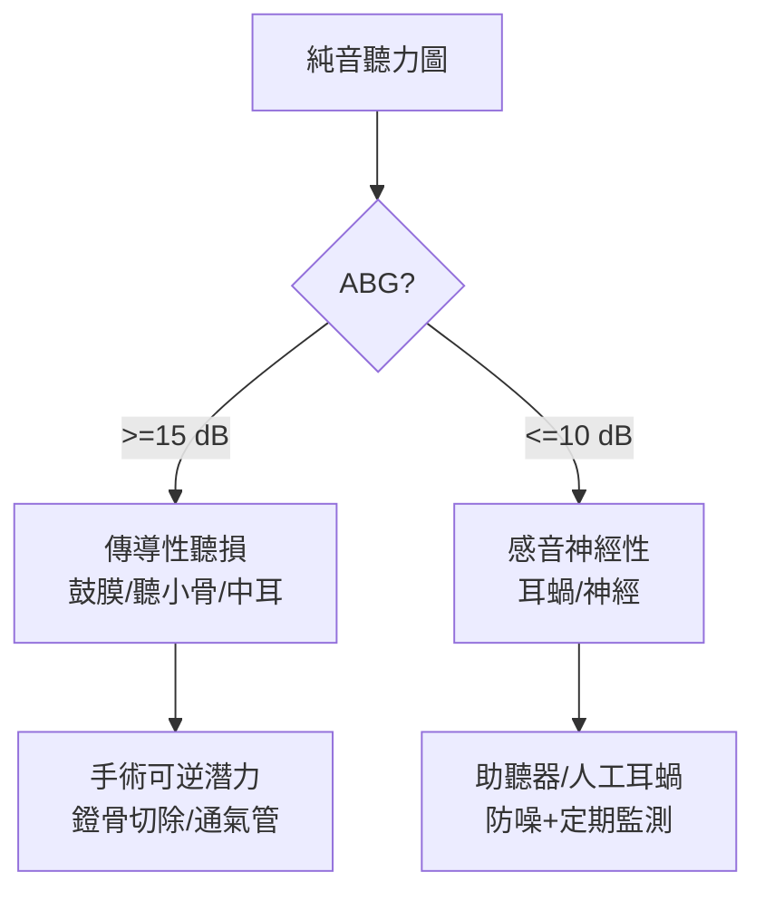

## 1922 - 弗萊徹與純音聽力檢查（讓「聽不到」變成可以畫成曲線的數據）

## 案件摘要

**本案要解決的問題：醫生如何客觀知道病人「聽不見什麼、聽不見多小聲」？**

1922 年，貝爾電話實驗室的物理學家 Harvey Fletcher 發表以 Western Electric 1A/2A 純音聽力計（audiometer）完成的系統性聽閾測量研究（與 Wegel 合作，*Phys. Rev.* 1922–24），確立了純音聽力檢查（pure-tone audiometry）與**聽力圖（audiogram）**的標準格式：250–8000 Hz 頻率軸、0 dB HL 參考零級、氣導與骨導兩條曲線。從此「耳聾」從形容詞變成座標圖——聽力學的醫學化、助聽器處方、職業聽損鑑定與人工耳蝸選擇，全部站在這張圖上。

## 前因 -- 為什麼會有這個案子

- 19 世紀的測聽工具是音叉與 Galton 哨（1876–79）：定性可、定量難，且無標準參考——「不同醫生測同一人，結果差一倍」。
- 電話工業的意外推力：貝爾實驗室為優化電話線路，需要「人耳頻率響應」的數據；Fletcher 的團隊本來在做通訊工程，結果做出醫學儀器。
- Western Electric 2A（1923）成為第一支商用純音聽力計；1930s-40s 學校篩檢與二戰軍隊聽損評估（`1898-阿庫風電子助聽器.md` 的產業配套）使儀器普及。
- 臨床痛點明確：耳硬化（`1878-凱塞爾鐙骨鬆動術.md`）與梅尼埃病（`1861-梅尼埃眩暈病灶在內耳.md`）的鑑別需要客觀分型。

## 線索與推理 -- 數學式、程式、理論

本案的推理核心是**「氣骨導差（ABG）」這個鑑別邏輯**：

$$ ABG = HL_{\text{氣導}} - HL_{\text{骨導}} $$

```python
def classify_hearing_loss(air, bone):
    abg = air - bone
    if abg >= 15:  return "傳導性: 中耳/外耳問題(ABG 大)"
    if abg <= 10:  return "感音神經性: 耳蝸/聽神經問題"
    return "混合性"

print(classify_hearing_loss(air=50, bone=5))   # 傳導性 → 耳硬化症典型
print(classify_hearing_loss(air=50, bone=45))  # 感音神經性 → 噪音/老年聽損
```



Fletcher 同時期的理論貢獻同樣關鍵：他提出「言語清晰度指數」（articulation index，1929）——語音可懂度由頻頻段貢獻加權，導出後世「語音頻譜 500–4000 Hz」的臨床直覺；還有著名的**Fletcher–Munson 等響曲線**（1933，與 Munson）——人耳在低音量時對低頻不敏感，這解釋了為何助聽器「調音」必須依音量改變增益曲線。這些成果把心理物理學（Fechner 傳統）轉成工程參數。

## 結案 -- 後果與影響

- 聽力學職業誕生：1930s 學校篩檢、1944 年 Raymond Carhart 於西北大學開設首個聽力學學程（二戰復健推力）、1951 年後 ASHA 成立——聽力師成為獨立專業。
- 臨床診斷革命：Rinne/Weber 音叉試驗（19 世紀）被聽力圖取代為金標準；鼓室圖（tympanometry，1970）補上中耳力學——「傳導 vs 感音」鑑別的完整工具箱成型。
- 職業醫學與立法：美國 OSHA（1971）的噪音暴露限值與聽力保護計畫，全部依賴定期聽力圖的位移監測（standard threshold shift）。
- 人工耳蝸與助聽器的「處方學」：目標增益、插入增益、NAL-NL1/NL2 公式（1976–2011）——每一條公式都假設你先有一張聽力圖。
- 一句話結案：一張座標圖紙，讓耳聾從眾說紛紜的形容詞，變成可比較、可追蹤、可量產治療的數據。

## 關鍵人物與文獻

- Harvey Fletcher（1884–1981），貝爾電話實驗室；《Speech and Hearing》（1929）。
- R. L. Wegel 與 C. E. Lane 的純音測量物理（*Phys. Rev.*, 1924）；Western Electric 1A/2A 聽力計。
- Fletcher & Munson, "Loudness, its definition, measurement and calculation"（*JASA*, 1933）。
- Raymond Carhart（1912–1994）——聽力學學科創立者；George von Békésy（同時代）的精密測聽方法。
- Katz, *Handbook of Clinical Audiology*（歷代版）中的歷史章節。
