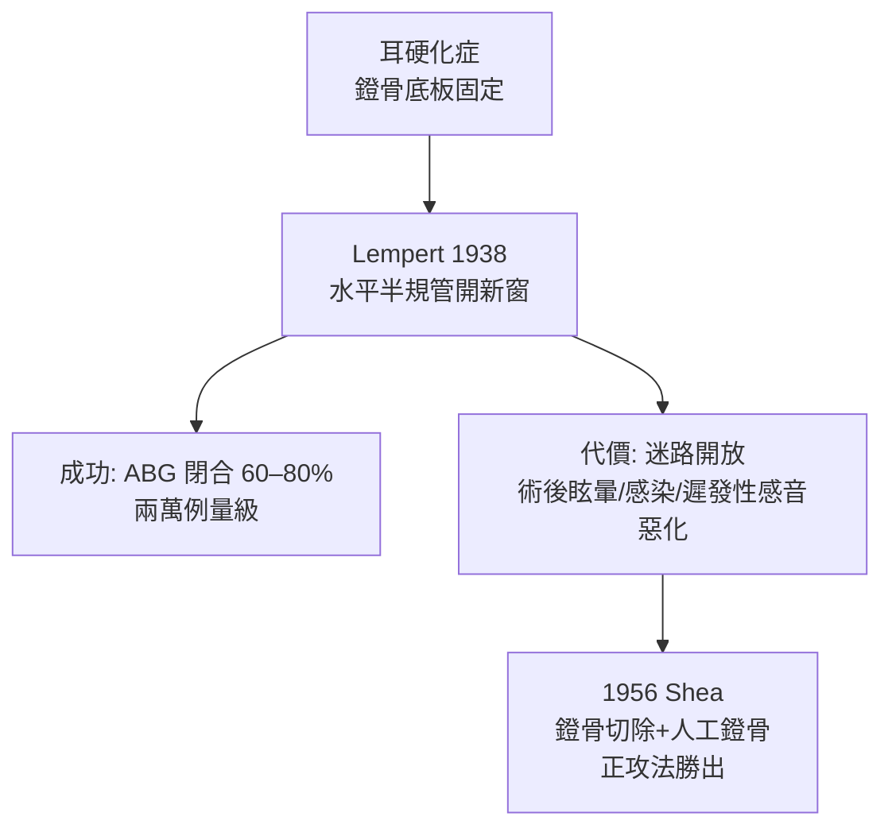

## 1938 - 倫佩特的一期開窗術（在迷路的骨壁上「開一扇新窗」）

## 案件摘要

**本案的謀略是繞道：既然正門（前庭窗）被耳硬化症焊死，就在旁邊的骨牆上開一扇新窗。**

1938 年，紐約耳外科醫生 Julius Lempert 宣告「一期開窗術」成功：在水平半規管骨壁上磨出一個小窗（fenestration），直接讓中耳腔的聲波激盪內耳淋巴液——徹底繞過被固定的鐙骨底板（`1878-凱塞爾鐙骨鬆動術.md` 的構想，半世紀後的復活與改良）。此後二十年，開窗術成為全球耳硬化症的標準手術，把一批批病人從「越來越聾」中拉回可聽世界，也把耳外科正式推進「顯微外科」時代。

## 前因 -- 為什麼會有這個案子

- 病理學已定案：耳硬化症的病灶是鐙骨底板周圍的骨質重塑與固定——開窗「繞道」的理論位置早在 19 世紀就被提出（Kessel 1878；Jenkins 1913；Nylén 1923 首次在顯微鏡下操作）。
- 感染時代剛過：磺胺類（1935 Domagk）與即將問世的青黴素（`../性病的歷史/1943-青黴素治癒梅毒.md` 同源的量產革命）讓「打開迷路」的感染風險首次可控。
- Lempert 的組織天才：他在紐約自建耳外科培訓中心（Lempert Institute），像辦師徒工坊一樣訓練全球醫生——技術擴散速度是本案勝負手。
- 聽力學配套已備：Fletcher 的純音聽力圖（`1922-弗萊徹純音聽力檢查.md`）使「術前 ABG、術後閉合多少」可以量化考核——手術第一次有考卷。

## 線索與推理 -- 數學式、程式、理論

開窗術的聲學邏輯：建立**第二個等效窗口**，讓「進入與釋出」的壓力差得以存在：

$$ \Delta P_{\text{內耳}} = p_{\text{新窗}} - p_{\text{蝸窗}} > 0 \quad (\text{鐙骨固定時} \; p_{\text{前庭窗}} \approx 0) $$

```python
def fenestration_math():
    # 正常: 前庭窗(有效) vs 蝸窗(釋壓) → 壓差驅動基底膜
    # 開窗術: 新窗(半規管壁) 接替前庭窗的角色
    normal_dP = 1.0
    otosclerotic_dP = 0.05    # 底板固定 → 壓差近零 → 40–60 dB 聽損
    fenestrated_dP = 0.75     # 新窗恢復大部分壓差
    print(f"正常 {normal_dP} / 病態 {otosclerotic_dP} / 開窗後 {fenestrated_dP}")

fenestration_math()
```



Lempert 的技術細節（以鑽與鑿逐層磨開骨迷路、以電鑽保持冷卻、皮瓣覆蓋新窗）顯示他理解「開窗必須防水與防長期閉塞」。其成功關鍵還有**中耳腔的密閉與含氣**——這正是耳咽管功能（`1561-Eustachii耳咽管解剖.md`）的重要性第一次在「外科決策」中變得生死攸關。開窗術的固有缺陷：新窗可能因骨質增生再閉合（復發）、迷路開放造成的平衡障礙、以及「遲發性耳蝸型耳硬化」的內耳損傷——這些把接力棒交給了 1950 年代的正攻法。

## 結案 -- 後果與影響

- 1940–50 年代全球開窗術浪潮：Lempert 訓練出的外科醫生（包括英國的 Cawthorne、法國的）建立各國耳外科學派；顯微鏡、電鑽、精細器械成為耳外科標配。
- 1956 年 Shea 鐙骨切除術以「重建鐙骨功能」取代「繞過鐙骨」，成功率更高、眩暈更少，開窗術在 1960s 退居二線——但 Lempert 建立的顯微耳外科體系完全被繼承。
- 教學制度化：顳骨手術實驗室（temporal bone lab）成為耳外科培訓標準——這個制度設計直接來自 Lempert 的工坊模式。
- 耳硬化症研究推進：1950s 後組織病理學確認病灶為「耳海綿化（otospongiosis）」；1990s COCH 基因與麻疹病毒假說；2010s 雙磷酸鹽類藥物嘗試。
- 一句話結案：開窗術是「錯誤但輝煌」的手術——它證明了耳內可以動刀，然後把舞臺讓給了更好的答案。

## 關鍵人物與文獻

- Julius Lempert（1890–1968），紐約；"One-stage fenestration operation"（1938）；自創 Lempert 耳外科研究所。
- J. Jenkins（1913）、G. Nylén（1923，首例顯微鏡下）——開窗構想與顯微化的前置。
- John J. Shea Jr.（1956/1958）鐙骨切除術——本案的「繼任偵探」。
- Samuel Rosen（1952）鐙骨鬆動術復活；W. House 的耳外科史回顧。
- A. Mudry, *Studies on the History of Otosclerosis*（2000）；K. J. Mangham 的耳硬化症治療史綜述。
