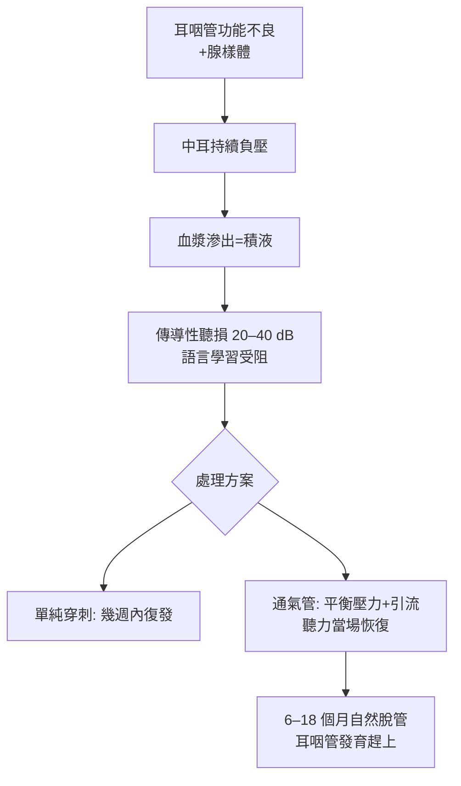

## 1954 - 阿姆斯特朗的通氣管（為中耳開一個「常駐通風口」）

## 案件摘要

**本案的問題：中耳積液悶著，聽力天天往下掉，而耳咽管不肯上班。**

1954 年，費城耳科醫生 Beverly Armstrong 發表「**鼓膜切開＋置入聚乙烯通氣管**」的標準化術式：在鼓膜切小口、放入一枚通氣小管，讓中耳與外界維持氣壓平衡、積液引流、黏液纖毛功能恢復。這是中耳炎治療史上最有影響力的手術——今日全球每年逾百萬兒童接受此術，是兒童最常見的手術之一。本案的謎題在於：一個這麼「小」的手術，為什麼能同時治好聽力、防止語言遲緩、並改寫中耳炎的病理學？

## 前因 -- 為什麼會有這個案子

- 抗生素時代（1940s 起）化膿性中耳炎死亡率驟降，但**漿液性/積液性中耳炎**（中耳積液不化膿）成為新的主要困擾——抗生素對它幾乎無效。
- 耳咽管功能不良是病因核心（`1561-Eustachii耳咽管解剖.md`）：兒童管軟骨發育未熟、角度水平、腺樣體（`1868-梅耶腺樣體面容.md`）壓迫管口——單純穿刺抽液幾乎必然復發，因為「負壓的引擎」還在。
- 先驅工作：1860s Politzer 已嘗試置入橡皮栓；1902 年 Heymann 等有零星置管報告，但無標準器材與術式，感染與脫落頻繁。
- 兒童語言與學習發展醫學的興起，使「持續 3 個月以上的積液＋聽損」被視為必須積極處理的公共衛生問題。

## 線索與推理 -- 數學式、程式、理論

通氣管的物理學本質是**把「一次性鼓膜切開」變成「可控的人工耳咽管」**：

$$ P_{\text{中耳}}(t) = P_{\text{外界}} \quad \text{（管開放時）}; \qquad \Delta P_{\text{反覆負壓}} \Rightarrow \text{積液迴圈} $$

```python
def otitis_media_with_effusion_loop():
    # 中耳負壓 → 血漿滲出 → 積液 → 纖毛功能下降 → 負壓持續
    pressure = -200  # daPa
    fluid = 0
    for day in range(1, 91):
        if pressure < -100:
            fluid += 1          # 負壓持續 → 積液累積
            hearing_loss = min(40, fluid * 0.5)   # dB
        else:
            fluid = max(0, fluid - 2)             # 管開放 → 引流恢復
            hearing_loss = max(0, fluid * 0.5)
    return f"90 天: 積液 {fluid} 單位, 聽損 {hearing_loss:.0f} dB"

print(otitis_media_with_effusion_loop())
```



Armstrong 的設計取巧之處：聚乙烯管具彈性「夾」在鼓膜切口上、不易過早脫落；管內徑約 1.5 mm 足以平衡壓力又不致太大。臨床推理上的關鍵洞見是**時間窗**：積液會隨兒童成長自癒（多數 3 歲以上兒童 3 個月內自癒），故通氣管是「橋樑」而非「終點」——這個「等待發育＋維持聽力」的雙重任務，正是 2000 年代 AAO-HNS 指引（3 個月以上聽損才考慮置管）的理論骨架。1980 年代後對「置管過度」的循證反思（包括長期置管者的鼓膜硬化與穿孔）又把鐘擺拉回中間。

## 結案 -- 後果與影響

- 通氣管成為全球兒科手術量前三名；美國每年約 70 萬例、台灣健保每年數萬例——「兒童最常見的擇期手術」。
- 併發症譜被完整研究：鼓膜硬化、永久穿孔（長期置管約 2–5%）、耳漏；1980s 起出現「通氣管 vs 觀察等待」的隨機試驗（Paradise 1983 起的 Pittsburgh 系列研究）。
- 積液性中耳炎的病因學被重塑：生物膜（biofilm）、胃食道逆流、過敏與煙害暴露——「耳咽管為中心」的框架未變，但治療從外科單線轉為多因管理。
- 成人「咽鼓管球囊擴張術」（2010s）是本案思想的最新化身：與其開洞，不如修復原生通風系統。
- 一句話結案：最好的手術有時只是給身體一點時間——通氣管的藝術在於「橋要多長」。

## 關鍵人物與文獻

- Beverly W. Armstrong（1921–2006），費城；"A new treatment for chronic secretory otitis media"（*AMA Archives of Otolaryngology*, 1954）。
- Adam Politzer（1860s）與 Heymann（1902）——置管的零星先驅。
- J. L. Paradise et al.（1983–2007）Pittsburgh 系列隨機試驗——置管時機的循證審判。
- AAO-HNS Clinical Practice Guideline: Otitis Media with Effusion（2004/2016 更新）。
- M. M. Paparella 的積液性中耳炎病理研究；Rosenfeld & Bluestone, *Evidence-Based Otitis Media*（1999）。
