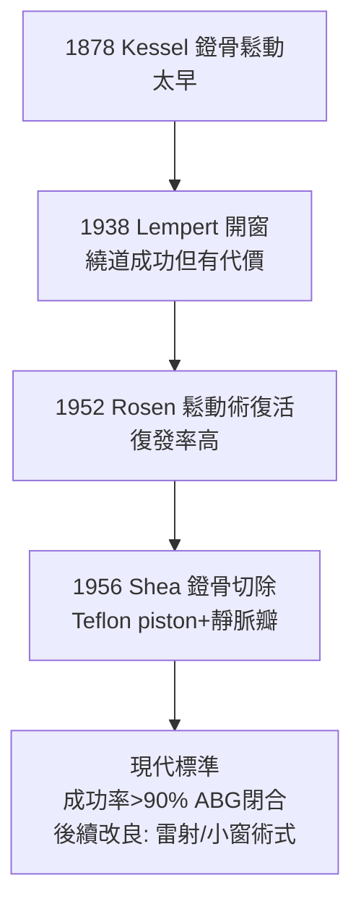

## 1956 - Shea 的鐙骨切除術（在耳朵最深處放進一個人造零件）

## 案件摘要

**本案的終局之戰：耳硬化症治療在「繞道」與「正攻」之間裁決，正攻法勝出。**

1956 年 5 月，孟菲斯耳外科醫生 John J. Shea Jr. 為一位耳硬化症女性患者施行史上第一例**鐙骨切除術（stapedectomy）**：移除被固定與部分切除的鐙骨，以前庭窗上的**靜脈瓣移植**封閉內耳開口，再置入 Teflon 製的人工鐙骨連接砧骨。術後病人氣骨導差幾乎完全閉合——傳導性聽損被「以人工零件替換」的方式根治。此術至今仍是耳硬化症的標準治療，成功率逾 90%，是顯微耳外科最精密的招牌手術。

## 前因 -- 為什麼會有這個案子

- Kessel（1878，`1878-凱塞爾鐙骨鬆動術.md`）的鐙骨手術曾被否定；Lempert（1938，`1938-倫佩特開窗術.md`）的開窗術成功但留下眩暈、感染與遲發性惡化的包袱。
- 1952 年 Samuel Rosen 復活「鐙骨鬆動術」（以針挑動固定處），短期效果佳但復發率高——「正門路線」重新被打開。
- 材料革命同時到位：Teflon（1938 年杜邦專利）化學惰性、可精密切削；Silastic、鉭絲等人工植入材料在心臟與骨科已驗證。
- 手術顯微鏡（Carl Zeiss 的耳科顯微鏡，1950s）使前庭窗這個 3 mm 的區域成為「可施工現場」；聽力圖（`1922-弗萊徹純音聽力檢查.md`）提供量化考卷。

## 線索與推理 -- 數學式、程式、理論

Shea 的力學目標是**完整重建聽骨鏈的壓力轉換**：

$$ G_{\text{中耳}} = \underbrace{\frac{A_{\text{鼓膜}}}{A_{\text{底板}}}}_{\approx 17} \times \underbrace{\frac{l_{\text{錘柄}}}{l_{\text{砧長腳}}}}_{\approx 1.3} \approx 22\,\mathrm{dB} $$

```python
def stapedectomy_model():
    # 移除固定鐙骨 → 人工鐙骨(piston)連接砧骨與前庭窗
    before = {"底板活動度": 0.05, "ABG_dB": 40}
    after  = {"底板活動度": 0.95, "ABG_dB": 5}
    # 關鍵工程問題: 前庭窗開放後如何防止外淋巴瘻與感音惡化?
    seal = "靜脈瓣(自體)覆蓋開口 → Teflon piston 輕觸其上"
    return before, after, seal

print(stapedectomy_model())
```



Shea 的三大工程決策值得偵查：其一，**封口材料用自體靜脈**——解決了 Kessel 時代「內耳開放即感染與瘻管」的死因；其二，**Teflon piston**——惰性、不與組織癒合過度、可預製標準化；其三，**保留或部分保留底板**（小窗 vs 全切）以降低感音性損傷。術式的後續演化（1970s Schuknecht 全切派 vs 1980s 雷射小窗派 stapedotomy）正是這三個決策的持續優化。併發症管理（感音性聽損 1–2%、眩暈、修復性手術）也被逐步量化——本案是「顯微外科＋材料科學＋生理學」三位一體的首場全勝。

## 結案 -- 後果與影響

- 耳硬化症手術治療的標準確立：全球每年約 5 萬例；氣骨導差閉合至 10 dB 內者逾 80–90%；術後聽力可維持數十年。
- 中耳植入物工業誕生：Teflon、鈦合金 piston、全鈦人工聽小骨（TORP/PORP，1990s）——耳外科成為「零件替換外科」的先驅之一。
- 手術顯微鏡與顳骨實驗室訓練制度化（Lempert 傳統的升級），催生 House 耳科研究所（1963）與顱底外科、聽神經瘤顯微外科的黃金年代。
- 聽力圖作為「術後考卷」的制度使耳外科成為最早全面循證化的外科專科之一。
- 一句話結案：人類第一次在活體內耳植入機械零件並讓它每天工作上萬次——這是顯微外科與材料工程的合著案件。

## 關鍵人物與文獻

- John J. Shea Jr.（1930–2015），孟菲斯；"Fenestration of the oval window"（*Ann. Otol. Rhinol. Laryngol.*, 1958，報告 1956 年首例系列）。
- Johannes Kessel（1878）、Julius Lempert（1938）、Samuel Rosen（1952）——本案的三代前置偵探。
- H. Schuknecht 的病理與全切派；M. Portmann、K. Plester 的歐洲改良；D. Perkins（1978）氬雷射小窗術。
- A. Mudry, *Studies on the History of Otosclerosis*（2000）；W. F. House 的耳外科回憶史料。
- Shea JJ, "A personal history of stapedectomy"（*Am. J. Otol.*, 1998）。
