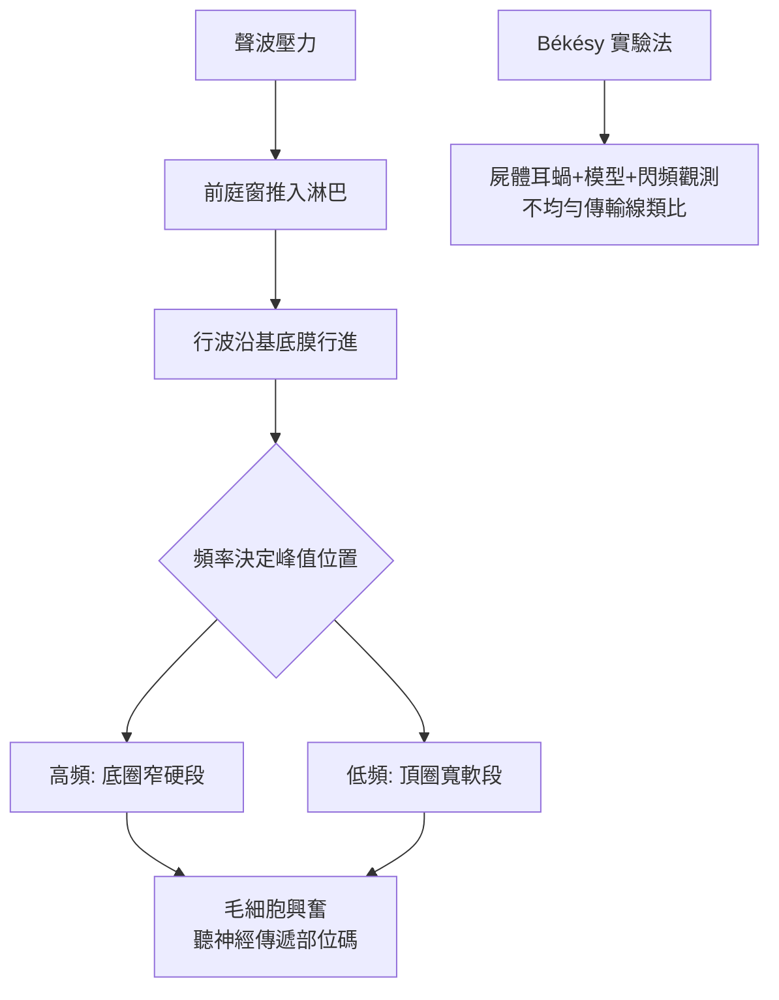

## 1961 - 貝凱西的行波學說獲諾貝爾獎（耳蝸的頻率地圖終於畫對了）

## 案件摘要

**本世紀之謎：聲音進入耳蝸後，究竟如何被「按音高分揀」？**

1961 年，匈牙利裔美國物理學家格奧爾格·馮·貝凱西（Georg von Békésy）獨得諾貝爾生理學或醫學獎，表彰他自 1928 年起三十年間對耳蝸機械力學的研究。他最重要的發現是**行波（traveling wave）**：基底膜並非共振弦（黑姆霍茲，`1863-黑姆霍茲共振學說.md`），聲波沿基底膜由底圈向頂圈行進、振幅沿途增大，在與頻率對應的位置達到峰值後迅速衰減——高頻峰在底圈、低頻峰在頂圈。耳蝸的頻率地圖（tonotopy）第一次有了實驗測量與力學解釋。

## 前因 -- 為什麼會有這個案子

- 理論僵局：黑姆霍茲共振論（高 Q 琴弦）與 Rutherford 電話論（頻率編碼）相持百年；前者解釋音調好但時間解析差，後者反之。
- 實驗困難：耳蝸藏在最硬的骨頭裡，活體測量幾乎不可能——Békésy 的解法是**以屍體顳骨、模型與工程測量迂迴**（他原為電話公司的聲學工程師）。
- 1928 年起他在布達佩斯與斯德哥爾摩用顯微鏡、閃頻觀察與毛髮計測量人類與動物屍體耳蝸的振動——以「死耳＋物理學」對抗「活耳不可測」的宿命。
- Corti（1851）發現螺旋器、Wever–Bray（1930）耳蝸微音電位——形態學與電生理都已到場，只差力學。

## 線索與推理 -- 數學式、程式、理論

行波方程可理想化為「不均勻傳輸線」上的波動：

$$ \xi(x,t) \; : \; m(x)\ddot{\xi} + c(x)\dot{\xi} + k(x)\xi = p(x,t), \quad f_{\text{peak}}(x) \approx \frac{f_0 e^{-\alpha x}}{} $$

```python
# Békésy 行波的「峰值位置—頻率」映射
def cochlea_map(freq_hz):
    import math
    # 經驗式: 位置由底圈(0)到頂圈(35 mm)，對數映射
    x_mm = 35 * (1 - math.log(freq_hz/20000)/math.log(20/20000)) if freq_hz>0 else 0
    x_mm = 35 * (1 - math.log10(freq_hz/20)/3)
    return x_mm

for f in (20000, 4000, 1000, 250, 100):
    print(f"{f} Hz → 峰值位置約 {cochlea_map(f):.1f} mm (由底圈起)")
# 高頻靠底圈、低頻靠頂圈 → tonotopic map
```



Békésy 的推理方式是典型工程師式：他不執著「耳朵像什麼樂器」，而是量出基底膜的**剛度梯度**（底圈硬、頂圈軟，相差約百倍），再用波動力學推導出「波峰位置隨頻率對數移動」——共振論被改寫為「寬調諧的波動分解」。其理論的留白：屍體耳蝸是**被動**的，測得的行波調諧太鈍，無法解釋人耳能分辨 0.5% 的頻率差——這個缺口要等到 1971 年 Rhode 的活體測量（Mössbauer 法）發現基底膜的**非線性、主動放大**，與 1980s-90s 毛細胞的電動運動（prestin 蛋白，1997–2005 確認）才補完：耳蝸是一部**自供能的放大器**。

## 結案 -- 後果與影響

- 「部位—頻率對應」成為耳科學的工程地基：人工耳蝸的電極頻率映射（`1978-克拉克多通道人工耳蝸.md`）、助聽器多頻道壓縮、聽力圖的頻率軸，全部站在 tonotopy 上。
- 臨床解釋力：噪音性聽損的 4000 Hz 谷（噪音能量集中區＋底圈易傷）、耳毒性藥物的高頻先損、老年性聽損的高頻下降型曲線——皆有行波地圖的力學解釋。
- 主動耳蝸的發現（Rhode 1971；Kemp 1978 的耳聲發射 OAE）開創「耳蝸是放大器」的新紀元：OAE 至今是新生兒聽力篩檢的標準工具。
- Békésy 晚年把諾獎獎金捐出，並以「科學的黃金律」著稱（先懷疑自己最珍愛的理論）——本案偵探的方法論遺言。
- 一句話結案：他用三十年的耐心測量，把耳朵裡一張畫了兩百年的地圖，第一次畫在了實測的座標上。

## 關鍵人物與文獻

- Georg von Békésy（1899–1972），1928 年起系列論文；*Experiments in Hearing*（1960）；1961 年諾貝爾生理學或醫學獎（單獨獲獎）。
- Hermann von Helmholtz（1863）共振論；William Rutherford（1886）電話論——被裁決的兩造。
- Wever & Bray（1930）耳蝸微音電位；W. G. Rhode（1971）活體非線性觀察；David Kemp（1978）耳聲發射。
- prestin 的發現（Zheng et al., *Nature* 2000）——主動耳蝸的分子偵結。
- Peter Dallos, "Cochlear amplification, outer hair cells and prestin"（*Curr. Opin. Neurobiol.*, 2008）。
