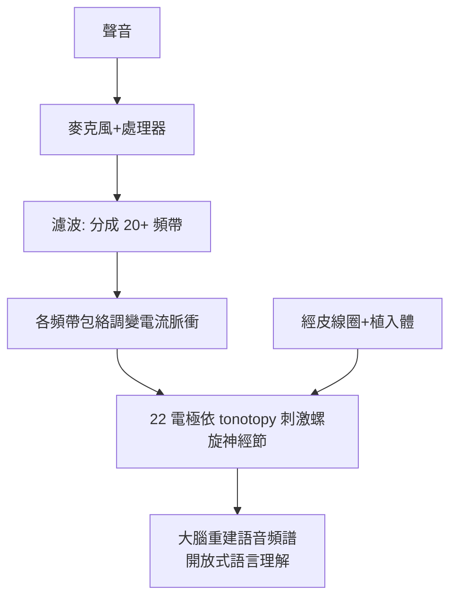

## 1978 - 克拉克的多通道人工耳蝸（在耳蝸裡鋪一排「電極鋼琴鍵」）

## 案件摘要

**本案的突破：聽覺不是一個「開關」，而是一張頻率地圖——所以植入物需要一排電極。**

1978 年 8 月 1 日，澳洲墨爾本的 Graeme Clark 團隊為兩位重度聾的成人植入史上第一套**多通道人工耳蝸**（後成為 Cochlear Nucleus 系統）：22 根電極沿耳蝸底圈推入，依行波學說（`1961-貝凱西行波學說諾獎.md`）把低頻電流送到頂圈附近、高頻送到底圈——在耳蝸裡重建一張 tonotopic 鋼琴鍵盤。病人 Rod Saunders 在調機後第一次「聽見」了語音的輪廓。1985 年 FDA 核准 Nucleus 22 為成人重度聾的常規治療；今日全球逾百萬人植入，重度聾兒童可獲近正常的口語發展——醫學史上最成功的神經假體。

## 前因 -- 為什麼會有這個案子

- 1957 年 Djourno 首例（`1957-Djourno首例人工耳蝸.md`）與 1972 年 House/3M 單通道裝置已證明「電流致聽」，但單通道只能提供節奏與強度，**無法分辨音高**——語音可懂度極低。
- 理論彈藥已備：Békésy 的行波與 tonotopy（1961）；Simmons 的多電極動物實驗（1964）；心理聲學證明音高至少部分由部位編碼。
- 反對聲浪巨大：1970 年代主流耳科學界認為「耳蝸極小且脆弱、多通道信號會互相干擾（channel interaction）、傷害殘存聽力」——1970s 末 FDA 與美國耳科學會一度不支持植入研究。
- Clark 的獨特出身：他父親是聾人藥劑師——他自述研究動機來自「看著父親在喧鬧的藥房裡靠唇讀與猜測行醫」。

## 線索與推理 -- 數學式、程式、理論

多通道的核心工程問題是**電極間的電流擴散與通道互擾**——Clark 用「電流聚焦＋位置編碼＋開關式刺激」解決：

$$ I_i(t) = A \cdot \text{env}_i(t), \quad f_i = f_{\text{CF}}(x_i) \; (\text{頻帶}i \to \text{電極}i, \text{依 tonotopy}) $$

```python
# 多通道 CIS 類策略的簡化模型
def multichannel_coding(n_channels=22):
    import math
    plan = []
    for i in range(n_channels):
        x = i / (n_channels-1)
        band = 20000 * (20/20000)**x      # 頻帶按對數分配
        electrode_pos = "底圈→頂圈"
        plan.append((f"通道{i+1}", round(band), electrode_pos))
    return plan[:5], "…共 22 通道, 頻帶→電極一對一映射"

print(multichannel_coding())
```



科學上的關鍵裁決：人類螺旋神經節細胞集中於底圈（高頻區），**電極插入深度有限**，故「低頻電流送到頂圈」其實是送到底圈深處——大腦經數週訓練即「重新映射」頻率—位置的對應，證明 tonotopy 是可塑的。更重要的意外發現是**兒童神經可塑性窗口**：1980s 末起，2 歲前植入的重度聾幼兒語言發展接近同齡聽常兒童——這把人工耳蝸從「成人重建聽力」改寫成「兒童早期發育干預」，並引發聾人社群的語言文化辯論（手語 vs 口語）——本案的社會章節與技術章節同樣厚重。

## 結案 -- 後果與影響

- 1985 年 FDA 核准 Nucleus 22（成人）；1990 年核准兒童（≥2 歲）；2000 年起年齡下限降至 12 個月；今日雙側植入與保留殘餘聽力的「電聲混合」植入成為趨勢。
- 編碼策略演化：F0/F2 → MPEAK → CIS/ACE（連續交替取樣）——「頻帶包絡＋電極映射」的框架穩定至今。
- 新生兒聽力篩檢（OAE/ABR，1990s 普及）＋早期植入的「黃金 1000 天」干預鏈，使先天重度聾的口語結局徹底改觀。
- 科學遺產：神經假體的設計範本（視網膜植入、深部腦刺激、脊髓刺激皆借用「通道—功能映射」思路）；大腦可塑性與關鍵期研究因之爆發。
- 一句話結案：他把 Békésy 量出來的地圖，變成了一排真正能發聲的琴鍵——人類第一次以工程手段還原了一種感官。

## 關鍵人物與文獻

- Graeme Clark（1935–），墨爾本大學；1978 年 8 月首例多通道植入（病人 Rod Saunders）；1982 年與 Cochlear 公司合作 Nucleus 系統。
- Ingeborg 與 Erwin Hochmair（維也納，Med-El 系統，1977/1980s）——多通道的歐洲平行戰線。
- Blair Simmons（1964）、William House（1972 單通道）——前置偵探。
- Graeme Clark, *Sounds from Silence*（2005 自述）；Mudry & Mills（2013）早期人工耳蝸史。
- FDA 核准史（1984/1985/1990）；Niparko et al., *Cochlear Implants: Principles and Practices*（2009）。
