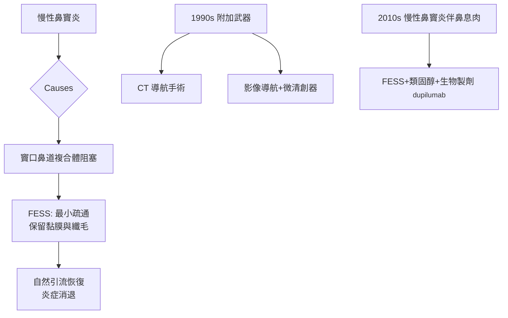

## 1985 - 功能性內視鏡鼻竇手術（從「刮光病灶」到「修好通風」的典範轉移）

## 案件摘要

**本案是一場外科哲學革命：鼻竇炎的病根不是「有病的黏膜」，而是「被堵住的關鍵通道」。**

1985 年前後，奧地利 Graz 的 Heinz Stammberger 與美國 Johns Hopkins 的 David Kennedy 分別發表**功能性內視鏡鼻竇手術（FESS, Functional Endoscopic Sinus Surgery）**的新範式：在手術顯微內視鏡（1970 年代 Messerklinger 開創的鼻內診斷內視鏡）引導下，只做**最小限度的竇口鼻道複合體（ostiomeatal complex）疏通**，保留鼻竇黏膜，讓黏液纖毛運輸與自然開口引流自行恢復。與 Caldwell-Luc（`1893-考德威爾呂克氏鼻竇手術.md`）的「黏膜全切＋人造引流窗」正面對決——FESS 以更小創傷、更好結局勝出，成為今日慢性鼻竇炎手術的世界標準。

## 前因 -- 為什麼會有這個案子

- 理論前提：Walter Messerklinger（Graz，1978）以內視鏡與染料實驗系統記錄鼻竇**黏液纖毛運輸方向**——發現上頜竇纖毛把黏液螺旋導向「自然口」，而非外科造的對孔；竇內感染多源自竇口鼻道複合體的阻塞（「病灶在門口，不在房間」）。
- 器械到位：冷光源＋廣角內視鏡（1970s）、Hopkins 柱狀鏡、精細鉗與動力系統；CT 影像（1970s）首次顯示篩竇與鉤突的三維解剖。
- 舊手術的失敗學：Caldwell-Luc 的長期併發症（麻木、瘢痕、萎縮性鼻炎）累積數十年——「清創式」哲學的問題清單已寫滿。
- Kennedy 的整合角色：他在 Messerklinger 學說基礎上提出「功能性」之名與選擇性手術策略，並與 Stammberger 在 1985 年前後的國際會議上互相引薦——兩地獨立發展、合流成名。

## 線索與推理 -- 數學式、程式、理論

FESS 的物理邏輯是**「最小干預恢復自淨系統」**：

$$ Q_{\text{引流}} = \dot{V}_{\text{纖毛}} \times A_{\text{自然口}} \quad \Rightarrow \quad \text{打通自然口} > \text{開新窗} $$

```python
def fess_logic():
    oc = "竇口鼻道複合體(鉤突/篩泡/中鼻甲週邊) = 阻塞關鍵"
    strategy = {
        "舊哲學(Caldwell-Luc)": "全切病變黏膜 + 人工對孔 → 破壞纖毛運輸",
        "新哲學(FESS)":        "僅切除鉤突/打通篩泡與自然口 → 保留纖毛自淨",
        "影像規劃":            "CT 三維重建 + 電腦導航(1990s) 避免眶/顱損傷",
    }
    return oc, strategy

for k, v in fess_logic()[1].items(): print(f"{k}: {v}")
```



診斷—治療的推理鏈：CT 顯示哪個竇腔受累 → 內視鏡確認阻塞點（鉤突、篩泡、上頜竇口）→ 選擇性疏通而非全開放。這正是「外科版的鑑識推理」：不殺所有嫌疑人，只移除真正的路障。生理學根據是纖毛運輸速率（正常約 6–8 mm/min）與竇腔換氣所需的 $P_{O_2}$ 恢復——阻塞解除後數週內黏膜纖毛形態可恢復，這是「保留」優於「切除」的實證基礎。1990s 的 CT 導航與微清創器（microdebrider）把安全性與效率再推一層。

## 結案 -- 後果與影響

- FESS 成為慢性鼻竇炎手術的世界標準；Caldwell-Luc 退居腫瘤、真菌球與齒源病變的特定情境。
- 鼻內視鏡技術外溢成為整個「鼻—顱底外科」：內視鏡視神經減壓（1980s）、腦垂腺瘤經蝶切除（1987–92 起普及）、擴大入路顱底腫瘤切除（2000s）——本案是「微創顱底外科」的起跑點。
- 疾病分類進化：慢性鼻竇炎伴/不伴鼻息肉的分型（EPOS 2012）、第 2 型發炎的生物製劑（dupilumab 2019）——「手術+內科」的組合時代。
- 併發症率從 C-L 時代的顯著水平降至 <1%（眼眶與顱內併發症除外）；術後鼻沖洗、類固醇灌洗成為標準照護。
- 一句話結案：最好的手術不是切掉所有病灶，而是還給器官它本來的排水系統。

## 關鍵人物與文獻

- Walter Messerklinger（1920–2000），Graz；*Endoscopy of the Nose*（1978）——纖毛運輸與內視鏡診斷的奠基。
- Heinz Stammberger（1948–），Graz；"Functional endoscopic sinus surgery"（1985/1986 系列報告）。
- David Kennedy（1956–），Johns Hopkins；"Functional endoscopic sinus surgery: Technique"（*Arch. Otolaryngol.*, 1985）。
- Oscar Hirschman（1901，早年內視鏡嘗試）與 Maltz（1925，鼻竇內視鏡先聲）——本案的史前線索。
- Fokkens & Lund, *European Position Paper on Rhinosinusitis (EPOS 2012/2020)*。
