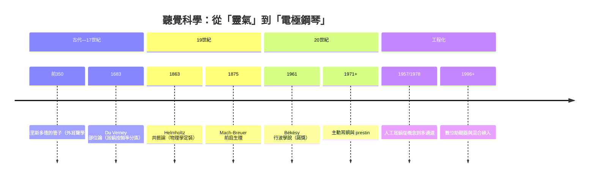
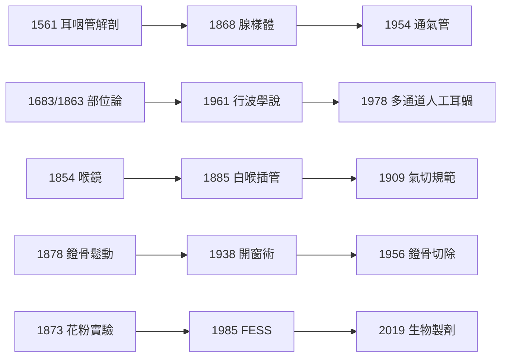

# 耳鼻喉科的歷史：從耳喇叭到人工耳蝸、從喉鏡到內視鏡顱底——五感門戶的兩千年破案史

> 本書以「推理探案」體例，為耳鼻喉科史上的每個關鍵事件寫一篇 wiki：
> 謎題是什麼（聲音如何被聽見？眩暈的病灶在哪？鼻竇為何反覆發炎？）？
> 偵探是誰（歌者、物理學家、工程師、外科醫生）？
> 線索與推理（解剖、力學、電生理、材料學）與結案（理論、手術、制度）各是什麼？
> 每篇檔名以年份開頭（4 位數，西元前以 `-` 開頭）。

## 三條主軸

| 線 | 演變 |
|---|---|
| **聽覺科學線** | 管子集音（幾何）→ 耳蝸解剖 → 共振/部位論 → 行波學說 → 主動耳蝸 → 電極鋼琴（人工耳蝸） |
| **外科技術線** | 禁忌（耳與氣道不可開）→ 顯微鏡與材料革命 → 鐙骨手術 → 通氣管與氣切規範 → 內視鏡微創 → 顱底外科 |
| **生理—疾病線** | 眩暈歸於腦 → 病灶在內耳 → 前庭生理（半規管/耳石器）→ 過敏與鼻竇的免疫學 → 神經可塑性（語言重建） |

---

## 年表（非常詳細版）

### 第一篇：古代——在打不開的器官面前

| 年份 | 事件 | 意義 | wiki |
|---|---|---|---|
| 約前 400 | 《希波克拉底文集》記載耳鳴、耳漏、沖洗與吹煙療法 | 耳首次被視為「可診治的器官」 | [-0350-亞里斯多德與耳喇叭](-0350-亞里斯多德與耳喇叭.md) |
| 約前 350 | 亞里斯多德《問題集》：以管子與「拉直耳朵」增強聽力的觀察 | 外耳聲學的第一次控制變因實驗；聽力輔具起源 | 同上 |
| 約前 1550–前 300 | 埃及紙草與亞歷山卓學派（Herophilus）解剖神經與氣管 | 解剖學前置工作 | [-0100-阿斯克列皮亞德斯氣切傳說](-0100-阿斯克列皮亞德斯氣切傳說.md) |
| 約前 100 | 阿斯克列皮亞德斯傳說中的氣管切開——喉嚨上的第一扇門 | 最簡單的切口、等待最久的刀 | 同上 |
| 約 1 世紀 | 蓋倫判決氣切「無益且危險」；靈氣聽覺學說統治千年 | 被封印的千年 | 同上 |
| 約 30 | 塞爾蘇斯《論醫學》：扁桃腺切除的完整術式與「分級治療」智慧 | 西方外科手冊的鼻祖 | [0030-塞爾蘇斯扁桃腺切除](0030-塞爾蘇斯扁桃腺切除.md) |

### 第二篇：文藝復興與啟蒙——解剖學的破冰

| 年份 | 事件 | 意義 | wiki |
|---|---|---|---|
| 1546 | Brasavola 留下文藝復興首例氣切紀錄；同世紀 Fabricius 著《氣管切開術》卻反對自己動刀 | 千年禁令鬆動 | [-0100-阿斯克列皮亞德斯氣切傳說](-0100-阿斯克列皮亞德斯氣切傳說.md) |
| 1561 | 歐斯達丘斯《解剖學探問》：耳咽管、鐙骨與迷路的精細解剖（銅版畫） | 中耳成為「有通風、引流、槓桿」的機械系統 | [1561-Eustachii耳咽管解剖](1561-Eustachii耳咽管解剖.md) |
| 1573–1609 | Coiter、Falloppio、Casserio 完善耳蝸與中耳解剖圖譜 | 形態學基礎 | [1683-DuVerney耳蝸力學](1683-DuVerney耳蝸力學.md) |
| 1683 | 杜韋爾內《耳的器官與聽覺》：聲音＝振動；耳蝸按頻率分區 | 部位論誕生；耳朵變成「聲學機器」 | 同上 |
| 1704 | Valsalva《De aure humana》：捏鼻鼓氣可通耳 | 耳咽管從解剖名詞變治療靶點 | [1561-Eustachii耳咽管解剖](1561-Eustachii耳咽管解剖.md) |
| 1760 | Cotugno 證明內耳充滿液體（迷路液） | 行波學說的介質前提 | [1961-貝凱西行波學說諾獎](1961-貝凱西行波學說諾獎.md) |
| 1789 | Scarpa 描繪前庭神經與球囊、橢圓囊 | 前庭解剖就緒 | [1875-馬赫布羅伊爾前庭器官](1875-馬赫布羅伊爾前庭器官.md) |

### 第三篇：19 世紀——理論黃金時代

| 年份 | 事件 | 意義 | wiki |
|---|---|---|---|
| 1741 | Ferrein「聲帶如琴弦」振動理論 | 嗓音生理前置 | [1854-賈西亞喉鏡](1854-賈西亞喉鏡.md) |
| 1819 | Bostock 描述「夏卡他」（乾草熱） | 過敏性鼻炎首次臨床描述 | [1873-布萊克利花粉實驗](1873-布萊克利花粉實驗.md) |
| 1828 | Physick 發明扁桃腺絞斷器 | 扁桃腺手術器械化 | [0030-塞爾蘇斯扁桃腺切除](0030-塞爾蘇斯扁桃腺切除.md) |
| 1834–1855 | Weber（骨導）與 Rinne（氣導）音叉試驗 | 傳導性 vs 感音性聽損的鑑別誕生（氣骨導差） | [1922-弗萊徹純音聽力檢查](1922-弗萊徹純音聽力檢查.md) |
| 1851 | Corti 發現螺旋器（內、外毛細胞、蓋膜） | 聽覺感受器現形 | [1863-黑姆霍茲共振學說](1863-黑姆霍茲共振學說.md) |
| 1854 | 歌唱教師賈西亞以雙鏡看見自己的聲帶 | 喉鏡與喉科學誕生 | [1854-賈西亞喉鏡](1854-賈西亞喉鏡.md) |
| 1857–1858 | Toynbee 顳骨病理；Türk/Czermak 推廣喉鏡 | 耳病理學與喉鏡臨床化 | [1878-凱塞爾鐙骨鬆動術](1878-凱塞爾鐙骨鬆動術.md) / [1854-賈西亞喉鏡](1854-賈西亞喉鏡.md) |
| 1860 | Toynbee《耳的疾病》：1,659 件顳骨的病理整理 | 耳硬化症病灶定位的先行者 | [1878-凱塞爾鐙骨鬆動術](1878-凱塞爾鐙骨鬆動術.md) |
| 1861 | 梅尼埃判決：眩暈＋耳鳴＋聽損的病灶在內耳迷路 | 眩暈從「神經病」改判到耳科 | [1861-梅尼埃眩暈病灶在內耳](1861-梅尼埃眩暈病灶在內耳.md) |
| 1863 | 黑姆霍茲《音的感覺》：共振論 | 部位論的物理學定裝；心理聲學聖經 | [1863-黑姆霍茲共振學說](1863-黑姆霍茲共振學說.md) |
| 1863 | Politzer 發明中耳吹張氣球法 | 耳咽管治療學全盛 | [1561-Eustachii耳咽管解剖](1561-Eustachii耳咽管解剖.md) |
| 1868 | 梅耶命名腺樣體、描述「腺樣體面容」、發明刮除術 | 兒童耳鼻喉科誕生 | [1868-梅耶腺樣體面容](1868-梅耶腺樣體面容.md) |
| 1870 | Goltz 鴿子半規管切除實驗 | 平衡器官的臨床線索 | [1875-馬赫布羅伊爾前庭器官](1875-馬赫布羅伊爾前庭器官.md) |
| 1871–1885 | Traube 氣壓艙、O'Dwyer 插管系列 | 白喉窒息的治療競賽 | [1885-歐德威白喉插管](1885-歐德威白喉插管.md) |
| 1873 | 布萊克利花粉實驗：乾草熱病因、皮膚試驗、花粉計數 | 過敏醫學的起源 | [1873-布萊克利花粉實驗](1873-布萊克利花粉實驗.md) |
| 1873–1875 | 馬赫與布羅伊爾（及 Crum Brown）：半規管＝旋轉加速度感測器 | 前庭生理學誕生 | [1875-馬赫布羅伊爾前庭器官](1875-馬赫布羅伊爾前庭器官.md) |
| 1876–1879 | Galton 哨與音叉測聽 | 聽力測量的史前時代 | [1898-阿庫風電子助聽器](1898-阿庫風電子助聽器.md) |
| 1878 | 凱塞爾施行史上第一批鐙骨鬆動術 | 「耳內不可動刀」禁忌被撕破 | [1878-凱塞爾鐙骨鬆動術](1878-凱塞爾鐙骨鬆動術.md) |
| 1878 | MacEwen 首例清醒氣管插管 | 麻醉氣道管理的黎明 | [1885-歐德威白喉插管](1885-歐德威白喉插管.md) |
| 1878–1897 | Zuckerkandl 鼻竇解剖經典；Emmert/Küfner 鼻內開窗 | 鼻竇外科前置 | [1893-考德威爾呂克氏鼻竇手術](1893-考德威爾呂克氏鼻竇手術.md) |
| 1880s | 馬赫《運動感覺學說基礎》（1875）；耳石器功能分工確立 | 前庭—動眼的生理框架 | [1875-馬赫布羅伊爾前庭器官](1875-馬赫布羅伊爾前庭器官.md) |
| 1883–1890 | Klebs–Löffler 白喉桿菌、Roux–Yersin 外毒素、Behring 抗毒素 | 白喉防治鏈成形 | [1885-歐德威白喉插管](1885-歐德威白喉插管.md) |
| 1885 | 歐德威白喉插管術問世 | 以管代刀；現代氣管插管的形制起源 | 同上 |
| 1886 | Rutherford 電話論（頻率編碼） | 與共振論的世紀之爭 | [1863-黑姆霍茲共振學說](1863-黑姆霍茲共振學說.md) |
| 1887 | Kirstein 直接喉鏡 | 喉鏡的直接路線 | [1854-賈西亞喉鏡](1854-賈西亞喉鏡.md) |
| 1890s | Killian 懸吊喉鏡與支氣管鏡；Jackson 食道鏡 | 內視鏡時代開啟 | [1909-傑克遜規範氣切術](1909-傑克遜規範氣切術.md) |
| 1893/1897 | Caldwell（費城）與 Luc（巴黎）：上頜竇根治術 | 鼻竇首次「外科可及」 | [1893-考德威爾呂克氏鼻竇手術](1893-考德威爾呂克氏鼻竇手術.md) |
| 1895 | X 光問世，隨即用於鼻竇診斷 | 影像學進場 | 同上 |
| 1898 | Hutchison 推出 Akouphone——首款電子助聽器 | 聽力輔具從幾何學跨入電學 | [1898-阿庫風電子助聽器](1898-阿庫風電子助聽器.md) |

### 第四篇：20 世紀上半——制度化與顯微外科前夜

| 年份 | 事件 | 意義 | wiki |
|---|---|---|---|
| 1900 | Politzer《耳科學史》出版；耳科學會遍立歐美 | 學科制度化 | [1561-Eustachii耳咽管解剖](1561-Eustachii耳咽管解剖.md) |
| 1902–1923 | Western Electric 純音聽力計；Fletcher 聽力圖與等響曲線 | 「耳聾」變成座標圖；聽力學誕生 | [1922-弗萊徹純音聽力檢查](1922-弗萊徹純音聽力檢查.md) |
| 1905–1907 | Bárány 旋轉椅與溫度試驗（1914 諾獎） | 前庭功能檢查學誕生 | [1875-馬赫布羅伊爾前庭器官](1875-馬赫布羅伊爾前庭器官.md) |
| 1906 | Pirquet 命名「allergy」 | 過敏學科命名 | [1873-布萊克利花粉實驗](1873-布萊克利花粉實驗.md) |
| 1909 | Jackson 規範氣管切開術，兒科死亡率 50%→<3% | 把「絕望的刀」變成標準作業 | [1909-傑克遜規範氣切術](1909-傑克遜規範氣切術.md) |
| 1911 | Noon 與 Freeman 發明減敏治療 | 過敏的第一種「治本」療法 | [1873-布萊克利花粉實驗](1873-布萊克利花粉實驗.md) |
| 1913 | Jenkins 開窗構想；1923 Nylén 顯微鏡下首例 | 開窗路線接力 | [1938-倫佩特開窗術](1938-倫佩特開窗術.md) |
| 1921 | 真空管助聽器；Carhart 創聽力學學程（1944） | 輔具工業與專業職業化 | [1898-阿庫風電子助聽器](1898-阿庫風電子助聽器.md) / [1922-弗萊徹純音聽力檢查](1922-弗萊徹純音聽力檢查.md) |
| 1926 | Portmann 內淋巴囊減壓構想 | 梅尼埃病手術治療起點 | [1861-梅尼埃眩暈病灶在內耳](1861-梅尼埃眩暈病灶在內耳.md) |
| 1928–1961 | Békésy 三十年耳蝸力學測量 | 行波學說的漫長實驗 | [1961-貝凱西行波學說諾獎](1961-貝凱西行波學說諾獎.md) |
| 1930 | Wever–Bray 耳蝸微音電位 | 兩種編碼並存的橋樑 | [1863-黑姆霍茲共振學說](1863-黑姆霍茲共振學說.md) |
| 1934 | Furstenberg 低鹽飲食治梅尼埃病 | 內耳液體平衡的內科路線 | [1861-梅尼埃眩暈病灶在內耳](1861-梅尼埃眩暈病灶在內耳.md) |
| 1935–1945 | 磺胺與青黴素時代：中耳炎、白喉、氣切感染的死亡率崩塌 | 感染不再是手術的天花板 | [1938-倫佩特開窗術](1938-倫佩特開窗術.md) |
| 1938 | Lempert 一期開窗術 | 顯微耳外科時代開啟 | [1938-倫佩特開窗術](1938-倫佩特開窗術.md) |
| 1938 | Hallpike/Yamakawa 病理：梅尼埃病＝內淋巴水腫 | 77 年前的判決被病理學確認 | [1861-梅尼埃眩暈病灶在內耳](1861-梅尼埃眩暈病灶在內耳.md) |
| 1942 | 第一代抗組織胺（Bovet–Staub） | 過敏藥理學起步 | [1873-布萊克利花粉實驗](1873-布萊克利花粉實驗.md) |
| 1952 | Rosen 復活鐙骨鬆動術；Dix–Hallpike 試驗 | 鐙骨手術回歸；BPPV 獨立成病 | [1956-Shea鐙骨切除術](1956-Shea鐙骨切除術.md) / [1861-梅尼埃眩暈病灶在內耳](1861-梅尼埃眩暈病灶在內耳.md) |

### 第五篇：戰後黃金年代——人工零件與神經假體

| 年份 | 事件 | 意義 | wiki |
|---|---|---|---|
| 1953 | 首支電晶體助聽器（Sonotone 1010） | 輔具小型化革命 | [1898-阿庫風電子助聽器](1898-阿庫風電子助聽器.md) |
| 1954 | Armstrong 鼓膜切開＋通氣管標準化 | 兒童最常見手術誕生 | [1954-阿姆斯特朗通氣管](1954-阿姆斯特朗通氣管.md) |
| 1956 | Shea 首例鐙骨切除術（Teflon piston＋靜脈瓣） | 耳硬化症治療的終局勝利 | [1956-Shea鐙骨切除術](1956-Shea鐙骨切除術.md) |
| 1957 | Djourno 與 Eyriès：史上第一例「電流直接致聽」 | 人工耳蝸的概念驗證 | [1957-Djourno首例人工耳蝸](1957-Djourno首例人工耳蝸.md) |
| 1960 | Békésy《Experiments in Hearing》出版 | 聽覺科學的集大成 | [1961-貝凱西行波學說諾獎](1961-貝凱西行波學說諾獎.md) |
| 1961 | Békésy 獨得諾貝爾生理學或醫學獎 | 行波學說定讞；tonotopy 畫對了 | 同上 |
| 1961–1972 | House–Doyle 美國首例；House/3M 單通道量產 | 人工耳蝸從實驗走向產品 | [1957-Djourno首例人工耳蝸](1957-Djourno首例人工耳蝸.md) |
| 1963 | House 耳科研究所成立；顱底外科黃金年代起跑 | 聽神經瘤顯微外科、中耳植入工業 | [1956-Shea鐙骨切除術](1956-Shea鐙骨切除術.md) |
| 1964 | Simmons 多電極動物實驗 | 多通道時代的生理學前置 | [1978-克拉克多通道人工耳蝸](1978-克拉克多通道人工耳蝸.md) |
| 1966 | 石坂夫婦發現 IgE | 過敏的分子鑰匙 | [1873-布萊克利花粉實驗](1873-布萊克利花粉實驗.md) |
| 1970s | Messerklinger 鼻內診斷內視鏡與纖毛運輸研究 | FESS 的理論與器械前置 | [1985-功能性內視鏡鼻竇手術](1985-功能性內視鏡鼻竇手術.md) |
| 1971 | Rhode 活體測得基底膜非線性 | 「主動耳蝸」的實驗線索 | [1961-貝凱西行波學說諾獎](1961-貝凱西行波學說諾獎.md) |
| 1975 | Paradise criteria：扁桃腺切除適應症循證化 | 鐘擺回到塞爾蘇斯的分級智慧 | [0030-塞爾蘇斯扁桃腺切除](0030-塞爾蘇斯扁桃腺切除.md) |
| 1978 | Kemp 發現耳聲發射（OAE） | 新生兒聽篩的未來工具；耳蝸是放大器 | [1961-貝凱西行波學說諾獎](1961-貝凱西行波學說諾獎.md) |
| 1978.8.1 | Graeme Clark 首例多通道人工耳蝸（墨爾本） | 在耳蝸裡鋪一排電極鋼琴鍵 | [1978-克拉克多通道人工耳蝸](1978-克拉克多通道人工耳蝸.md) |

### 第六篇：當代——微創、可塑性與工程化感官

| 年份 | 事件 | 意義 | wiki |
|---|---|---|---|
| 1980s | Epley 耳石復位術；BPPV 治療革命 | 眩暈最常見病因被「轉」好 | [1875-馬赫布羅伊爾前庭器官](1875-馬赫布羅伊爾前庭器官.md) |
| 1983–2007 | Paradise 系列隨機試驗：通氣管時機的循證審判 | 置管從濫用到精準 | [1954-阿姆斯特朗通氣管](1954-阿姆斯特朗通氣管.md) |
| 1985 | Kennedy 與 Stammberger 發表功能性內視鏡鼻竇手術 | 「修排水系統」取代「刮光病灶」 | [1985-功能性內視鏡鼻竇手術](1985-功能性內視鏡鼻竇手術.md) |
| 1985 | FDA 核准 Nucleus 22 多通道人工耳蝸 | 神經假體時代來臨 | [1978-克拉克多通道人工耳蝸](1978-克拉克多通道人工耳蝸.md) |
| 1985 | Ciaglia 經皮擴張氣切 | 氣切進入 ICU 床旁 | [1909-傑克遜規範氣切術](1909-傑克遜規範氣切術.md) |
| 1987–1992 | 經蝶內視鏡垂腺瘤切除普及 | 鼻內視鏡外溢到顱底 | [1985-功能性內視鏡鼻竇手術](1985-功能性內視鏡鼻竇手術.md) |
| 1990 | FDA 核准兒童人工耳蝸（≥2 歲；2000 年降至 12 個月） | 早期植入改寫語言發展 | [1978-克拉克多通道人工耳蝸](1978-克拉克多通道人工耳蝸.md) |
| 1996 | 首支全數位助聽器（Widex Senso） | 多頻道壓縮與降噪 | [1898-阿庫風電子助聽器](1898-阿庫風電子助聽器.md) |
| 1997–2005 | prestin 蛋白確認：外毛細胞的電動運動 | 主動耳蝸的分子偵結 | [1961-貝凱西行波學說諾獎](1961-貝凱西行波學說諾獎.md) |
| 2000s | CT 導航、微清創器、球囊擴張耳咽管成形術 | 微創工具箱完備 | [1985-功能性內視鏡鼻竇手術](1985-功能性內視鏡鼻竇手術.md) / [1561-Eustachii耳咽管解剖](1561-Eustachii耳咽管解剖.md) |
| 2001/2012 | ARIA 與 EPOS 指引：過敏性鼻炎與鼻竇炎分型 | 內科—外科整合時代 | [1873-布萊克利花粉實驗](1873-布萊克利花粉實驗.md) / [1985-功能性內視鏡鼻竇手術](1985-功能性內視鏡鼻竇手術.md) |
| 2010s | 電聲混合植入、雙側植入、自助調機與 OTC 助聽器（2022） | 聽覺重建的個人化 | [1978-克拉克多通道人工耳蝸](1978-克拉克多通道人工耳蝸.md) / [1898-阿庫風電子助聽器](1898-阿庫風電子助聽器.md) |
| 2019 | dupilumab 等生物製劑用於慢性鼻竇炎伴鼻息肉 | 第 2 型發炎的精準內科 | [1985-功能性內視鏡鼻竇手術](1985-功能性內視鏡鼻竇手術.md) |
| 2020s | 基因治療（OTOF 聾的耳蝸內基因療法試驗）、腦機介面聽覺研究 | 下一場革命的前夜 | [1957-Djourno首例人工耳蝸](1957-Djourno首例人工耳蝸.md) |

---

## 核心線索：理論與技術的因果鏈

## 五個「偵探式」母題

1. **「看不見的器官」如何被看見**：喉鏡（1854，一面鏡子）→ 聽力圖（1922，一張座標紙）→ CT＋內視鏡（1985）。診斷工具的每一次升級，都重新定義了一次疾病。
2. **「太早的偵探」**：Kessel（1878）的鐙骨手術、Bouchut（1858）的插管、Brasavola 之前的氣切——概念正確、條件不足，冤案要等幾十年才平反。
3. **「正確的手術、錯誤的理論」**：Caldwell-Luc 開了門卻開錯窗；黑姆霍茲造了錯誤的鋼琴卻打對了地基——外科與科學都靠「錯得可驗證」而進步。
4. **「以管代刀」**：耳咽管、通氣管、白喉插管、氣切套管、人工鐙骨 piston、人工耳蝸電極——耳鼻喉科的本質之一，是為身體設計正確的「管道」。
5. **「感官可以被重建」**：從亞里斯多德的喇叭（放大物理聲音）到 Clark 的電極（直接命令神經）——兩千三百年的同一句話：聽不見的人，值得被重新接上世界。

## 一句話的總判決

> 耳鼻喉科的歷史，是人類把「五感門戶」逐一從玄學改寫成工程學的破案卷宗——
> 而每樁懸案的結案陳詞，都為下一個病人多開了一扇門。
