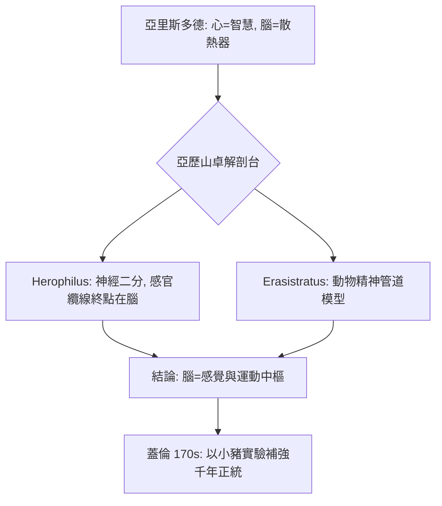

## -0250 - 希羅菲利斯的解剖台：腦第一次被正式指認為「感覺與運動之府」

## 案件摘要

**本案偵破的是一場思想的搬家——靈魂從心臟搬進腦子。**

公元前約 280–250 年，在托勒密王朝的亞歷山卓城，**Herophilus（希羅菲利斯）與 Erasistratus（埃拉西斯特拉圖斯）**進行了有史記載以來第一批系統性人體解剖（據 Celsus 與 Tertullian 的指控，可能還包括活體解剖死刑犯）。他們的偵探結論推翻了亞里斯多德「心臟是智慧之府、腦只是散熱器」的千年定論：**腦，才是神經系統的中心，是感覺與運動的總指揮**。神經學的地理大發現，從這張解剖台開始。

## 前因 -- 為什麼會有這個案子

- **亞歷山卓的制度紅利**。托勒密王朝允許醫者在 Museion 解剖屍體（傳說連死刑犯活體也在其列）；同時代的中國以孝道禁止毀傷遺體，羅馬後來也立法禁止——亞歷山卓是古代世界極少數的解剖例外區。
- **亞里斯多德的錯誤嫌疑人**。Aristotle（前 384–322）以心為智性中樞、腦為冷卻血液的散熱器——這個「散熱器假說」邏輯自洽，卻從未經屍體檢驗；要辦倒它，需要新的證據來源：**親手剖開的人體**。
- **希波克拉底學派的伏筆**。前 400 年代的希氏文集已主張「腦是意識的譯員」（見《論聖病》對癲癇的自然化解釋），但缺乏解剖學支撐；Herophilus 給這個假說補上了屍檢證據。

## 線索與推理 -- 數學式、程式、理論

**線索一：神經與腱的分離。** Herophilus 首次明確區分**神經（neuron，今義）與肌腱**，並把神經分為兩類——

$$ \text{神經} \begin{cases} \text{感覺神經：軟而走向上行} \\ \text{運動（運動性）神經：硬而走向下行} \end{cases} $$

他追蹤視神經與聽神經進入腦，證明感官的線纜**終點在腦**——這是「腦為感覺中樞」的第一條硬證據。

**線索二：腦室的測量與命名。** 他詳細描述腦的四個腦室、命名**十二指腸**（duodenum，順帶遺產）、並特別研究**第四腦室後方的「筆尖」（calamus scriptorius）**與中央水管。Erasistratus 則把運動與感覺分別派給小腦與大腦（方向不對，但「分而治之」的架構是對的），並提出「動物精神（pneuma psychikon）」沿神經中空的管道傳輸——一個日後被蓋倫（見 `0170-蓋倫腦室與動物精神.md`）發揚、被千年誤用的模型。

**線索三：脈搏的量尺。** Herophilus 用水鐘（klepsydra）計時，以自己年齡為標準建立脈搏分類——把「量測」引入醫學。這個方法論移植到神經學，就是後來反射、傳導速度（Helmholtz, 1850）與 EEG（見 `1929-Berger腦電圖.md`）一路的量化傳統。

## 結案 -- 後果與影響

- **腦科正式立案**。此後「腦為中樞」成為亞歷山卓—蓋倫醫學的正統；蓋倫的生理學大廈直接蓋在 Herophilus 的地基上。
- **解剖學作為偵查手段的確立**。「以解剖駁倒哲學」的模式——先有屍體證據、再修正理論——是維薩里（見 `1543-維薩里人體構造.md`）與現代神經解剖學的祖傳方法。
- **一樁倫理懸案**。Tertullian 控告 Herophilus「活剖六百人」；無論數字是否誇張，這是醫學史上第一次人體實驗倫理爭議，與兩千年後的塔斯基吉、紐倫堡守則遙遙相望。
- **文本幾乎全毀**。Herophilus 的著作在亞歷山大圖書館火災後散佚，其學說僅存於 Galen、Celsus 等人的轉述——史上影響最大的神經科學家之一，竟沒有一頁原文傳世。
- **一句話結案**：亞歷山卓的解剖刀為靈魂辦理了搬家手續——從心臟搬進腦室，從此神經學有了自己的領土。

## 關鍵人物與文獻

- **Herophilus（約前 335–前 280）**——Chalcedon 人，亞歷山卓解剖學派創始人；命名十二指腸、視網膜（retina）一詞亦出自其門；被 Tertullian 稱為「劊子手」、被醫學史稱為「解剖學之父」。
- **Erasistratus（約前 310–前 250）**——Ceos 人，生理學先驅；提出動物精神論與心臟瓣膜功能研究；因其腦比人腦相對小的緣故貶低動物智力（神經系統比較解剖的先聲）。
- 原始文獻——皆已佚失；主要轉述者：Celsus《De Medicina》、Galen《論解剖操作》、Tertullian《De Anima》。
- 現代註腳——von Staden, *Herophilus: The Art of Medicine in Early Alexandria*, 1989，重輯了全部殘篇，為這樁冷案重建了完整卷宗。
