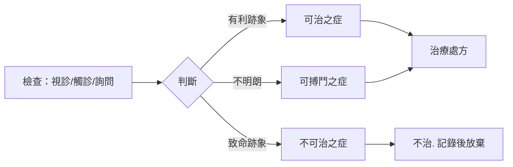

## -1700 - 史密斯紙草：人類第一次凝視「腦」這個器官

## 案件摘要

**本案偵破的是一個器官——在它被認為值得注意之前，先被描述了。**

公元前約 1700 年（抄寫年代），一名埃及醫者在莎草紙上謄抄了一份更古老（約前 3000 年）的外科手冊，即後世所稱的 **Edwin Smith Surgical Papyrus**。全卷 48 個病例由頭頂依序向下檢查，其中反覆出現一個詞——**ımy.t（「顱骨內的東西」）**——這是人類文獻中對腦最早的描述。案子吊詭之處在於：埃及人製作木乃伊時用鉤子從鼻孔掏出腦子丟棄，卻在這份手冊裡精準記錄了它的外形、腦膜、腦脊髓液，以及**「頭部受傷導致身體對側無力」**的臨床事實——比 Broca 的局部化論早了三千五百年。

## 前因 -- 為什麼會有這個案子

- **戰場外科的需求**。古埃及工程兵團與戰俘勞動營（金字塔工地）產生大量頭部外傷；手冊是針對「可治 / 可搏鬥 / 不可治」三分法的分診指引，腦傷病例佔了前段最大篇幅。
- **心中心論的宇宙觀**。埃及醫學以心臟為一切感覺與生命之府，血管（mtw）把氣、血、淚、精送到全身——腦在理論上無足輕重，所以它反而能被**描述而不被理論扭曲**。
- **觀察先於思辨的技術傳統**。與宗教醫學文獻（如埃伯斯紙草的咒語部分）不同，史密斯紙草幾乎沒有超自然解釋，是現存最「臨床」的古代文本。

## 線索與推理 -- 數學式、程式、理論

**線索一：對腦的解剖描述。** 病例 6 描述顱骨裂開、暴露「顱骨內的東西」，寫道它呈**「起伏的皺褶，像熔化的銅表面起波紋」**——這是對腦回（gyri）的最早比喻；又記錄了**包著它的膜（meninges）**與**「裡面的水」**（腦脊髓液）。偵探式的還原如下：

```text
觀察鏈（史密斯紙草病例 6–22 復原）：
顱骨開放性骨折 → 見到腦 → 記錄表面皺褶、雙側對稱、外覆薄膜、內含清液
→ 觸診發現「另一層膜上的液體」 = 硬腦膜與蛛網膜下腔
→ 這是一份「用眼看、用手摸」的腦的清單
```

**線索二：對側性麻痺——被寫下卻未被追問的線索。** 病例 8 記載：「一個頭部受傷的病人，一隻眼失明，**對側**手臂與腿無力。」這正是錐體束交叉（pyramidal decussation）的臨床表現。以現代符號表示交叉通路：

$$ \text{左側運動皮質} \xrightarrow{\text{延髓交叉}} \text{右側肢體} \quad\Longrightarrow\quad \text{傷左腦} \;\Rightarrow\; \text{右側癱} $$

但手冊作者沒有追究「為何是對側」——記錄了現象，懸置了機制。這個懸置的問號要到 1861 年 Broca（見 `1861-BrocaTan失語症.md`）之後才被正式接案。

**線索三：三分法與預後量化。** 手冊對每例依嚴重度排序：



這是史上第一個**分診演算法**與**預後評分**雛形——「不可治」病例仍詳盡描述，等於把放棄治療的病人轉為屍檢觀察材料。

## 結案 -- 後果與影響

- **腦從此有了病歷**。顱骨骨折、腦膜、腦回、腦脊髓液、創傷性癲癇、偏癱、失語（病例 20 的「他不知道自己在說什麼」疑似最早的失語描述）都被記錄在案。
- **臨床觀察方法的誕生**。「視診—觸診—診斷—預後—治療/放棄」五段式，是希波克拉底學派（見 `-0400` 時代以降的希臘醫學）與現代病歷的直接祖先；Edwin Smith 紙草也因此被稱為「外科之書」。
- **一段被遺忘的懸案**。紙草在 1862 年被美國古物商 Edwin Smith 購得，1906 年捐給紐約歷史學會，1930 年由 James Henry Breasted 全文譯介——「腦的第一次現身」在實驗室與顯微鏡時代之後才被重新接案，本身就像一樁考古冷案。
- **一句話結案**：埃及人沒有理論來解釋腦，於是成了第一個**只描述、不臆測**的腦科偵探——方法論的先手，比答案早了三千五百年。

## 關鍵人物與文獻

- **匿名的埃及外科醫師**——原始手冊作者（約前 3000 年）與抄寫者；史上第一位神經外科觀察者。
- **Edwin Smith（1822–1906）**——美國古物商、業餘埃及學家，1862 年於盧克索購得紙草；他堅持不拆散出售，使全卷得以保存。
- **James Henry Breasted（1865–1935）**——芝加哥大學埃及學家，1930 年出版《Edwin Smith Surgical Papyrus》全譯本，讓這份最早的神經學文獻重見天日。
- 原始文獻——Edwin Smith Papyrus（紐約歷史學會藏，Papyrus 47206）；Breasted, *The Edwin Smith Surgical Papyrus*, University of Chicago Press, 1930。
- 現代註腳——2010 年代學者重新檢視 48 例，確認其中 27 例涉及頭部，為古代世界最集中的神經外傷病歷集。
