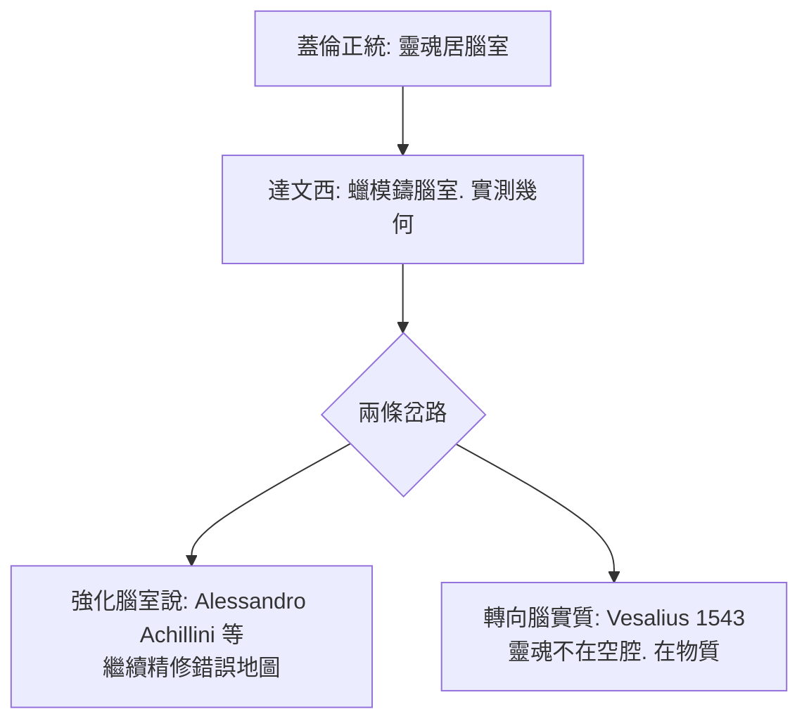

## 1504 - 達文西的蠟腦：在解剖桌上雕刻思想的位置

## 案件摘要

**本案偵破的是一個過渡時期的腦——介於蓋倫的正統與現代解剖之間。**

約 1489–1508 年，**Leonardo da Vinci（1452–1519）**在米蘭與佛羅倫斯偷偷解剖了約 30 具人屍（教會禁令之下，他的助手 Gorjies 被處絞刑的傳聞更添危險氣氛）。約 1504–1508 年，他做了一個前所未見的偵探手藝：**把熔蠟注入牛腦腦室，蠟凝固後煮掉腦組織**——人類第一個腦室鑄模（ventricular cast）。他據此畫出剖面圖，把「感受（senso comune）」安置在第三腦室、想像與記憶分列其後。這是文藝復興時期對蓋倫腦室學說（見 `0170-蓋倫腦室與動物精神.md`）最精緻的一次實測——也是它最漂亮的一次臨終合影。

## 前因 -- 為什麼會有這個案子

- **藝術家需要解剖學**。達文西為了畫準人體（如《維特魯威人》）而剖屍，卻越剖越深，從肌肉骨骼一路剖到腦與心臟——藝術需求變成科學偵查。
- **蓋倫版的官方地圖仍在流通**。15 世紀大學的解剖課是「教授高坐誦讀蓋倫，剃刀匠在下切肉」；無人親手驗證。達文西是少數「畫家兼解剖者」，眼與手皆為自己所有。
- **腦室學說的懸而未決**。靈魂功能到底裝在哪個腦室？蓋倫各版本說法不一。達文西的方法直白得驚人：**把腦室澆出來，量它**。

## 線索與推理 -- 數學式、程式、理論

**線索一：腦室鑄模法。** 流程復原如下：

```text
Step 1: 取牛腦（或人腦）. 完整保留腦膜
Step 2: 以細針從第四腦室注入熔蠟
Step 3: 蠟冷凝. 水煮溶去腦組織
Step 4: 取出腦室鑄模. 多角度描繪. 標註尺寸
```

這是**可重複的物理模型實驗**——把不可見的空間變成可測量的實物。這套「鑄模—還原—繪圖」思維，與今日的灌注固定、3D 重建血脈相連。

**線索二：他同時畫了正確的腦回，卻把功能放錯地方。** 達文西的晚期腦圖（約 1508）已經繪出**皺褶的腦回、軟腦膜、甚至疑似腦下垂體與視交叉**，解剖觀察是超前的；但功能定位仍沿用腦室三分法——把「感受共同體（senso comune）」放在腦室中軸。可見：**觀察已就位，理論還在旧房間**。



**線索三：機械式身心觀的雛形。** 達文西把神經比作繩索與槓桿、把肌腱比作滑輪系統；他在筆記中寫道：「靈魂似乎居於判斷之座，而判斷之座似乎是感官共同匯聚之處。」這種**用機器語言描述身體**的直覺，通往笛卡爾（見 `1662-笛卡爾松果腺.md`）的反射機器。

## 結案 -- 後果與影響

- **史上第一張實測腦室圖**。蠟模法成為腦室解剖的標準技術，沿用至 19 世紀。
- **解剖插圖的革命**。達文西的透視、剖面、多視角標註，把解剖圖從示意畫升級為**工程圖**；這個視覺標準由後來的 Vesalius 工作室（以版畫量產）發揚光大。
- **一個未出版的懸案**。達文西計劃的《解剖學論文》從未付梓，手稿散落；若當年出版，神經解剖學可能提前半世紀現代化——史上最著名的「未發表的破案報告」。
- **一句話結案**：達文西用一塊蠟證明了腦室的形狀，也順手暴露了學說的空洞——**量得出空間，量不出思想**；下一步只能往腦實質裡找。

## 關鍵人物與文獻

- **Leonardo da Vinci（1452–1519）**——畫家、工程師、解剖者；現存腦解剖手稿主要藏於溫莎堡皇家圖書館（RL 19127 等）。
- **Marcantonio della Torre**——帕維亞解剖學教授，達文西的計劃合作者，1511 年瘟疫早逝，合作中斷。
- 原始文獻——Windsor 手稿 RL 12603v、19127r–19128r（腦室鑄模與腦剖面圖）。
- 現代註腳——2000 年代神經史學者以 MRI 對照溫莎腦圖，確認其腦回描繪準確度遠超同代；「畫家之眼」的偵查能力經影像醫學複核後結案。
