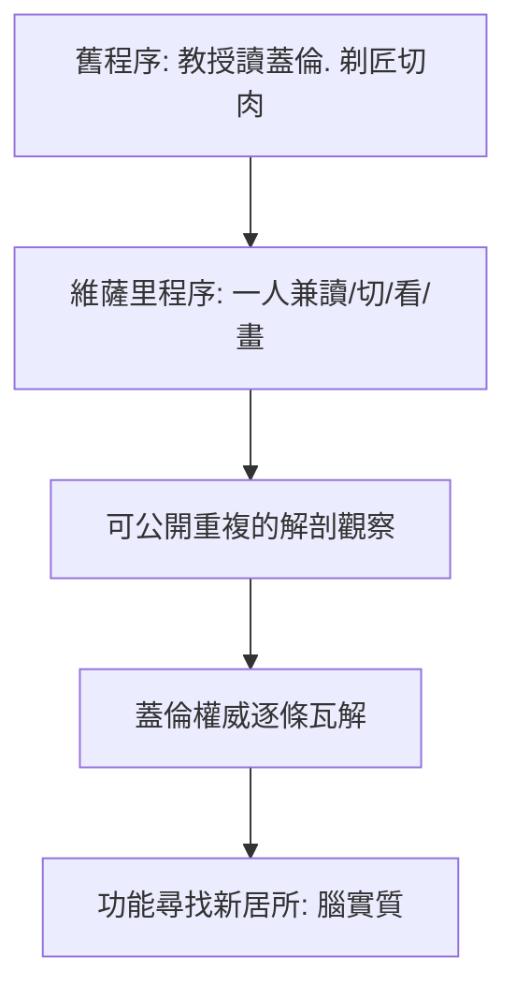

## 1543 - 維薩里《人體構造》：靈魂不在腦室，在腦的物質裡

## 案件摘要

**本案偵破的是一場長達千年的偽證案——以自己的眼睛為證物。**

1543 年，28 歲的帕多瓦大學解剖學教授 **Andreas Vesalius（維薩里，1514–1564）**在巴塞爾出版《**De humani corporis fabrica**》（《人體構造七卷》），附 200 餘幅精美木刻版畫。他在解剖台上當眾比對蓋倫（見 `0170-蓋倫腦室與動物精神.md`）的文本與眼前的屍體，逐一指出錯誤：人沒有腦細網；人的下頜是一塊骨頭而非兩塊；蓋倫的解剖來自動物而非人。神經學章節中，他重繪了腦、腦膜與神經起止，並質疑「靈魂居於腦室」——**功能應該住在腦實質裡**。這本書是解剖學的《判決書》，也是局部化論（見 `1861-BrocaTan失語症.md`）的立案前置文件。

## 前因 -- 為什麼會有這個案子

- **人體解剖的解禁與競爭**。15 世紀末起義大利大學恢復人體解剖；Padua、Bologna 各設解剖劇場，觀眾席上坐著醫生、貴族與學生——當眾驗證成為可能。
- **印刷術的放大器**。1500 年前後歐洲已能精印科學版畫；提香的威尼斯畫派可能參與了《人體構造》插圖（學界長期爭議的作者權懸案）。一本「以圖為證」的巨著，只有印刷時代才可能存在。
- **個人動機**。維薩里青年時在巴黎受教於蓋倫主義者 Guinter，親手解剖時發現文字與屍體對不上——「老師讀蓋倫，我看見另一個身體」，糾紛由此埋下。

## 線索與推理 -- 數學式、程式、理論

**線索一：蓋倫錯誤的分類偵查。** 維薩里把錯誤歸為三類，並逐一出示證據：

| 蓋倫主張 | 維薩里的觀察 | 錯誤根源 |
|---|---|---|
| 人有腦細網（rete mirabile） | 人腦無此構造；僅見於牛羊 | 以動物補人體 |
| 靈魂功能分居三腦室 | 腦室為腦脊液之腔；構造因人而異 | 理論先行 |
| 下頜兩塊、胸骨七節 | 下頜一塊、胸骨三節 | 沿用猿類解剖 |

偵查規則可寫成一句方法論：

$$ \text{若} \; \text{屍體觀察} \neq \text{文本權威} \quad\Rightarrow\quad \text{以屍體為準} $$

**線索二：對腦室學說的精準打擊。** 維薩里在第七卷指出：各腦室形狀在人群中變異甚大，與「想像、理性、記憶」的恆定功能分工並不匹配；且靈魂若是非物質的，怎會「住在」一個水腔裡？他寫道：腦的**實質（substantia cerebri）**才是器官本身——這一句話把功能定位從「空腔」搬到「組織」，是腦皮質研究的開戰宣言。

**線索三：解剖劇場的表演政治。** 《人體構造》卷首版畫：維薩里站在解剖台邊親手持刀，四周擠滿觀眾，教授席位空著。這幅構圖是一份**程序宣言**——解剖者親自動手、親眼觀察、當眾示證：

## 結案 -- 後果與影響

- **蓋倫主義的官方崩塌**。雖然蓋倫派圍攻多年（Eustachius、Falloppio 皆有反擊），到 17 世紀「以觀察修正權威」已成醫學常態——現代科學的「可重複性」原則在解剖劇場裡先成型。
- **腦實質研究的開端**。此後 Thomas Willis（1664《腦解剖學》以動物實驗定出腦動脈環）與 Malpighi 的顯微解剖接棒，「思想藏在腦組織哪裡」成為正式的科學問題。
- **作者本人的悲劇結局**。維薩里因解剖爭議遭宗教法庭調查，1564 年被迫赴聖地贖罪，途中死於希臘 Zante 島——偵探本人成為案件代價的一部分。
- **一句話結案**：維薩里沒有提出新理論，他只做了一件事——**把眼睛與屍體的證言，置於文本權威之上**；神經學從此改以實物為法官。

## 關鍵人物與文獻

- **Andreas Vesalius（1514–1564）**——布魯塞爾人，帕多瓦大學解剖學教授、查理五世與腓力二世的御醫；《人體構造》1543 巴塞爾初版、1555 修訂版。
- **Jan Stephan van Calcar**——提香門下畫家，一般認為繪製了初版多幅解剖圖（作者權仍有爭議）。
- 原始文獻——Vesalius, *De humani corporis fabrica libri septem*, Basel: Oporinus, 1543；第五卷論腦與神經。
- 現代註腳——2018 年《人體構造》初版拍出高價，其腦部版畫至今被神經解剖教科書引用；一張 1543 年的圖，仍在為 21 世紀的課堂作證。
