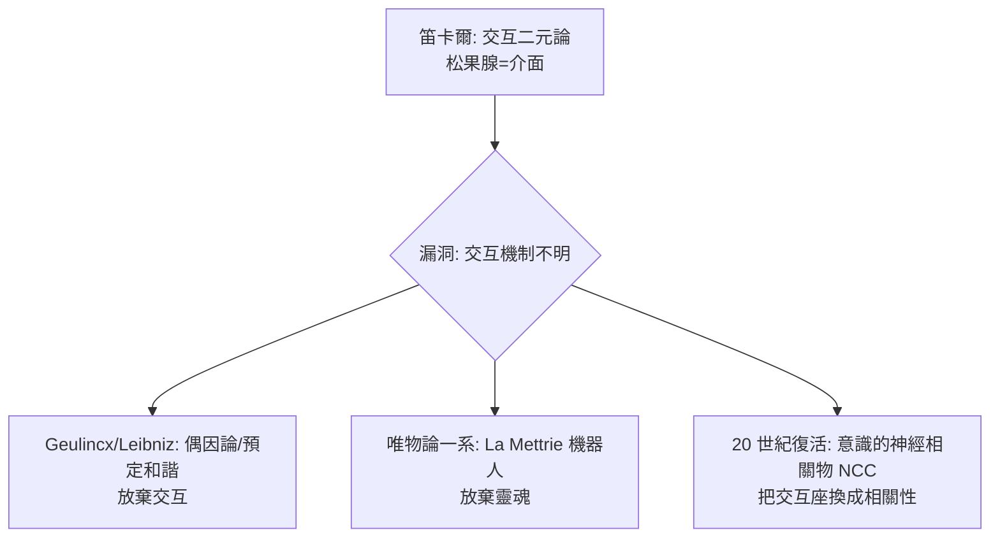

## 1662 - 笛卡爾的松果腺：把身體寫成機器，把靈魂安置在單一 Seat

## 案件摘要

**本案偵破的是一個哲學佈局——身心如何交互？笛卡爾選了一個解剖學嫌疑人：松果腺。**

René Descartes（1596–1650）在《論人》（*L'Homme*，寫於 1630 年代，因懼於伽利略案而未出版）與《論靈魂的激情》（1649）中提出：身體是一部**液壓機器**——動物靈（spiritus animales）沿神經流動，肌肉如氣缸；而靈魂與身體的交互點，位於腦中央一個小腺體——**松果腺（glandula pinealis，conarion）**。理由之一是它「單一」而非成對，而感官輸入皆是成對的（雙眼、雙耳），單一意象需要單一匯合處。1662 年拉丁譯本《De homine》附圖出版，這套「反射機器＋單一交互座」模型影響哲學與生理學兩百年。本案的兩難在於：機器模型是革命性的，而松果腺是選錯的偵查地點。

## 前因 -- 為什麼會有這個案子

- **蓋倫體系的機械化改造**。維薩里（見 `1543-維薩里人體構造.md`）已拆掉部分正統，但「動物靈沿神經流動」仍無替代品；17 世紀新科學（Galileo、Harvey 的血液循環）傾向以機械與流體解釋身體。
- **身心問題的正式立案**。基督教要求靈魂不死且非物質；機械生理學描述一切身體運動。兩者如何相遇？笛卡爾的嚴格二元論（res cogitans / res extensa）必須找到一個**交互介面**。
- **威廉·哈維的示範**。1628 年 Harvey 以定量計算證明血液循環，展示「身體可以被純物理地解釋」——笛卡爾直接借力：既然心臟是泵，腦為何不能是閥門系統？

## 線索與推理 -- 數學式、程式、理論

**線索一：反射機器的完整藍圖。** 笛卡爾在《論人》中描述的迴路：

$$ \text{感官} \rightarrow \text{神經纖維牽動腦內孔道} \rightarrow \text{動物靈改道} \rightarrow \text{神經} \rightarrow \text{肌肉（充氣收縮）} $$

他明言這套機器**不需要靈魂參與**即可完成避開火焰、退縮防衛——這是「反射（réflexion）」概念的哲學誕生，比 19 世紀的反射弧學說（見 `1822-貝爾馬根迪神經根.md`）早兩百年。

**線索二：松果腺的選址論證。** 笛卡爾的偵查邏輯（依《論靈魂的激情》§31–32）：

```text
前提 1: 意象（image）在靈魂中是單一的
前提 2: 雙眼/雙耳的輸入在腦內各成對出現
推論  : 需要一個不成對的匯合點
觀察  : 松果腺單一. 位於腦室中央. 懸於動物靈流之上
結論  : 松果腺 = 靈魂的 Seat（主要座位）
```

邏輯自洽，但有一個致命的實地核查漏洞：**松果腺其實是成對結構的融合**（西方學界要到 19 世紀才釐清），且其解剖學位置根本不「懸浮」。單一性前提本身就是錯的。

**線索三：身心交互的數學困境。** 若靈魂非物質而身體守恆，交互作用如何不違反動量守恆？笛卡爾的「腦內改向」從未給出機制，之後的 Leibniz（預定和諧）、Spinoza（身心平行）都是對這個漏洞的迴避方案：



## 結案 -- 後果與影響

- **反射概念誕生**。「刺激—中樞—反應」的機器式迴路成為神經生理學的基本語法，經 Marshall Hall 與 Sherrington（見 `1897-謝靈頓突觸.md`）精修至今。
- **神經是電纜而非水管的伏筆**。笛卡爾仍用水壓模型，但他把神經的功能完全物理化，使 Galvani 的電學解釋（見 `1791-伽伐尼動物電.md`）成為順理成章的接班。
- **松果腺成為科學史名案**。今日已知松果腺是褪黑素分泌腺、受視網膜光訊號調控——它確實接收「單一」的光暗訊息，只是與靈魂無關；笛卡爾選錯嫌疑人，卻歪打正著選中了一個感光內分泌器官。
- **二元論的長期遺產**。「精神疾病」與「身體疾病」的分科、心身醫學的邊界之爭，都活在笛卡爾劃下的界線陰影裡。
- **一句話結案**：笛卡爾最大的貢獻不是找到靈魂的座位，而是**證明身體可以不靠靈魂運轉**——反射機器一旦出廠，就再也停不下來。

## 關鍵人物與文獻

- **René Descartes（1596–1650）**——法國哲學家、數學家；《論人》草成於 1633 年前後，1650 年作者死於瑞典宮廷；1662 年 Schuyl 拉丁譯本出版、1664 年 Clerselier 法文原版出版。
- **Thomas Willis 與 Niels Stensen（Steno）**——17 世紀解剖學家，先後指出松果腺在動物中普遍存在、且非人類獨有，直接駁倒選址論證。
- 原始文獻——Descartes, *De homine* (Leiden, 1662)；*Les Passions de l'âme* (Paris, 1649)。
- 現代註腳——笛卡爾筆記中曾把松果腺與感光功能聯想（信函中論及「單眼化」感知），現代松果腺光周期研究（褪黑素）與其直覺的巧合，是本案最溫柔的註腳。
