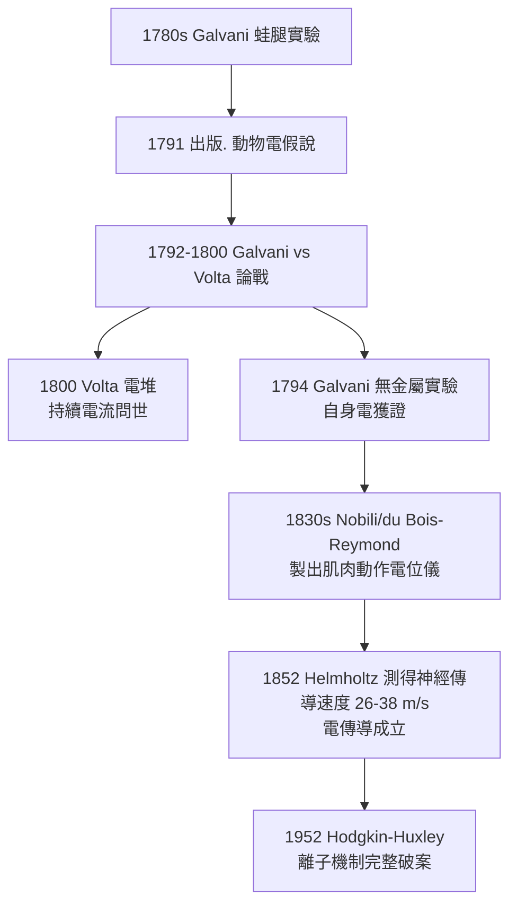

## 1791 - 伽伐尼的青蛙腿：神經裡流的是電，不是動物靈

## 案件摘要

**本案偵破的是神經傳導的物理本質——一場持續十年的「電與金屬」雙偵探對決。**

1791 年，波隆那大學解剖學教授 **Luigi Galvani（1737–1798）**出版《De viribus electricitatis in motu musculari》（《論肌肉運動中的電力》），報告了他自 1780 年代起的系列實驗：解剖的青蛙腿在銅鉤與鐵欄杆接觸時痙攣、閃電時抽搐、被他稱為「**動物電（electricitas animalis）**」的內在電力所驅動。物理學家 **Alessandro Volta** 質疑金屬才是電源，兩人的論戰意外催生了電池。本案的終審判決由 19 世紀陸續宣讀：**神經傳導是電的**——神經生理學的物理學基礎就此確立。

## 前因 -- 為什麼會有這個案子

- **萊頓瓶與靜電熱潮**。1745 年萊頓瓶問世，電學成為歐洲沙龍科學；Franklin 的風箏實驗（1752）把電從玩具變成自然哲學。電與生物體的接觸點（電鰻、電鯰）自古已知，等待統一解釋。
- **蓋倫管道模型的破產邊緣**。「動物靈沿中空神經流動」（見 `0170-蓋倫腦室與動物精神.md`）從未被觀察到流體；Hallér 學派主張肌肉有「收縮力（vis insita）」，但力是什麼？誰在傳遞？學說群龍無首。
- **蛙腿：完美的偵探器材**。蛙的神經—肌肉標本（neuro-muscular preparation）小、敏感、易保存，可以在桌上重複刺激——伽伐尼家用餐桌上的青蛙，成為史上產出最高的神經實驗平台。

## 線索與推理 -- 數學式、程式、理論

**線索一：三組對照實驗。** Galvani 筆記中的偵查序列：

```text
實驗 A（1780.11.6）: 解剖桌上蛙腿旁起電機放電 → 蛙腿抽搐（即使未連接）
實驗 B（1786 前後）: 銅鉛蛙腿吊在鐵欄杆. 風吹接觸 → 反覆痙攣（無起電機!）
實驗 C: 只用一種金屬接觸 → 不痙攣
```

由 C 可推得金屬「兩種以上」是必要條件——這正是後來 Volta 攻擊的破口，也是 Galvani 陣營內部（侄子 Aldini）未察覺的證據裂縫。

**線索二：兩位偵探、兩種理論。**

$$ \text{Galvani: } \; V_{\text{金屬弧}} \; \text{只是「放電迴路」} \; \Rightarrow \; \text{電源在動物組織內部（動物電）} $$
$$ \text{Volta: } \; V_{\text{迴路}} = V_{\text{異種金屬接觸}} \; \Rightarrow \; \text{電源在金屬，生物只是靈敏檢流計} $$

兩人都對了一半：Volta 正確指出異種金屬接觸產電（1800 年據此造出電堆，**電池**誕生）；Galvani 的天才在於 1794 年的**「無金屬實驗」**——把蛙的神經斷端直接搭在肌肉傷面上，同樣引發痙攣。無金屬參與而電仍在，動物組織自身的電被當場人贓並獲。

**線索三：理論的接力表。**



## 結案 -- 後果與影響

- **神經生理學的物理化**。神經從「精神水管」變成「導電電纜」；此後 Hermann、du Bois-Reymond 的電生理學、Caton 的腦電（見 `1929-Berger腦電圖.md`）、Hodgkin–Huxley 的離子通道（見 `1952-HodgkinHuxley動作電位.md`）都在這條電纜上施工。
- **電池的意外誕生**。論戰的直接副產品是 Volta 電堆——持續電流使人類能做電解、電磁學；神經科學的一場爭議，照亮了整個 19 世紀物理學。
- **電刺激療法與哥德式想像**。Galvani 之侄 Aldini 公開用電流使死刑犯屍體面部抽動（1803 倫敦），成為 Mary Shelley《科學怪人》（1818）的靈感來源之一——科學案卷裡最戲劇性的文化遺產。
- **一句話結案**：蛙腿抽搐了十幾年，最終判定——**神經裡流的不是靈魂，是離子**；「動物電」這個名字錯了形容詞，對了名詞。

## 關鍵人物與文獻

- **Luigi Galvani（1737–1798）**——波隆那解剖學教授；妻子 Lucia Galeazzi（同為科學家）深度參與實驗，貢獻長期被忽略。
- **Alessandro Volta（1745–1827）**——帕維亞物理學教授；1800 年發明電堆；電壓單位伏特以其命名。
- **Giovanni Aldini（1762–1834）**——Galvani 之侄，把電流實驗推向公開表演與醫療應用。
- 原始文獻——Galvani, *De viribus electricitatis in motu musculari commentarius*, Bologna, 1791；Volta 致 Royal Society 信（1800）。
- 現代註腳——1950 年代 Hodgkin–Huxley 以烏賊巨大軸突破案後，科學史為 Galvani 平反：他的「內在電」就是跨膜電位；一場兩百年的案件，以正名結案。
