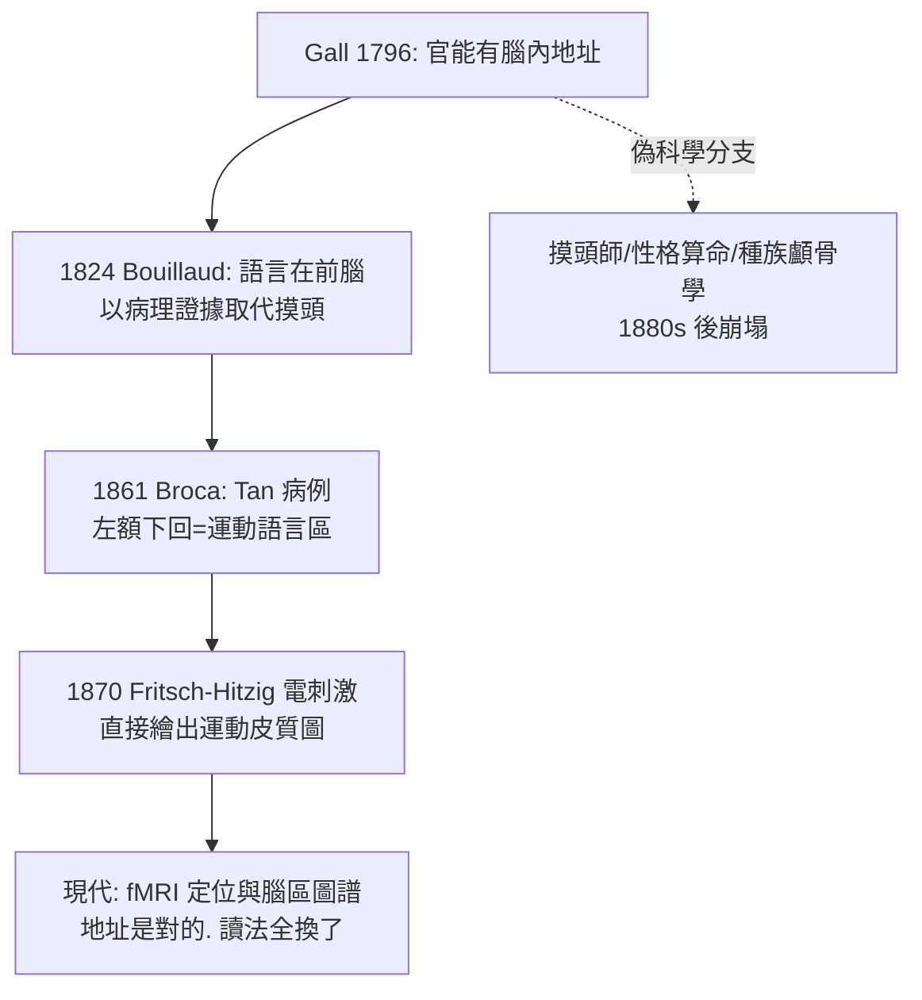

## 1796 - 顱相學：一次大規模的「以頭形讀心」錯誤起訴

## 案件摘要

**本案是一樁被正確起訴、錯誤定罪的懸案——兇手（局部化論）最終落網，但辦案手法（顱相學）被判定程序違法。**

1796 年前後，維也納醫師 **Franz Joseph Gall（1758–1828）**開始在沙龍與講堂宣講他的「顱骨學（craniology，後由助手 Spurzheim 命名為 phrenology 顱相學）」：腦是心靈的器官；心靈由數十種獨立「官能（faculties）」組成；**官能發達之處腦組織肥大，推擠顱骨形成隆起**——因此摸頭骨即可讀出一個人的性格與才能。這套學說風靡歐美半世紀，養出職業「摸頭師」與數百萬份頭型圖譜；科學界最終將其判為偽科學——但它對「**功能在腦上有地址**」的堅持，意外為 Broca（見 `1861-BrocaTan失語症.md`）時代的科學局部化論鋪了路。

## 前因 -- 為什麼會有這個案子

- **心靈哲學的官能心理學**。18 世紀蘇格蘭學派（Thomas Reid 等）把心靈分為理智、意志等官能——但官能只存在於哲學課本，沒有人問過「官能住在腦的哪裡」。Gall 宣稱他來補這個地址。
- **一個小學的記憶**。Gall 自述七歲時注意到記憶力強的同學**眼睛特別凸出**，成年後又觀察到善於言辭者眉骨發達——「器官越大，功能越強」的直覺由此萌生。
- **主流的阻力**。笛卡爾傳統視心靈為統一、非物質；Gall 宣稱人格可被顱骨幾何學測量，等於把靈魂拆成零件出售，宗教與哲學界同聲討伐；1802 年奧皇禁止其講學，Gall 遂巡迴全歐。

## 線索與推理 -- 數學式、程式、理論

**線索一：Gall 的「偵查五原則」（比其結論更長壽）。**

```text
1. 心智功能是腦這個器官的產物
2. 腦由多個獨立器官（官能中樞）組成
3. 各器官大小與功能強度相關
4. 顱骨形狀反映其下腦組織的外形
5. 據此可由顱骨外部讀取內部功能
```

原則 1–3 後來被證明基本正確（見 Broca、Fritsch–Hitzig、現代認知神經科學）；原則 4–5 是致命錯誤——**顱骨不會隨腦回發育而隆起**，外殼與內容之間隔著硬腦膜與腦脊液，這個「間接讀取」注定失真。

**線索二：26 個官能的圖譜與其取證方式。** Gall 與 Spurzheim 劃定破壞性官能（殺戮、偷竊、情慾）與智性官能（語言、數字、比較）共 26–35 區。其「證據」是：個案頭型＋性格的對照收集。形式上像流行病學，實則**選擇偏差**無控制：

| 取證步驟 | 缺陷 |
|---|---|
| 收集罪犯頭型 | 無常人對照組 |
| 事後解讀隆起 | 事後歸因（HARKing） |
| 案例不符即另立新區 | 不可證偽 |

**線索三：它先錯了方法，卻問對了問題。** 顱相學的遺產鏈：



## 結案 -- 後果與影響

- **局部化論的粗暴開路者**。正是因為 Gall 把「功能有腦內地址」喊得家喻戶曉，1820–1860 年的臨床醫師才會去**找地址**——Flourens 以鳥類切除實驗反駁顱相學（主張腦整體等能），反而促使 Broca 用人類臨床病例完成科學版的局部化。
- **偽科學的社會傷害**。19 世紀中葉起，顱相學被用於篩選移民、罪犯與殖民地的「劣等民族」，與後來的犯罪人類學（Lombroso）合流；其頭型讀心法為科學種族主義提供了模板。
- **人格測量的執念**。「以外部指標量化人格」的慾望並未死去——它換了儀器（從卡尺換成問卷與演算法）繼續存在。
- **一句話結案**：顱相學錯在**量錯了東西**（頭殼而非腦），錯在**無法被證偽**；但它押下的核心賭注——思想有解剖學地址——最終由更嚴謹的偵探兌現。錯誤的方法，偶然押中正確的方向。

## 關鍵人物與文獻

- **Franz Joseph Gall（1758–1828）**——維也納出身、巴黎定居；與學生 Spurzheim 巡迴歐洲演講；墳墓刻著「感謝上蒼，我未曾奉承任何人」。
- **Johann Christoph Spurzheim（1776–1832）**——助手與宣傳家，創造 phrenology 一詞；1832 年在波士頓講學中死於傷寒，意外把顱相學播種到美國。
- **Marie-Jean-Pierre Flourens（1794–1867）**——法國實驗生理學家，以鴿腦切除實驗主張「大腦整體等能」，成為局部化論的臨時反派。
- 原始文獻——Gall & Spurzheim, *Anatomie et physiologie du système nerveux*, Paris, 1810–1819；Gall, *Sur les fonctions du cerveau*, 1822–1825。
- 現代註腳——神經史學界現在承認 Gall 對灰白質分層、神經交叉等貢獻（他以解剖學聞名於當時）；本書將其定位為「方法錯誤的方向盤」。
