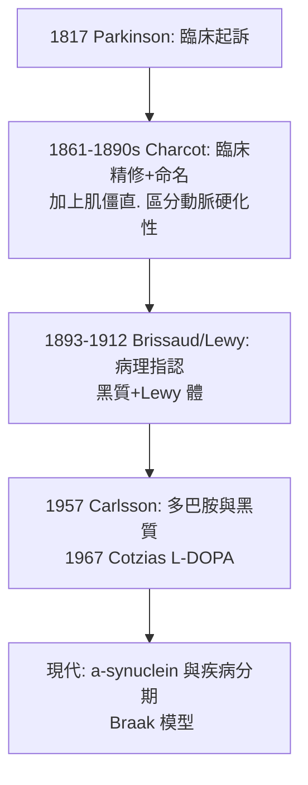

## 1817 - 巴金森的《論震顫性麻痺》：一個倫敦醫師在街上跟蹤病人

## 案件摘要

**本案偵破的是一種病的「出生證明」——純粹靠觀察，一針藥都沒有。**

1817 年，倫敦外科醫師 **James Parkinson（1755–1824）**自費出版 66 頁小冊《**An Essay on the Shaking Palsy**》（《論震顫性麻痺》），首次把一組症狀——靜止性震顫、姿勢前傾碎步、起步困難、進行性加重——定義為**一個獨立疾病實體**，而非老年衰弱或各種雜症。為了觀察病人，他在街道與市集**跟蹤病人數條街**，記下他們的步態與姿勢。46 年後，Charcot 為這個病正式命名為 **Parkinson's disease（巴金森病）**；又過 140 年，L-DOPA（見 `1967-左多巴療法.md`）讓「以觀察起訴的病」第一次得到化學答辯。

## 前因 -- 為什麼會有這個案子

- **18 世紀的症狀大雜燴**。「震顫」被混在癱瘓、風濕、酒精性顫抖中；《大英百科》當時把 tremor 與 paralysis 綁定敘述。要起訴一個「新病」，必須先證明它**不是**別的病。
- **倫敦的流行病學現場**。工業化城市人口老化、鉛與錳職業暴露、擁擠街道——Parkinson 作為醫療改革者（曾為精神病院撰文揭弊、參與政治激進運動），習慣以公共視角收集病例。
- **Galen 以來的分類空轉**。古代醫學把震顫歸為體液失調；沒有病理標本、沒有顯微鏡，唯一可用的證據只有**臨床現場**——Parkinson 選擇把街道當作解剖台。

## 線索與推理 -- 數學式、程式、理論

**線索一：六個病例的臨床定義。** Parkinson 依「偵探三段法」起訴：

```text
不隨意運動 (involuntary tremulous motion) - 減力但不完全癱
特徵: 靜止時明顯. 動作時減輕. 持續進行
伴隨: 軀幹前傾. 步態由走轉跑(前衝). 感覺與智力"未受侵犯"(部分誤判)
病程: 隱匿起病. 進行性. 不可逆
結論: 這是一個獨立的疾病實體. 命名 "Shaking Palsy"
```

其中「智力未受侵犯」的判斷有誤（巴金森病可伴認知退化），但在無腦影像、無神經病理的年代，以可觀察的行為劃界，已是當時證據的極限。

**線索二：跟蹤取證法。** Parkinson 自述病例多「以眼睛捕獲於街頭」——他的敘事如偵探尾隨：

| 觀察項 | Parkinson 的記錄 | 現代對應 |
|---|---|---|
| 震顫 | 靜止時「如抓揉麵團」 | 靜止性震顫（搓丸樣） |
| 姿勢 | 「頸與軀幹前屈」 | 屈曲姿勢 |
| 步態 | 「越走越快. 幾乎小跑」 | 慌張步態（festination） |
| 起步 | 「第一步極難邁出」 | 凍結步態 |

**線索三：病理的缺席與百年懸案。** Parkinson 承認自己無法回答「病灶在哪」——他把病理假說謙虛地留給後人。這個空位由三代偵探填補：



## 結案 -- 後果與影響

- **疾病實體觀念的示範**。「以臨床特徵叢界定一種病」的方法成為神經病學的標準動作；Charcot 的臨床教學（見其 Salpêtrière 學派）直接繼承這份卷宗。
- **一個病名的社会認同**。Charcot 以 Parkinson 之名命名，使一個自費小冊的作者成為醫學史上最常被念出的姓氏之一。
- **藥理學的長跑起點**。從 1817 的描述到 1967 的 L-DOPA，恰好一百五十年——「先有病歷、後有藥」的時間差，正是臨床神經學與神經科學之間的距離。
- **一句話結案**：Parkinson 沒有顯微鏡、沒有病理室，只有眼睛與倫敦的街道；他證明了一件事——**在儀器到來之前，好的觀察也能立案**。

## 關鍵人物與文獻

- **James Parkinson（1755–1824）**——倫敦 Shoreditch 外科醫師、藥師；政治激進分子（曾因同情法國大革命涉案被傳喚）；亦撰化石學著作，林奈學會會員。
- **Jean-Martin Charcot（1825–1893）**——巴黎 Salpêtrière 醫院神經學奠基者；1860s–80s 精修本病並正式命名 Parkinson's disease；其學生包括 Freud 與 Babinski。
- 原始文獻——Parkinson, *An Essay on the Shaking Palsy*, London: Whittingham & Rowland, 1817（現存首版不足百冊，2010 年代拍出高價）。
- 現代註腳——2005 年起神經病理學界以 Braak 分期重建病程（嗅球→延髓→黑質→皮質），解釋了 Parkinson 當年觀察到的前驅症狀順序；1817 年的街道觀察，在電子顯微鏡時代仍是第一手證詞。
