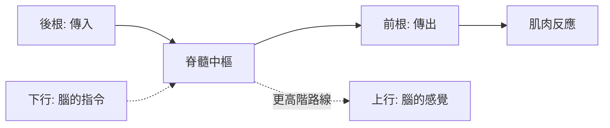

## 1822 - 貝爾–馬根迪定律：脊髓的兩條根，一條上山一條下山

## 案件摘要

**本案偵破的是神經系統的第一條「單向交通法規」——感覺與運動各有專用車道。**

1811 年 Charles Bell 私印小冊（供 30 冊）提出脊神經後根與感覺相關；1822 年法國生理學家 **François Magendie（1783–1855）**發表決定性實驗：切斷小狗脊神經**後根**→肢體**失去感覺但仍能動**；切斷**前根**→肢體**完全癱瘓但觸之有痛覺反應**。合併為 **Bell–Magendie 定律：後根管感覺（傳入），前根管運動（傳出）**。這是實驗生理學對神經系統的第一條硬定律，反射學說（見 `1897-謝靈頓突觸.md`）與 Bell 的「兩條路線」成為 19 世紀神經科學的公路系統——也引爆了一場持續百年的發現權之爭。

## 前因 -- 為什麼會有這個案子

- **蓋倫的模糊遺產**。蓋倫已知前後根粗細不同（前硬後軟），猜測功能有別，但未實驗；1700 年代各種「神經力」學說無法被證偽（見 `1791-伽伐尼動物電.md` 之前的僵局）。
- **Bell 的解剖直覺**。Bell 觀察後根連於脊髓背角、前根連於前角，灰質形狀不同，直覺「構造不同，功能必不同」——但他 1811 年的小冊《Idea of a New Anatomy of the Brain》僅印 100 冊、只送友人 30 冊，且未做清楚的前後根分別切斷實驗。
- **法國實驗生理學的崛起**。Magendie 標榜「不迷信理論、只做實驗」；他與 Claude Bernard 一脈，把生理學從沙龍帶進手術台——他有設備、有活體、有發表管道。

## 線索與推理 -- 數學式、程式、理論

**線索一：Magendie 的十字路口實驗（1822, 《Journal de physiologie》）。**

```text
Setup: 狗. 暴露腰椎脊神經根
Case 1: 切斷後根(背根) → 肢體運動仍在. 但針刺/燒灼無反應(痛覺消失)
Case 2: 切斷前根(腹根) → 肢體完全癱瘓. 但針刺仍見對側/反射性退縮(感覺仍在)
Case 3: 兩根皆切 → 完全失聯. 肢體成死路
```

以訊號流圖表示：

$$ \text{皮膚} \xrightarrow{\text{後根(傳入)}} \text{脊髓} \xrightarrow{\text{前根(傳出)}} \text{肌肉} $$

**線索二：誰先發現？——優先權的偵查。** Bell 主張其 1811 小冊已言明後根司感覺；但史家翻查原冊，Bell 只論及後根與感覺的**解剖關聯**，明言前根司運動的證據要到 1820 年代補述，且無活體切斷對照。Magendie 則有一攬子可重複實驗。法庭式結論：

| 證據項 | Bell (1811) | Magendie (1822) |
|---|---|---|
| 解剖觀察（後根連感覺路線） | ✅ | ✅ |
| 前根司運動的明文主張 | 模糊/後補 | ✅ |
| 分別切斷的活體對照實驗 | ❌ | ✅ |
| 可重複、有發表 | ❌ | ✅ |

**線索三：反射弧的下一步。** 定律立起後，「刺激—中樞—反應」的迴路有了合法車道：



這張圖在 1840 年代由 Marshall Hall 命名為「反射弧（reflex arc）」，在 Sherrington 手中被補上最後一塊拼圖——突觸。

## 結案 -- 後果與影響

- **神經功能的交通法規確立**。「傳入/傳出」二分成為神經解剖學的基本座標，所有後續定位（皮質運動區、感覺區、脊髓束）都以此為網格。
- **動物實驗倫理的第一案**。Magendie 以「活體解剖的殘酷冷靜」聞名（同代稱之「活體解剖王子」）；英國 1876 年《防止動物殘酷法》的立法辯論中，他的實驗是正反雙方共同引用的案例。
- **優先權之爭的範本**。Bell 與 Magendie 的爭執延續到 20 世紀史學訴訟；本書依證據標準將「定律」歸於兩人並列——科學史上「先喊」與「先證」的分野自此有了判例。
- **一句話結案**：後根上山（感覺進腦），前根下山（命令出肢）；Magendie 的小狗替人類神經學畫出了第一張單行道地圖。

## 關鍵人物與文獻

- **Charles Bell（1774–1842）**——蘇格蘭外科醫師、解剖插畫家（自己作圖）；另有 Bell 面神經麻痺之名傳世。
- **François Magendie（1783–1855）**——法國實驗生理學之父；1846 年率先以嗎啡皮下注射；學生 Claude Bernard 稱其方法為「生理學的歸納法」。
- 原始文獻——Bell, *Idea of a New Anatomy of the Brain*, London, 1811（私人印行）；Magendie, « Expériences sur les fonctions des racines des nerfs rachidiens », *Journal de physiologie expérimentale*, 1822。
- 現代註腳——20 世紀末胚胎學研究發現運動神經元的軸突引導（netrin 等）機制，恰與前後根的早期發育差異呼應：交通法規在胚胎期就已立法。
