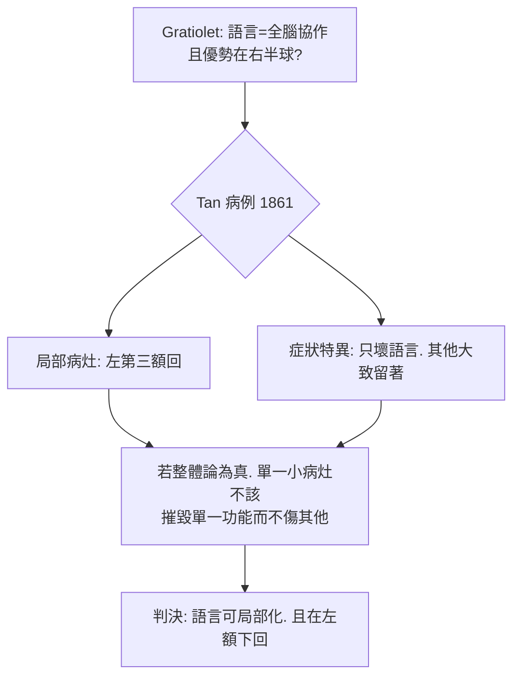

## 1861 - Broca 的病人「Tan」：一句話失語症與語言的腦內地址

## 案件摘要

**本案的死者只會說一個音節；兇手是他左腦的一處病變；偵探靠一場醫學會議的賭注破案。**

1861 年 4 月，巴黎 Bicêtre 醫院收容一位 51 歲、病名「Tan」的長期住院病人——他自 21 歲起喪失語言能力，**唯一能發的音是「Tan」**（配以手勢），但聽力、智力與右半身癱（晚年）俱全。外科醫師 **Paul Broca（1824–1880）**為了反駁外科名醫 Gratiolet 的「語言分散全腦」說，宣稱：若語言有局部病灶，必在**左額葉第三額回**。Tan 於 4 月 17 日死亡，翌日 Broca 解剖：**左第三額回後部軟化囊腫**，其餘腦組織大致完好。病例以「Impairment of speech as a consequence of a lesion of the third left frontal convolution」提交人類學會——運動性失語與 Broca 區自此誕生，局部化論（見 `1796-顱相學.md` 的科學版）正式定讞。

## 前因 -- 為什麼會有這個案子

- **顱相學敗訴後的真空**。Flourens 的整體論（鳥類切除實驗）在學術界居上風；「人類高級功能不可定位」成為正統。Gall 雖錯了方法，卻把「語言在額葉」喊了半世紀——科學界既不齒其摸頭，又無法完全駁倒其個案收集。
- **Bouillaud 的預告**。1825 年法國醫師 Bouillaud 依臨床病例主張語言中樞在額葉，並於 1848 年「打賭」：若有人提出額葉損傷而不失語的反例，願付賭金。這場賭局懸了十三年。
- **人類學會的舞台**。1860 年代巴黎人類學會（Broca 為創會秘書）以實證材料為辯論單位，是「臨床—病理配對」方法的最佳法庭。

## 線索與推理 -- 數學式、程式、理論

**線索一：臨床—病理配對法。** Broca 的偵查公式：

$$ \text{症狀 } S \; \text{恆伴隨病灶 } L \;\Rightarrow\; S \text{ 的功能位於 } L $$

Tan 病例的配對項目：

```text
保留: 聽力正常/理解指令/非口語交流(手勢.表情)/記憶智力大體完好
喪失: 主動性口語(僅 Tan 與髒話等自動語言)
解剖: 左第三額回後 1/3 軟化. 同側側腦室擴大. 右半球完好
```

**線索二：為什麼是「左」腦？——Broca 當年自己也不敢多說。** 他收集了後續多例，1863 年報告 8 例中 7 例病灶在左；1865 年正式提出「我們用左半球說話（nous parlons avec l'hémisphère gauche）」——偏側化的第一次科學陳述。Tan 的對側肢體癱瘓（右癱）提供了內部一致性：左腦傷→右癱＋失語，兩條線索匯於同側。

**線索三：與 Gratiolet 的法庭對決。**



Broca 的勝訴關鍵不在解剖，而在**邏輯**：整體論無法解釋「為何恰好是這一處的損傷，恰好只壞這一種功能」。

## 結案 -- 後果與影響

- **局部化論的科學定讞**。「臨床症狀＋病灶定位」成為神經病學的標準偵查法（如 Wernicke 1874, 見 `1874-Wernicke感覺性失語.md`）；Fritsch–Hitzig 的電刺激（見 `1870-電刺激運動皮質.md`）以更主動的手段接手擴圖。
- **失語症學的誕生**。運動性（Broca）失語：「懂但不會說」；兩年後 Wernicke 補上感覺性失語：「會說但不懂」——語言的神經解剖學大廈在十年內立起骨架。
- **自動語言 vs 意志語言的懸案**。Tan 仍能罵髒話、唱熟歌——這條線索指向基底核與內側額葉的「自動語言迴路」，要到 20 世紀才被接案。
- **一句話結案**：一個只會說「Tan」的病人，替全人類說出了最重要的一句話——**語言住在左額下回**；思想的地圖，自此開始有了經緯度。

## 關鍵人物與文獻

- **Paul Broca（1824–1880）**——巴黎外科醫師、人類學會創辦人；亦研究人類學與腫瘤學；其「Tan」標本保存於巴黎 Dupuytren 博物館。
- **Louis-Victor Leborgne（「Tan」, 1809–1861）**——鞋匠之子、癲癇病人、住院 31 年；死於蜂窩性組織炎與敗血症；他的腦是神經科學史上最著名的一件物證。
- **Achille-Louis Foville / Ernest Auburtin**——額葉語言論的前後輩；Auburtin 在 1861 年 4 月會議上宣稱「給我一位額葉損傷而不失語的病人，我放棄學說」——Tan 恰好次日送達，成為科學史上最戲劇性的「願者上鉤」。
- 原始文獻——Broca, « Perte de la parole, ramollissement chronique et destruction partielle du lobe antérieur gauche du cerveau », *Bulletin de la Société d'anthropologie*, 1861。
- 現代註腳——2007 年 Dronkers 等以 MRI 重掃 Leborgne 保存之腦，發現病灶深處尚累及**內囊與紋狀體**——Broca 區並非唯一兇手；百餘年後的「重新驗屍」修正了判決書，但未推翻定讞。
