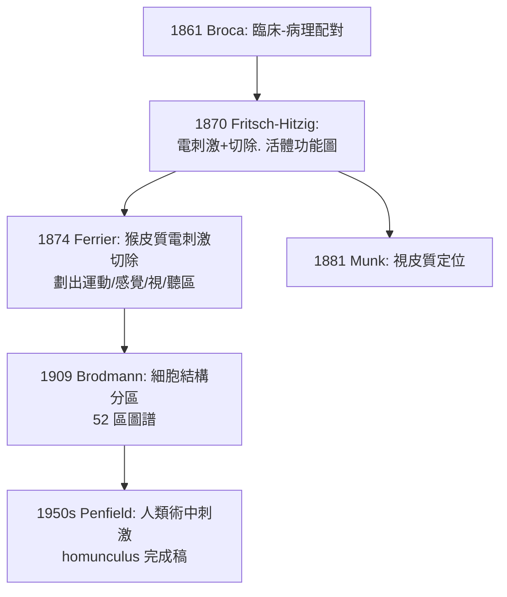

## 1870 - 電刺激運動皮質：以電當問訊員，直接審問腦皮質

## 案件摘要

**本案偵破的是「運動皮質」這個組織的存在——不用等病人受傷，主動把問題打進腦裡。**

1870 年春，柏林軍醫 **Gustav Theodor Fritsch（1838–1927）**與生理學家 **Eduard Hitzig（1838–1907）**以正弦電流刺激**清醒狗的暴露大腦皮質**：刺激額葉特定部位，對側肢體規律收縮；刺激越強，越靠近癲癇。他們在《柏林生理學院檔案》發表《論大腦的電可興奮性》，畫出史上第一張**運動皮質功能圖**——以實驗手段確認 Broca 臨床法（見 `1861-BrocaTan失語症.md`）指向的局部化論，並把「定位」從病理解剖推進到**活體電生理**。

## 前因 -- 為什麼會有這個案子

- **直流 vs 感應電流的百年爭議**。19 世紀中葉多數生理學家相信皮質「不可興奮」（Du Bois-Reymond 等刺激無效）；失敗的原因之一是用了直流或過強電流。Hitzig 來自陸軍電療經驗，善於掌握「剛好會引發反應」的電量。
- **埋線與草地的傳說場景**。Hitzig 自述在替傷兵電療時，曾以電極接觸頭皮引發對側眼動——「皮質可以從外面被叫醒」的直覺由此而來；兩人最初的實驗據說在 Hitzig 柏林家中**梳妝台前的草地**上做（助手太太縫紉的梳妝台），後才轉入實驗室。
- **Broca 與 Gage 的鋪墊**。臨床—病理配對（1861、1848）已證明局部功能存在；但解剖法是被動偵查——Fritsch–Hitzig 首次**主動審問**。

## 線索與推理 -- 數學式、程式、理論

**線索一：可興奮性判準。** 判定「皮質運動點」的三項標準：

```text
(1) 閾值電流下即有規律肌肉收縮
(2) 部位對應: 刺激皮質某點 → 對側特定肌群(可重複)
(3) 摘除該皮質區 → 對應肌群選擇性麻痺
```

其中 (2)＋(3) 構成「因果閉環」：刺激陽性＋切除缺陷，比單純病理相關強得多。

**線索二：對側性與身體地圖的初稿。** Fritsch–Hitzig 發現興奮點集中在狗腦**十字溝（cruciate sulcus）前緣**，且呈現粗略的**體位對應（somatotopy）**——後肢點在後、前肢點在前。以現代符號寫出皮質—肌肉映射：

$$ M : \text{皮質座標} \,(x,y) \longmapsto \text{對側肌群} \quad \text{且} \; M \text{ 為連續圖（近乎保序）} $$

這條「保序映射」線索，1874 年被英國神經科學家 Jackson 以臨床癲癇「進行性麻痺」（Jacksonian march，抽搐沿身體順序擴散）獨立佐證，最終由 Penfield 的人類電刺激圖（1930s–50s）畫成著名的小矮人（homunculus）。

**線索三：方法論的接力賽。**



## 結案 -- 後果與影響

- **實驗神經學取代病理推論**。電刺激＋局部切除成為 19 世紀末神經科學的主力工具；Ferrier 以猴腦細圖震撼 1881 年倫敦國際醫學會議，外科神經定位（如腦腫瘤手術）由此可能。
- **癲癇外科的理論基石**。Jacksonian march 與皮質電刺激圖匯流，催生 1886 年 Horsley 的首例皮質癲癇灶切除術——神經外科從此立案。
- **對整體論的最後一擊**。Flourens 學派的等能論在可重複的電刺激面前潰退；神經功能從「哲學問題」轉為「工程地圖」。
- **一句話結案**：Fritsch 與 Hitzig 證明——**不必等腦壞掉才認識腦**；把電極當作問訊筆，皮質會自己招供身體地圖。

## 關鍵人物與文獻

- **Gustav Theodor Fritsch**——柏林醫師、人類學家，後以攝影與人種學聞名。
- **Eduard Hitzig（1838–1907）**——軍醫出身的生理學家，後任 Halle、Zürich 教授；晚年從事精神醫學，是「腦與心智橋樑」的信徒。
- 原始文獻——Fritsch & Hitzig, « Über die elektrische Erregbarkeit des Grosshirns », *Archiv für Anatomie, Physiologie und wissenschaftliche Medicin*, 1870。
- 現代註腳——今日的經顱磁刺激（TMS, 1985–）與皮質內微刺激陣列（腦機介面, 見 `2006-腦機介面BrainGate.md`），都是這場 1870 年草地實驗的直系後裔：人類仍在用「電」審問皮質。
