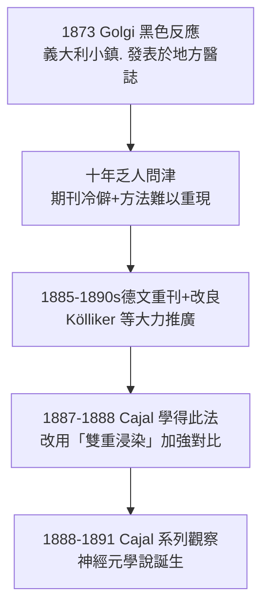

## 1873 - 高基的黑染法：在濃湯裡讓一根神經元自己現形

## 案件摘要

**本案偵破的是一個方法學奇蹟——為了看清腦組織，先讓它幾乎全黑，再讓極少數細胞「自己點燈」。**

1873 年，義大利小鎮醫院（Abbiategrasso 療養院）的年輕主治醫師 **Camillo Golgi（1843–1926）**在自家簡陋廚房實驗室裡，把腦組織浸入**重鉻酸鉀**硬化後，再浸入**硝酸銀**溶液——奇蹟發生：**全片組織染成渾濁的黃褐色，但隨機只有極少數（約 1–5%）神經元被完全染黑**，包括所有纖細的樹突與軸突，一根一根浮現在黑色霧靄中。這就是 **「黑色反應（reazione nera）」/ 高基染色法**。若染出全部細胞，切片將是一團無法判讀的墨漬；「隨機稀染」反而讓單一神經元的完整形體首次現形——這個方法直接餵養了 Cajal 的神經元學說（見 `1888-Cajal神經元學說.md`），並引發 1906 年諾貝爾獎最著名的對決（見 `1906-高基與Cajal諾獎之爭.md`）。

## 前因 -- 為什麼會有這個案子

- **網狀學派的顯微困境**。1870 年代的腦切片是「細胞太密、突起太細」：Gerlach 主張神經纖維交織成連續的網（reticulum），Max Schultze 以為突起彼此融合——顯微鏡下確實看不出界線，**網狀論是對當時影像的合理解釋**。
- **染色技術的軍備競賽**。Carmine、osmium、aniline 染料相繼問世（見 `../性病的歷史/1910-埃爾利希洒爾佛散606.md` 中染料工業的背景），但皆染「細胞核」或「成片」，無法染出神經元全形。Golgi 自 1870 年代初即在 Verbania 一帶的小醫院自行摸索。
- **小鎮醫院的意外優勢**。Golgi 遠離大學中心、設備極差——正因資源少，他致力於「用最少標本看清最多結構」；廚房爐台上的慢火硬化，成就了史上最幸運的配方。

## 線索與推理 -- 數學式、程式、理論

**線索一：配方的偵查還原（1873 年版）。**

```text
Step 1: 新鮮腦組織 2mm 塊 → 2-5% 重鉻酸鉀中硬化 6-8 週(暗處)
Step 2: 轉入 0.5-1% 硝酸銀溶液 2-3 天(緩慢沉澱)
Step 3: 酒精脫水. 火棉膠包埋. 薄切(20-40 μm)
Step 4: 觀察: 全片黃褐霧狀 + 極少數神經元全黑(含全部突起)
```

化學本質要到 20 世紀末才釐清：Ag⁺ 沉積在個別神經元的粒線體與細胞質中形成氧化銀/磷酸銀結晶——**「隨機稀染」機制至今仍無完全定論**，是本案唯一的未結卷宗（「為何只有少數細胞現形」仍是懸案）。

**線索二：Golgi 自己讀出了錯誤結論。** 方法是對的，判讀是錯的：Golgi 看到突起連成一片，認定**神經纖維融合成連續網**（改良網狀論），甚至認為樹突是營養器官、軸突才傳導。偵查過程中「器材說謊」的典型案情——

| 觀察事實 | Golgi 的解讀 | Cajal 的解讀（1888+） |
|---|---|---|
| 突起細而相鄰 | 融合成網 | 相鄰但不相連（有縫隙） |
| 染色顆粒 | 纖維連續的證據 | 隨機稀染的假象限制 |
| 樹突大量分支 | 營養結構 | 訊號接收天線 |

**線索三：方法的傳播奇蹟。**



## 結案 -- 後果與影響

- **神經解剖學的第一把萬能鑰匙**。此後 50 年，幾乎所有重要神經元型態（Purkinje 細胞、錐體細胞、星狀細胞）都以高基染色描繪；Cajal 的巨著《人與脊椎動物神經系統的精細結構》（1899–1904）全靠此法。
- **「少即是多」的方法論格言**。高基染色法教會神經科學一件事：**看清結構的方法，可以犧牲通量換取清晰**——單細胞電生理、螢光標記（Golgi 法至今仍用於稀疏標記）一脈相承。
- **諾獎同台的反諷**。1906 年 Golgi 與 Cajal 共獲諾貝爾獎——發明方法的人與推翻他理論的人同台領獎，且 Golgi 致辭仍在為網狀論辯護（見 `1906-高基與Cajal諾獎之爭.md`）。
- **一句話結案**：高基的偵探天才在於**讓證據自己選擇性現身**；可惜他讀錯了自己拍下的照片——顯微鏡拍得出神經元，讀懂照片需要另一雙眼（Cajal 的眼）。

## 關鍵人物與文獻

- **Camillo Golgi（1843–1926）**——帕維亞大學教授、諾貝爾獎得主；另發現高基體（1898，細胞器）、瘧疾與發燒週期的關係；義大利參議員。
- 原始文獻——Golgi, « Sulla struttura della sostanza grigia del cervello », *Gazzetta Medica Italiana—Lombardia*, 1873（初刊於地方醫誌，沉寂十年）。
- 現代註腳——2010 年代研究顯示高基法染上的是「膜性細胞器系統」，稀染率與組織含水量、浸泡時間相關；這個 19 世紀的廚房配方，至今沒有一份能完全解釋自己的化學機理——科學史上最浪漫的未解配方。
