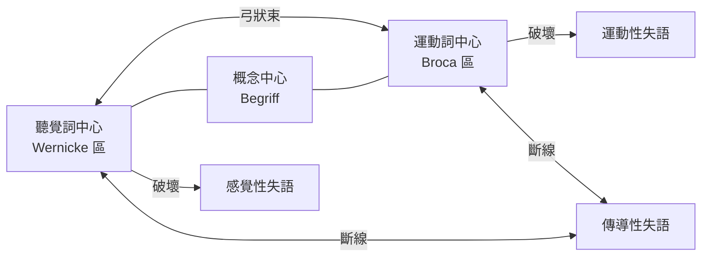

## 1874 - Wernicke 的感覺性失語：能說話的人，為何聽不懂自己？

## 案件摘要

**本案偵破的是語言的另一端——Broca 找到了「說」的地址，Wernicke 找到了「懂」的地址，並畫出第一張語言迴路圖。**

1874 年，26 歲的布勒斯勞助理醫師 **Carl Wernicke（1848–1905）**出版 71 頁小冊《*Der aphasische Symptomencomplex*》（失語症狀叢），報告數例「**能流利說話，卻聽不懂別人說話、也不懂自己說了什麼**」的病人（多為中風者）。解剖證實病灶在**左顳上回後部**——與 Broca 區（左額下回）分居大腦外側裂兩岸。Wernicke 更進一步提出：語言是**感覺意象與運動意象之間的迴路**，兩區之間以纖維束相連——史上第一個神經**網絡模型**。他預言：切斷這條連線，會產生第三種失語——傳導性失語（conduction aphasia），數年後果然有人證實。

## 前因 -- 為什麼會有這個案子

- **Broca 定讞後的新問題**。1861 年後「語言在左額下回」幾成定論；但臨床上不少病人**語言流利**卻答非所問——病灶顯然不在額葉。這些「不合規」病例是待破的懸案。
- **Meynert 的解剖學地基**。維也納神經解剖學家 Theodor Meynert（Wernicke 的老師）已畫出皮質聯絡纖維與投射纖維的走向圖，並主張「反射迴路」是心理功能的基礎——Wernicke 只差把語言套進去。
- **感官心理學的後盾**。Helmholtz 學派的「感覺—意象—動作」心理學（見 `1791-伽伐尼動物電.md` 之後的生理學氛圍）提供理論語彙：語音的「聽覺意象」儲存在聽皮質附近。

## 線索與推理 -- 數學式、程式、理論

**線索一：症狀的精細分類。** Wernicke 對照兩類病人：

| | Broca（運動性）失語 | Wernicke（感覺性）失語 |
|---|---|---|
| 口語產出 | 電報式、費力 | 流利但空洞（jargon 亂語） |
| 理解 | 大致保留 | 嚴重受損 |
| 自我監控 | 知道自己說不出（苦惱） | 不覺得自己有問題 |
| 病灶 | 左額下回後部 | 左顳上回後部 |

**線索二：語言迴路模型——從地圖升級為路網。** Wernicke 的核心創見是把兩個「點」連成「線」：

$$ \text{聽覺皮質} \rightarrow \underbrace{[\text{Wernicke 區}]}_{\text{聽覺詞意象}} \xrightarrow{\;\text{弓狀束}\;} \underbrace{[\text{Broca 區}]}_{\text{運動詞意象}} \rightarrow \text{口語動作} $$

他據此預測三種失語，並寫成偵探預言：

```text
預言 1: 破壞 Wernicke 區   → 感覺性失語(自己證實)
預言 2: 破壞 Broca 區     → 運動性失語(Broca 已證)
預言 3: 切斷弓狀束連線     → 複誦障礙. 但理解與自發語言相對保留
         = "傳導性失語"    → 1885 年後由 Lichtheim 等證實 ✓
```

**線索三：Lichtheim 的房子模型。** 1885 年 Ludwig Lichtheim 把 Wernicke 模型畫成三點圖（聽覺中心—概念中心—運動中心），成為此後 60 年失語症分類的標準圖示：



## 結案 -- 後果與影響

- **網絡神經科學的起點**。「功能＝相連區域的迴路，而非孤立的一點」——這個思想是今日連結組（connectome，見 `1990-fMRI與BOLD腦功能成像.md`）的 19 世紀原型；失語症研究成為第一個系統性的腦網絡科學。
- **臨床神經病學的教科書化**。Wernicke 後來編《神經疾病教科書》（1881–83），使德語區成為世界神經學中心；其分類法至今仍在床邊使用。
- **過早的統一論**。Wernicke 晚年試圖以「聯絡纖維」解釋一切高級功能，過度延伸使其模型在 20 世紀初被 Holistic 派（Head、Goldstein）攻擊；直到 1990 年代神經影像讓「雙流模型」（ dorsal/ventral streams）復活——他的迴路以現代形式平反。
- **一句話結案**：Broca 找到說話的出口，Wernicke 找到理解的入口，弓狀束把兩者接成一條迴路——**語言不是一個地址，是一條路**。

## 關鍵人物與文獻

- **Carl Wernicke（1848–1905）**——布勒斯勞（今弗羅茨瓦夫）神經精神病學家；1905 年騎自行車摔落山崖而死；其子亦為神經學家。
- **Theodor Meynert（1833–1892）**——維也納解剖學家，Freud 的老師；皮質纖維解剖學之父，Wernicke 迴路的解剖學供應商。
- **Ludwig Lichtheim（1845–1928）**——1885 年系統化語言迴路模型並命名傳導性失語。
- 原始文獻——Wernicke, *Der aphasische Symptomencomplex: Eine psychologische Studie auf anatomischer Basis*, Breslau: Cohn & Weigert, 1874。
- 現代註腳——2015 年起 DTI 擴散張量影像證實弓狀束確有「直接長束＋間接經顳頂的雙段」結構，與 Wernicke 的原始推斷高度吻合——「預言式偵探」的最終平反。
