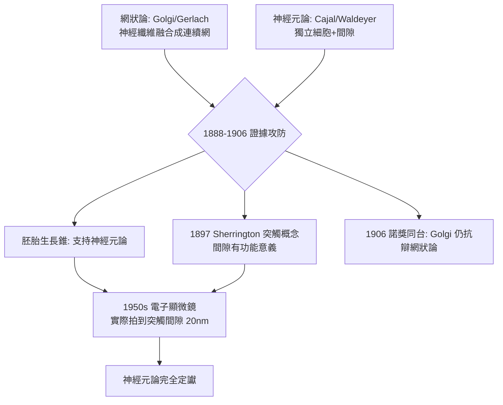

## 1888 - Cajal 的神經元學說：腦不是一張網，是億萬個獨立細胞

## 案件摘要

**本案偵破的是神經系統的基本單位——思想由獨立的細胞攜帶，而非在連續的網中流動。**

1887 年，西班牙解剖學家 **Santiago Ramón y Cajal（1852–1934）**在馬德里見到同事以高基染色法（見 `1873-高基黑染色法.md`）染出的神經元，深受震撼。1888 年他自創改良染色（雙重浸染），在巴塞隆拿家中以**顯微鏡＋素描筆**觀察小鳥、小鼠與成人的腦，發表一系列論文，提出革命性結論：**神經元是獨立的細胞單位**，突起彼此接近但**不融合**；訊號沿樹突→胞體→軸突**單向**傳遞（動力極化定律）。1891 年 Waldeyer 命名為「神經元（Neuron）」並系統化此學說。這是神經科學的「細胞學說時刻」——從網狀論到神經元論，等於從「連續的 ether」跳到「顆粒的原子」。

## 前因 -- 為什麼會有這個案子

- **網狀論的正統地位**。Gerlach、Golgi 與多數德國權威主張神經纖維交織融合成連續網——「心靈在連續網中自由流動」甚至有哲學吸引力。Cajal 是這場訴訟中唯一的非德國偵探。
- **細胞學說的延伸期待**。1838–39 年 Schleiden–Schwann 立下「生物由細胞構成」後，唯一頑抗的據點就是神經系統；神經元是否獨立，是細胞學說的最後一戰。
- **個人裝備**。Cajal 青年時是畫家與反叛者（曾被關禁閉），父親是鄉村醫師；繪畫天分＋顯微鏡＝史上最強的「視覺偵查組合」。他自費買下當時最好的 Zeiss 顯微鏡。

## 線索與推理 -- 數學式、程式、理論

**線索一：胚胎腦的「時間差偵查」。** Cajal 的關鍵手法：網狀論與神經元論在**成體腦**難分勝負（突起太密），他就去看**胚胎腦**——發育早期的神經纖維較稀疏、正在生長。他清楚看到**生長錐（growth cone）**以獨立尖端探路、絕不與鄰居融合：

```text
胚胎期觀察(1888. 鳥胚脊髓/小腦):
- 軸突以「軟質生長錐」尖端獨立延伸
- 纖維到達標的細胞附近 → 停止. 靠近. 但不融合
- 成體: 高基影像中突起「看似相連」是稀染解析度不足的假象
```

以偵探語言：**命案現場（成體腦）太亂，就回到案發之前（胚胎）找監視器。**

**線索二：動力極化定律。** 1891 年 Cajal（並由 van Gehuchten 精修）提出訊號方向律：

$$ \text{訊號} : \text{樹突} \;\longrightarrow\; \text{胞體} \;\longrightarrow\; \text{軸突} \;\longrightarrow\; \text{終末} \quad (\text{單向}) $$

這條律使「反射弧」（見 `1822-貝爾馬根迪神經根.md`）與 Wernicke 迴路（見 `1874-Wernicke感覺性失語.md`）獲得細胞層次的機制：迴路之所以有方向，是因為每個神經元的「極性」都一致。

**線索三：審判日——網狀論 vs 神經元論。**



## 結案 -- 後果與影響

- **現代神經科學的地基**。神經元學說確立後，才有突觸（Sherrington, 見 `1897-謝靈頓突觸.md`）、神經傳導物質（見 `1921-Loewi迷走神經物質.md`）、動作電位（見 `1952-HodgkinHuxley動作電位.md`）與可塑性研究——今日教科書每一頁都站在本案之上。
- **神經可塑性的伏筆**。Cajal 觀察到「練習使神經元分支增多」的現象，晚年寫下著名的可塑性預言：「**若有辦法增強其生長……神經的生長機制可以再被喚醒**」——學習記憶的突觸理論（Hebb 1949、Kandel 2000）是他百年後的續集。
- **弱勢偵探的勝訴模式**。Cajal 語言（西班牙語）、地緣（邊陲）、資源皆劣勢，勝在**觀察密度與圖像說服力**——他的手繪圖至今仍是神經科學的視覺經典。
- **一句話結案**：腦不是一張網，而是億萬座獨立燈塔之間的燈光往來——**訊息在間隙中被轉發**；這個「間隙」，就是下一個案件的現場（突觸）。

## 關鍵人物與文獻

- **Santiago Ramón y Cajal（1852–1934）**——「現代神經科學之父」；1906 年諾貝爾生理學或醫學獎（與 Golgi）；著作《Recuerdos de mi vida》自述偵探生涯；其手繪圖逾 2900 幅。
- **Wilhelm von Waldeyer-Hartz（1836–1921）**——柏林解剖學家，1891 年命名 neuron 並以德文大力推廣（科學傳播的關鍵助攻，Cajal 自己承認）。
- 原始文獻——Cajal, « Estructura de los centros nerviosos de las aves », *Revista Trimestral de Histología Normal y Patológica*, 1888（個人創辦期刊）；*Textura del sistema nervioso del hombre y de los vertebrados*, 1899–1904。
- 現代註腳——2000 年代起，「神經元學說」在兩處被精修：膠細胞（glia）同樣參與訊號調控；部分神經元以電突觸（gap junction）直接融合通訊——獨立燈塔之間，原來還有幾扇直通的窗。
