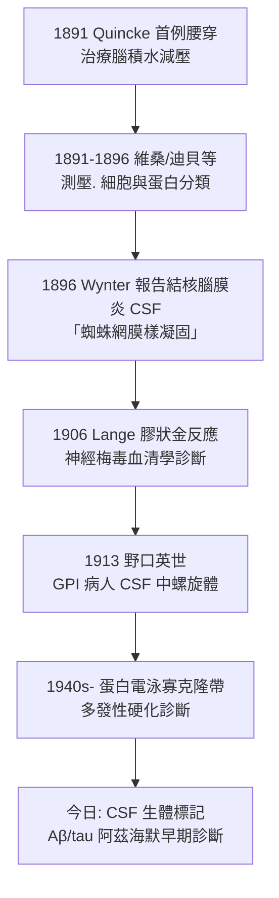

## 1891 - 奎克的腰椎穿刺：把針送進脊髓的「安全峽谷」

## 案件摘要

**本案偵破的是一條通往中樞神經系統的「液體走廊」——不開顱即可取得腦的證詞。**

1891 年，基爾大學神經科醫師 **Heinrich Quincke（1842–1922）**報告首例**腰椎穿刺（Lumbalpunktion）**：以細針自第 3–4 腰椎間刺入蛛網膜下腔，抽取腦脊髓液（CSF）。他的原始動機是**治療**——為腦水腫兒童「減壓引流」；真正的革命卻是**診斷**：CSF 是「流動的腦脊切片」，細胞、蛋白、糖、抗體皆可檢驗。此後結核性腦膜炎、梅毒性神經病（見 `../性病的歷史/1913-野口英世解開麻痺性痴呆之謎.md`）、多發性硬化、腦膜炎的鑑別診斷全部改寫——神經科第一次有了「抽血」等級的常規取證工具。

## 前因 -- 為什麼會有這個案子

- **CSF 的解剖學新知**。1875 年 Key 與 Retzius 證明蛛網膜下腔是一個連續液體腔；但「可以安全地從下背部穿刺」無人敢試——針尖距脊髓圓錐（約 L1–L2）太近的恐懼，像魔咒一樣存在。
- **腦積水的臨床絕境**。1880 年代嬰幼兒腦積水幾乎無藥可救；外科分流手術死亡率極高。Quincke 尋找「從外面直接給腦減壓」的方法，目標是救病人，不是找診斷。
- **無菌技術的成熟**。1880 年代 Lister 消毒法普及、可重複使用的細玻璃針問世——「進入體腔不感染」首次成為可依賴的前提。

## 線索與推理 -- 數學式、程式、理論

**線索一：安全峽谷的幾何學。** 脊髓在成人止於 L1–L2；馬尾神經漂浮在 L2 以下的 CSF 中，細針可以**推開**神經根而不刺穿。穿刺點選 L3–L4 或 L4–L5（約兩側髂嵴連線平面）：

$$ \text{成人脊髓末端} \approx L_1\text{-}L_2 \quad;\quad \text{穿刺點} \in [L_3, L_5] \;\Rightarrow\; \text{安全餘量} \geq 1\text{–}2 \text{ 節段} $$

嬰兒脊髓更低（約 L3），故兒童需取更低節段——這是 Quincke 早期療法部分失敗的教訓之一。

**線索二：診斷價值的爆炸（1891–1913 的接力破案）。**

**線索三：壓力本身是證詞。** Quincke 與同代人發現 CSF 開放壓（正常約 $10\text{–}20\ \mathrm{cmH_2O}$，側臥）本身就是診斷線索——顱內高壓、特發性顱內高壓症、交通/非交通性腦積水的分流判斷都以壓力計為準。腰穿因此同時取得**兩種證據**：液體成分＋動力壓力。

## 結案 -- 後果與影響

- **神經科的常規取證**。從 1890 年代末起，腰穿成為神經科病房的例行程序；「無腦影像時代，CSF 就是腦的活檢」——直到 CT/MRI（見 `1971-電腦斷層CT看腦.md`）問世，它的鑑別地位才部分讓位，但成分分析無可取代。
- **神經梅毒大破案的必經之路**。沒有腰穿，就沒有 1913 年野口的螺旋體發現與 1917 年瘧熱療法的療效監測；性病（見同目錄性病 wiki）與神經科在 CSF 玻片上會師。
- **治療用途的現代復活**。椎管內化療、脊髓麻醉（1898 年 Bier 首例）、腰大池引流，都是這根針的後代；「減壓」的原始動機則以特發性顱內高壓治療延續至今。
- **一句話結案**：Quincke 的針尖找到的不只是液體，而是**一條通往腦的合法通道**——從此神經科不用打開顱骨，也能訊問腦。

## 關鍵人物與文獻

- **Heinrich Irenaeus Quincke（1842–1922）**——基爾內科教授；另發現 Quincke 水腫（血管性水腫，以其命名）；性格孤僻，晚年居於法蘭克福郊外。
- **Walter Essex Wynter（1864–1945）**——倫敦醫師，1889 年已獨立施行腰穿（以套管針）治療腦積水；與 Quincke 的優先權之爭顯示「同時代人各自的獨立破案」。
- 原始文獻——Quincke, « Die Lumbalpunktion des Hydrocephalus », *Berliner Klinische Wochenschrift*, 1891。
- 現代註腳——今日腰穿併發症以低顱壓頭痛為主（約 10–30%）；2020 年代以無創測壓與細針技術持續改良——1891 年的「安全峽谷」幾何學，仍是指引針尖的地圖。
