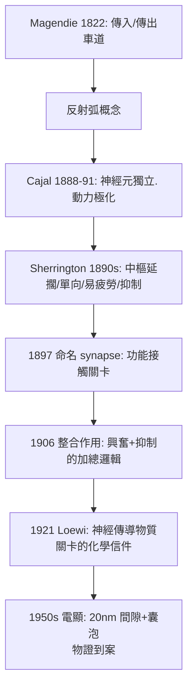

## 1897 - 謝靈頓的突觸：兩個神經元之間，有一道可裁判的關卡

## 案件摘要

**本案偵破的是神經科學史上最重要的一個「看不見的結構」——突觸（synapse），先由推理命名，四十年後才被顯微鏡拍到。**

1897 年，英國生理學家 **Charles Scott Sherrington（1857–1952）**在 Foster 與 Sherrington 合著的《生理學教科書》第九章中，首次使用「**synapse**」一詞，指稱神經元之間功能接觸的部位。他觀察到的謎題是：**反射的傳導是單向的、且比神經纖維本身慢得多、還會疲勞**——纖維內的傳導不該如此。唯一合理的解釋：神經元之間存在**低效率、有阻力、可調變的接觸關卡**。1906 年他出版《神經系統的整合作用》，以突觸理論統一反射、抑制與整合。電子顯微鏡 1950 年代拍到突觸間隙（約 20 nm），偵探的推理終於被物證坐實。

## 前因 -- 為什麼會有這個案子

- **神經元學說剛剛定讞**。Cajal（見 `1888-Cajal神經元學說.md`）證明神經元彼此獨立——但獨立細胞如何協作？如果細胞是分開的，「訊息怎麼跳過縫隙」成為新的懸案。
- **反射生理學的實驗積累**。Sherrington 接手 Magendie–Hall 的反射研究（見 `1822-貝爾馬根迪神經根.md`），以脊髓犬做系統實驗：電流刺激皮膚，測反射的閾值、時程與方向。
- **神經末梢的形態學疑點**。高基染色顯示神經末梢在標的細胞旁形成繁複終枝（Cajal 稱之「小籃」），但光學顯微鏡解析度（約 0.2 μm）不足以分辨是否有縫隙——形態學證據懸置，只能靠**功能推理**。

## 線索與推理 -- 數學式、程式、理論

**線索一：三個「不像纖維」的功能異常。** Sherrington 在脊髓反射上的量測：

| 現象 | 纖維內傳導 | 反射中樞觀察值 | 推論 |
|---|---|---|---|
| 傳導延遲 | 極短（m/s 級） | 中樞延擱（central delay）約 0.5–1 ms 額外 | 有「中轉站」 |
| 方向性 | 雙向可導 | 反射嚴格單向（傳入→傳出） | 關卡有極性 |
| 疲勞 | 幾乎不疲勞 | 反射極易疲勞 | 關卡消耗物質 |

三項異常同時指向：**瓶頸不在纖維，在細胞之間**。

**線索二：抑制的發現——關卡不只是「通」與「不通」。** 1890 年代末 Sherrington 發現**拮抗抑制**（伸肌收縮時屈肌受抑制，即 reciprocal innervation）與**中樞抑制**：訊號可以**主動壓低**下一個神經元的興奮性。這說明關卡有「煞車檔」——純物理接續（如電纜焊點）不可能如此，暗示關卡具**化學或電性質的可調控性**。

**線索三：命名的偵探工作。** 「synapse」一詞由 Sherrington 的劍橋古典學朋友 **Arthur Verrall**（與 Foster 商議）建議，源自希臘語 συνάπτειν（「扣緊、相接」）：

## 結案 -- 後果與影響

- **神經科學的基本單位完成**。細胞（Cajal）＋關卡（Sherrington）＝可以建構**迴路與計算**的系統；所有後續理論（傳導物質、突觸可塑性、學習與記憶）都在突觸這個地址上施工。
- **1932 年諾貝爾獎**。Sherrington 與 Adrian 因神經元功能研究獲獎；Sherrington 的學生包括 Eccles（突觸生理學諾獎 1963）與 Penfield（人類皮質圖），偵探學派三代同堂。
- **「整合」觀念的誕生**。神經系統的功能不只是傳導，更是**加權整合**（時間加成、空間加成、興奮/抑制對比）——這是今日人工神經網路加權求和的生物學原型。
- **一句話結案**：Sherrington 沒有看到突觸，他**算出了突觸**——延擱、單向與疲勞三個數字，逼出了神經科學史上最重要的推論結構；真正的物證，要等 1950 年代的電子顯微鏡歸檔。

## 關鍵人物與文獻

- **Charles Scott Sherrington（1857–1952）**——牛津生理學教授、諾獎得主；「the integrative action」使其成為神經生理學的牛頓；詩人氣質，晚年出版詩集《The Assaying of Brabantius》。
- **Michael Foster**——劍橋生理學家，《教科書》主編，給 Sherrington 留下「第九章神經系統」的寫作任務——一個章節，誕生一個世紀的科學。
- 原始文獻——Foster & Sherrington, *A Text Book of Physiology, Part III*, 1897；Sherrington, *The Integrative Action of the Nervous System*, Yale University Press, 1906。
- 現代註腳——電突觸（gap junction）的發現證明 Sherrington 的「化學關卡」並非唯一；人類視網膜與腦幹仍大量使用電性直通——關卡的設計，原來有兩種規格。
