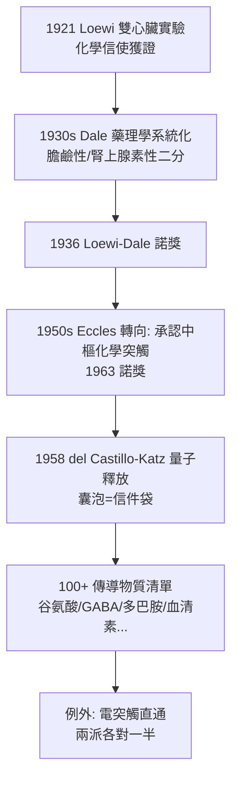

## 1921 - Loewi 的迷走神經物質：一場夢裡設計的實驗

## 案件摘要

**本案偵破的是突觸關卡裡傳遞的「信件」——神經末梢靠化學物質，而不只是電，指揮下一個細胞。**

復活節前夜（1920 年 5 月或 1921 年，Loewi 自己記憶亦模糊），奧地利藥理學家 **Otto Loewi（1873–1961）**在夢中想到一個實驗：半夜起床匆匆記下，翌晨竟看不懂自己的筆跡；第二夜同一個夢再現，他直接衝進實驗室。當天（他自述為 1921 年復活節星期六）完成實驗：**以電刺激蛙心迷走神經使其心跳減慢，取出灌流液注入第二顆未受刺激的心臟——第二顆心臟也減慢了**。結論：迷走神經釋放了一種化學物質（他命名 Vagusstoff，即**乙醯膽鹼**）。1936 年他與 **Henry Dale** 共獲諾貝爾獎。突觸（見 `1897-謝靈頓突觸.md`）的關卡裡，第一次找到了信使。

## 前因 -- 為什麼會有這個案子

- **電 vs 化學的世紀之爭**。突觸如何傳訊？「電學派」（如 Eccles 早年）認為電流直接跳過接觸點；「化學派」以 Langley、Dale 為首，主張末梢釋放化學物質。爭論持續數十年，缺的是決定性實驗。
- **Dale 的藥理學對照組**。Henry Dale 已證明乙醯膽鹼可使器官反應與副交感刺激相同（「擬副交感」效應）——但「體內神經真的釋放它」仍是推測。藥理學與生理學之間隔著一個證據。
- **Loewi 的個人習慣**。他一生多夢且常在夢中思考；本案是科學史上最著名的「夢中實驗設計」（與 Kekulé 的苯環夢齊名，且本案有可重複的實驗記錄支撐）。

## 線索與推理 -- 數學式、程式、理論

**線索一：雙心臟灌流實驗（裝置偵查）。**

```text
Setup: 兩顆離體蛙心. 共用灌流液循環
實驗 A: 電刺激心 1 的迷走神經 → 心 1 跳動減慢
實驗 B: 心 1 的灌流液轉灌心 2 (未刺激) → 心 2 也減慢 ✓
對照  : 未刺激心 1 的灌流液 → 心 2 無變化
推論  : 灌流液中含有「迷走神經受刺激後釋放的物質」 = Vagusstoff
```

以訊號模型表示：

$$ \text{電訊號(神經)} \xrightarrow{\text{末梢}} \text{化學信使(ACh)} \xrightarrow{\text{受體}} \text{電/機械反應(心臟)} $$

**線索二：信使的身分鑑定。** Vagusstoff 的性質逐一比對：極易被破壞（膽鹼酯酶）、作用與乙醯膽鹼一致、可被毒扁豆鹼增強——1936 年前後化學定性完成：**Vagusstoff = 乙醯膽鹼（acetylcholine, ACh）**。Dale 陣營另證交感神經末梢釋放腎上腺素類物質（後定為正腎上腺素）。神經傳導物質（neurotransmitter）成為正式科學類別。

**線索三：化學派 vs 電學派的終審。**



## 結案 -- 後果與影響

- **藥理學與神經科的接軌**。「傳導物質→受體→藥物」成為神經藥理學主幹：治療重症肌無力、帕金森（見 `1967-左多巴療法.md`）、抑鬱症（SSRI）的藥物邏輯全部由此開枝。
- **「膽鹼能/腎上腺素能」的命名體系**。Dale 原則（一個神經元各末梢釋放同一傳導物質）成為神經化學分類基石，雖後來發現共同遞質（co-transmission）修正之。
- **夢的科學地位**。Loewi 自述本案為「上天的啟示」；本案常被引用於創造心理學——但注意：夢只給了**設計**，驗證仍靠清醒時的對照實驗。
- **一句話結案**：Loewi 用兩顆蛙心證明——神經對器官的命令，是裝在化學信封裡寄出的；突觸的關卡，原來是一座**郵局**。

## 關鍵人物與文獻

- **Otto Loewi（1873–1961）**——格拉茨大學藥理學教授；1938 年納粹入侵後被捕，獲釋條件是「自願放棄」諾獎獎金，流亡美國紐約大學；他戰後仍寬容地說「科學超越國界」。
- **Henry Dale（1875–1968）**——英國國家醫學研究所所長；發現組織胺、命名突觸傳遞的藥理學框架；1936 諾獎。
- 原始文獻——Loewi, « Über humorale Übertragbarkeit der Herznervenwirkung », *Pflügers Archiv*, 1921（兩篇系列報告）。
- 現代註腳——Loewi 的實驗日誌遺失，日期（1920 或 1921）成為史學小懸案；但雙心臟實驗已無數次重複——科學史上「記錄丟了、結論不丟」的罕見案例。
