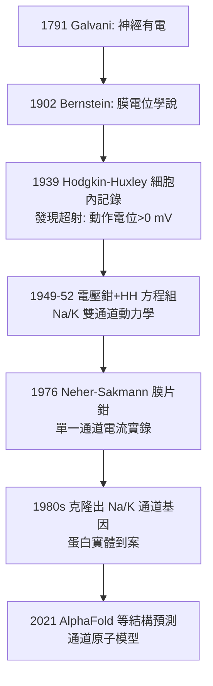

## 1952 - Hodgkin 與 Huxley 的動作電位：用烏賊的巨軸突與一組方程式，算出神經的電學心臟

## 案件摘要

**本案偵破的是神經傳導的分子級機制——動作電位如何產生、如何沿著軸突奔跑。**

1952 年，劍橋的 **Alan Hodgkin（1914–1998）**與 **Andrew Huxley（1917–2012）**在《Journal of Physiology》連發五篇論文，以**烏賊（Loligo）的巨大軸突**（直徑可達 0.5–1 mm，粗到可插入電極）為材料，用**電壓鉗（voltage clamp）**技術量測鈉、鉀電流，提出四變數微分方程組，完整重現動作電位的形狀、傳導速度與不反應期。1963 年兩人（與 Eccles）獲諾貝爾獎。本案的獨特之處：**偵探不是靠觀察破案，而是靠一組方程式**——離子通道的分子實體要到 1970–80 年代（膜片鉗與克隆）才現形，Hodgkin–Huxley 模型在通道被看見之前 20 年就寫對了它的行為。

## 前因 -- 為什麼會有這個案子

- **電生理學的百年積累**。從 Galvani（見 `1791-伽伐尼動物電.md`）、du Bois-Reymond 的損傷電位，到 1902 年 Bernstein 的「膜學說」（靜息電位＝K⁺ 濃度差；動作時膜「破洞」而電位歸零）——後者被證明錯了一半：動作電位**超過零、甚至比靜息更正**，舊學說無法解釋。
- **二戰的技術遺產**。Hodgkin 戰時為雷達工作（Huxley 亦在海军部），熟練了精密電子測量；戰後放大器與陰極射線示波器的性能，使 μV 級快速訊號可以精確記錄。
- **烏賊的禮物**。英國普利茅斯海洋生物站的烏賊巨軸突是唯一「能插進電極」的哺乳類等價軸突——動物模型的選擇性優勢（與 1900 年代 Cantani 蛙心、1970 年代海兔一脈相承）。

## 線索與推理 -- 數學式、程式、理論

**線索一：電壓鉗——把「電壓」釘住，量「電流」。** 1949–52 年 Hodgkin、Huxley 與 Katz 建立電壓鉗：

$$ I = C_m \frac{dV}{dt} + \bar{g}_{Na} m^3 h\,(V-E_{Na}) + \bar{g}_{K} n^4 (V-E_{K}) + g_l (V - E_l) $$

$$ \frac{dn}{dt} = \alpha_n(1-n) - \beta_n n \quad (\text{m. h 同構式}) $$

其中 $m, h, n$ 是閘門變數（鈉活化/鈉失活/鉀活化），以指數動力學演化。核心發現：

```text
動作電位上升段: Na+ 內流(m³ 活化. 快) → 膜內變正(超射!)
下降段: Na 失活(h 關閉) + K 外流(n⁴ 活化. 慢)
不反應期: h(鈉失活門)關閉未重置 → 一段時間無法再激發
```

**線索二：Bernstein 學說的「修正案」判決。**

| 預測 | Bernstein (1902) | Hodgkin–Huxley (1952) |
|---|---|---|
| 靜息電位 | K⁺ 平衡電位 ✓ | K⁺ 主導 ✓（修正：Goldman 方程） |
| 動作電位峰值 | ≈ 0 mV（膜破洞） | ≈ +40 mV（**Na⁺ 內流**，膜反轉） |
| 再生性爆發 | 無 | Na 內流的正回饋（霍奇金循環） |

**線索三：用方程式「跑」出整隻神經。** Hodgkin–Huxley 模型以手搖計算機模擬，重現了傳導速度、閾值、不反應期、甚至陽極斷電興奮等細節：



## 結案 -- 後果與影響

- **神經編碼的物理基礎確立**。全有全無的動作電位、閾值、不反應期、傳導速度——神經訊息的「位元格式」自此有了方程式；計算神經科學以 HH 模型為起點語法。
- **通道生物學的預言書**。HH 模型的「閘門變數」在 1976 年膜片鉗（Neher–Sakmann，1991 諾獎）與 1980 年代通道蛋白克隆中獲得分子實體——**理論先於顯微鏡 24 年的經典破案**。
- **藥理學的靶點圖**。局部麻醉劑（利多卡因堵鈉通道）、抗癲癇藥（卡馬西平）、TTX（河豚毒素）的作用機制皆在 HH 框架內定位。
- **一句話結案**：Hodgkin 與 Huxley 用一條烏賊神經與一組微分方程，證明神經衝動不是「精神在水管裡流」，而是**離子穿過閘門的電學風暴**——蓋倫的液體隱喻，在原子層面以另一種形式還魂。

## 關鍵人物與文獻

- **Alan Lloyd Hodgkin（1914–1998）**——劍橋三一學院教授；戰時雷達研究員；爵士、功勳勳章（OM）。
- **Andrew Fielding Huxley（1917–2012）**——Aldous Huxley 之弟、Thomas Huxley 之孫；後任倫敦大學學院教授、皇家學會會長；同時是肌肉橫橋理論的作者。
- **Bernard Katz（1911–2003）**——合作者與後繼者，突觸量子釋放（1970 諾獎）的作者。
- 原始文獻——Hodgkin & Huxley, « A quantitative description of membrane current and its application to conduction and excitation in nerve », *J. Physiol.* 117: 500–544, 1952（系列第四篇）。
- 現代註腳——HH 方程至今仍是人工神經元模型與離子通道藥物篩選的基準；2021 年蛋白結構預測革命讓「閘門變數」終於有了原子座標——1952 年的方程式，等待了七十年才拿到自己的分子身份證。
