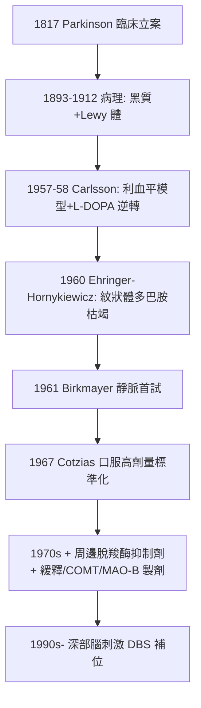

## 1967 - 左多巴（L-DOPA）：化學信使的補給線，讓凍結的身體重新起步

## 案件摘要

**本案偵破的是一條「以化學補償取代神經修復」的治療路線——缺什麼，補什麼。**

1967 年，紐約哥倫比亞大學的 **George Cotzias（1918–1977）**在《New England Journal of Medicine》發表里程碑論文：以**口服高劑量左多巴（L-DOPA / levodopa）**治療巴金森病（見 `1817-巴金森論震顫麻痺.md`），病人從「坐輪椅、語音如耳語」到「走路、寫字、說話」的轉變被記錄在影片與病歷中——神經科學史上最戲劇性的療效之一。理論鏈條為：1950 年代瑞典藥理學家 **Arvid Carlsson** 證明多巴胺是腦內傳導物質，並於 1957–58 年發現利血平耗竭多巴胺可造成「巴金森樣狀態」、左多巴可逆轉；1960 年 Ehringer 與 Hornykiewicz 解剖巴金森死者腦，發現**黑質—紋狀體多巴胺銳減**——病灶、傳導物質、藥物三條線索在此會師。Carlsson 獲 2000 年諾貝爾獎。

## 前因 -- 為什麼會有這個案子

- **神經化學的登場**。1950 年代以前，突觸化學僅限自律神經（見 `1921-Loewi迷走神經物質.md`）；腦內是否也有專屬傳導物質、它們如何與疾病對應，仍是空白卷宗。
- **意外的副作用線索**。1950 年代利血平（降血壓/抗精神病藥）引發部分病人**類巴金森症狀**——藥物把疾病「做出來」了，這是罕見而寶貴的偵查線索：追查這顆藥做了什麼，就等於偷看了疾病的機制。
- **臨床的無奈現狀**。1817 年以來，巴金森治療僅有抗膽鹼藥（效果有限）與立體定位手術（破壞性）；病人與家屬的需求壓力巨大，卻無一線化學療法。

## 線索與推理 -- 數學式、程式、理論

**線索一：卡爾森的逆轉實驗（1957–58）。**

```text
Step 1: 利血平 → 兔子出現鎮靜. 僵直. 運動減少(巴金森樣)
Step 2: 測腦內單胺類 → 多巴胺被耗竭(血清素亦降)
Step 3: 補血清素前驅物(5-HTP) → 無效
Step 4: 補多巴胺前驅物(L-DOPA) → 動作恢復. 僵直解除 ✓
推論: 「巴金森樣狀態」的化學關鍵 = 紋狀體多巴胺
```

**線索二：病理與化學的配對（Ehringer–Hornykiewicz, 1960）。** Hornykiewicz 以新方法量化死者腦區單胺含量：

| 腦區 | 巴金森死者 vs 對照 |
|---|---|
| 紋狀體（尾核/殼核）多巴胺 | **降 80–90%** |
| 黑質 | 細胞大量喪失（Lewy 體所在） |
| 其他區域 | 大致正常 |

配對完成：**黑質細胞死亡 → 紋狀體多巴胺枯竭 → 運動症狀**。這是「疾病＝特定傳導物質系統的特定缺陷」的第一個完整示範。

**線索三：Cotzias 的劑量偵查。** 早年 Birkmayer 與 Hornykiewicz（1961）靜脈注射左多巴已有戲劇性但短暫效果；口服小劑量無效。Cotzias 的關鍵是**逐步加量**至每日數克：

$$ \text{血漿 L-DOPA} \xrightarrow{\text{血腦屏障}} \text{紋狀體} \xrightarrow{\text{芳香 L-胺基酸脫羧酶}} \text{多巴胺} \Rightarrow \text{補足缺口} $$



## 結案 -- 後果與影響

- **神經精神藥理學的範式**。「特定疾病＝特定傳導物質系統障礙」的路線圖，直接催生：血清素與抑鬱（SSRI, 1987 fluoxetine）、GABA 與焦慮/癲癇、谷氨酸興奮毒性等整個世代的藥物偵查。
- **黑質—紋狀體迴路的教科書化**。運動皮質—基底核迴路的「直接/間接通路」模型（1980s–90s, Albin/DeLong）以左多巴療效為活體證據。
- **長期的另一面**。左多巴不治病因（黑質持續死亡），數年後出現「劑末現象」與不自主異動（dyskinesia）；DBS（1990s, Benabid）與細胞療法為接棒者——本案破了「症狀」，未破「病根」。
- **一句話結案**：從 1817 年街頭的觀察，到 1967 年的一顆藥丸——巴金森案的最終答案是化學的：**黑質的燈塔熄滅了，紋狀體便斷糧；左多巴不重建燈塔，只送來等量的燈油**。

## 關鍵人物與文獻

- **Arvid Carlsson（1923–2018）**——瑞典哥德堡大學；確立多巴胺為獨立傳導物質；2000 年諾貝爾生理學或醫學獎（與 Greengard、Kandel）。
- **Oleh Hornykiewicz（1926–2020）**——維也納神經化學家，「多巴胺理論」的病理學支柱；多次與諾獎擦身，被同儕譽為「無冕之王」。
- **George Cotzias（1918–1977）**——希臘裔美國醫師，布魯克黑文國家實驗室/哥倫比亞大學；以高劑量口服 L-DOPA 標準化療法。
- 原始文獻——Cotzias, Van Woert & Schiffer, « Aromatic amino acids and modification of parkinsonism », *NEJM* 276: 374–379, 1967；Ehringer & Hornykiewicz, *Klin. Wochenschr.* 1960。
- 現代註腳——2010 年代 α-突觸核蛋白（α-synuclein）與腸—腦軸研究重啟「病根」偵查（Braak 分期）；左多巴則仍列於世界衛生組織基本藥物清單——一個 1967 年的答案，服務了半個多世紀。
