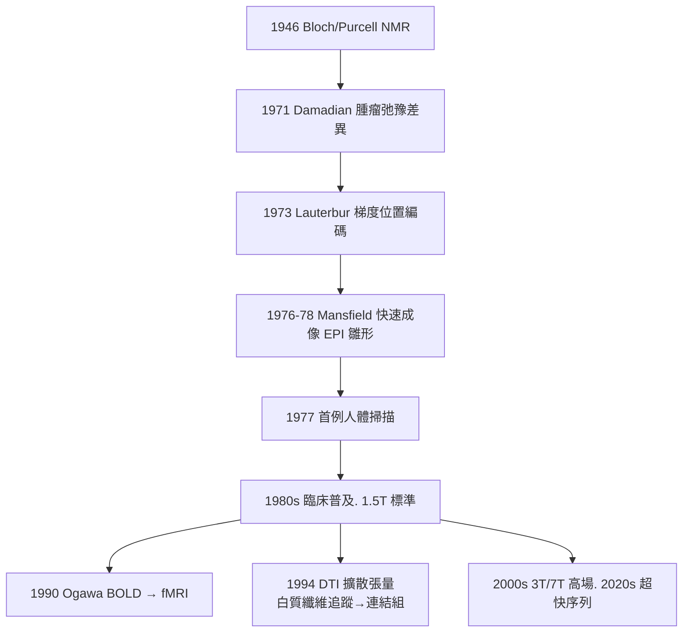

## 1977 - MRI：以氫原子的自旋偵訊腦，無輻射、可選任意切面

## 案件摘要

**本案偵破的是一種全新的腦照相術——不射 X 光，而是「問水」。**

1977 年，紐約州立大學石溪分校的 **Raymond Damadian** 完成首台全身人類 MRI 掃描（專利 1974；掃描一位病人耗時近 5 小時，僅得 4 條資料線）；同年 **John Mallard 的阿伯丁團隊**發表首張臨床可用的人體磁振影像；**Peter Mansfield**（諾獎共同得主）的快速成像梯度技術使其在 1980 年代實用化。2003 年 Lauterbur 與 Mansfield 共獲諾貝爾生理學或醫學獎（Damadian 落選，引發著名爭議）。MRI 以**核磁共振**偵測體內氫原子（水與脂肪），軟組織對比度遠勝 CT，且無游離輻射——腦的白質、灰質、腦幹、脊髓從此在無創條件下纖毫畢現，並為 fMRI（見 `1990-fMRI與BOLD腦功能成像.md`）與 DTI 連結組鋪路。

## 前因 -- 為什麼會有這個案子

- **核磁共振的物理基礎（1946）**。Bloch 與 Purcell 分別發現物質中的核磁共振（NMR，1952 諾獎）：把原子核置於強磁場，施加射頻脈衝，核自旋會吸收再釋放特定頻率的訊號——「以射頻向原子核喊話」。
- **醫學應用的兩步**。1971 年 Damadian 發現**大鼠腫瘤組織的 T1/T2 弛豫時間異常**（細胞含水量差異），提出「NMR 可偵測疾病」；1973 年 **Paul Lauterbur** 在《Nature》提出以**梯度磁場**為訊號加註空間座標，做出世界第一張二維 NMR 影像（兩支裝水的試管）——「位置編碼」是本案的關鍵破解。
- **CT 的成功示範**。CT（見 `1971-電腦斷層CT看腦.md`）證明了「數學重建影像」的醫療與商業價值，資金與人才隨之湧入 NMR 影像賽道。

## 線索與推理 -- 數學式、程式、理論

**線索一：共振與位置編碼。** 氫核在磁場 $B_0$ 中的進動頻率：

$$ \omega = \gamma B_0 \qquad (\gamma \approx 42.58\ \text{MHz/T，氫核}) $$

施加線性梯度 $dB/dz$ 後，不同位置 $z$ 的氫核頻率不同——**頻率即地址**：

```text
偵查三步:
(1) B0 主磁場: 全體氫核統一進動(等待口令)
(2) 梯度場+射頻脈衝: 只「叫醒」指定切面的氫核(選層)
(3) 讀出訊號+反傅立葉變換: 頻率→x. 相位→y. 強度→組織含水量
結果: 任意切面. 任意對比(T1/T2/PD) 的軟組織地圖
```

**線索三：CT vs MRI 的對照偵查表。**

| | CT | MRI |
|---|---|---|
| 訊號源 | X 光穿過人體的衰減 | 體內氫核的自旋回波 |
| 軟組織對比 | 低（1–2% 差異） | 高（白/灰質、腦幹、脊髓清晰） |
| 輻射 | 有 | 無 |
| 切面 | 軸向為主（早期） | 任意方向 |
| 強項 | 急性出血、骨折 | 腫瘤、脫髓鞘、脊髓、功能成像 |

**線索三：從結構到功能的分岔。**



## 結案 -- 後果與影響

- **神經科診斷的全面升級**。多發性硬化（腦室旁脫髓鞘斑）、脊髓病變、小腫瘤、癲癇灶（見 `1929-Berger腦電圖.md` 的結構驗證）——CT 看不見的病灶全部現形；MRI 取代氣腦造影等侵入性手段的歷史任務徹底完成。
- **認知神經科學的基礎設施**。結構 MRI 提供個體化腦解剖座標，fMRI/DTI 進而給出功能與連線圖——1990 年代的「腦十年」運動，硬體地基正是 1977 年這台慢速掃描機。
- **諾獎爭議懸案**。2003 年 Damadian 落選，其支持者在《紐約時報》買整版廣告抗議；本案成為「專利發明 vs 科學發現」誰該得獎的教科書爭議。
- **一句話結案**：MRI 的偵查對象不是病灶，而是**構成腦的水**——氫原子自旋被磁場整隊、被射頻喊話、被梯度編號；腦的自我供述，比 X 光的影子誠實得多。

## 關鍵人物與文獻

- **Raymond Damadian（1936–）**——醫師出身，全身掃描機「Indomitable」現藏 Smithsonian；堅持其 T1/T2 發現為應用奠基，終身未獲諾獎。
- **Paul Lauterbur（1929–2007）**——化學家；1973 年在筆記本餐巾上勾勒梯度成像構想（著名軼事）；2003 諾獎。
- **Peter Mansfield（1933–2021）**——諾丁漢物理學家，回波平面成像（EPI）奠基，使 fMRI 成為可能；2003 諾獎。
- 原始文獻——Lauterbur, « Image Formation by Induced Local Interactions: Examples Employing Nuclear Magnetic Resonance », *Nature* 242: 190, 1973；Damadian, *Science* 171: 1151, 1971。
- 現代註腳——2020 年代 7T 臨床 MRI 已可分辨皮質分層與微小血管；「以水為證人」的偵查法，正逼近 1909 年 Brodmann 細胞地圖（見 `1909-Brodmann52區腦圖.md`）的活體版本。
