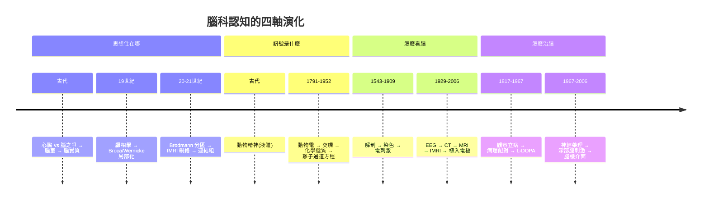

# 腦科的歷史：從紙草上的腦皺褶、腦室裡的靈魂、神經元學說，到腦機介面的思想輸出線

> 本書以「推理探案」的體例，為人類神經科學（腦科）史上的每個關鍵事件寫一篇 wiki：
> 謎題是什麼（思想藏在何處？一句話如何定位病灶？）？偵探是誰？線索與推理是什麼？
> 每篇檔名以年份開頭（4 位數，西元前以 `-` 開頭，如 `-0157`）。

## 雙線主軸

| 線 | 演變 |
|---|---|
| **解剖與方法線** | 紙草觀察 → 亞歷山卓解剖 → 蓋倫腦室學說 → 維薩里實證 → 高基染色 → 電刺激皮質 → 電生理 → CT/MRI → fMRI |
| **理論與治療線** | 動物精神 → 顱相學爭議 → 局部化論 → 神經元學說 → 突觸 → 動作電位 → 神經傳導物質 → 可塑性 → 腦機介面 |

---

## 年表（非常詳細版）

### 第一篇：腦的第一次現身——古代世界的觀察與誤讀

| 年份 | 事件 | 意義 | wiki |
|---|---|---|---|
| 約前 1700（抄本；內容約前 3000） | 埃及《史密斯紙草》描述腦回、腦膜、腦脊髓液與「頭傷致對側偏癱」 | 最早的腦記錄＋最早的對側性線索（未被追問） | [-1700-史密斯紙草與最早的腦](-1700-史密斯紙草與最早的腦.md) |
| 約前 280–250 | 亞歷山卓 Herophilus/Erasistratus 系統解剖人腦：神經二分、感官纜線終點在腦 | 靈魂由心臟「搬進」腦；腦科正式立案 | [-0250-希羅菲利斯的解剖台](-0250-希羅菲利斯的解剖台.md) |
| 約 157–176 | 蓋倫：喉返神經實驗、脊髓分層切斷、腦室—動物精神—中空神經模型 | 統治近 1500 年的生理學帝國；實驗生理學起源 | [0170-蓋倫腦室與動物精神](0170-蓋倫腦室與動物精神.md) |

### 第二篇：文藝復興與機器時代的腦——從蠟模到反射

| 年份 | 事件 | 意義 | wiki |
|---|---|---|---|
| 1504 前後 | 達文西注入熔蠟鑄出腦室模型，精繪腦回與腦膜 | 第一個腦物理模型；方法超前、理論仍舊 | [1504-達文西腦室蠟模](1504-達文西腦室蠟模.md) |
| 1543 | 維薩里《人體構造》：人無腦細網、靈魂功能應在腦實質 | 「屍體證言＞文本權威」的方法論定讞 | [1543-維薩里人體構造](1543-維薩里人體構造.md) |
| 1662 | 笛卡爾《論人》出版：反射機器＋松果腺＝身心交互座 | 反射概念誕生；松果腺選錯了嫌疑人 | [1662-笛卡爾松果腺](1662-笛卡爾松果腺.md) |

### 第三篇：電的發現與定址的執念——顱相學到神經根

| 年份 | 事件 | 意義 | wiki |
|---|---|---|---|
| 1791 | Galvani《論肌肉運動中的電力》；與 Volta 十年論戰 | 神經傳導是電的；副產品：電池 | [1791-伽伐尼動物電](1791-伽伐尼動物電.md) |
| 1796 起前後 | Gall 顱相學：官能有腦內地址、摸頭讀心 | 方法被證偽，問題（局部化）卻押對 | [1796-顱相學](1796-顱相學.md) |
| 1817 | Parkinson《論震顫性麻痺》：街頭跟蹤觀察、六病例定義一個病 | 疾病實體觀念的示範；1861 年後 Charcot 命名 | [1817-巴金森論震顫麻痺](1817-巴金森論震顫麻痺.md) |
| 1822 | Magendie 切斷狗脊神經前後根（Bell 1811 預告） | Bell–Magendie 定律：後根司感覺、前根司運動 | [1822-貝爾馬根迪神經根](1822-貝爾馬根迪神經根.md) |

### 第四篇：局部化論的定讞——鐵棍、Tan、電極與迴路

| 年份 | 事件 | 意義 | wiki |
|---|---|---|---|
| 1848 | Phineas Gage 鐵棍穿顱；Harlow 1868 年報告人格改變 | 人格有解剖地址（額葉）；「蓋奇不再是蓋奇」 | [1848-蓋奇鐵棍事故](1848-蓋奇鐵棍事故.md) |
| 1861 | Broca 解剖病人「Tan」：左第三額回＝運動語言區 | 局部化論科學定讞；語言開始有經緯度 | [1861-BrocaTan失語症](1861-BrocaTan失語症.md) |
| 1870 | Fritsch & Hitzig 電刺激狗運動皮質，畫出體位對應圖 | 主動審問皮質；Ferrier、Penfield 接力 | [1870-電刺激運動皮質](1870-電刺激運動皮質.md) |
| 1873 | Golgi「黑色反應」：重鉻酸鉀＋硝酸銀稀染神經元全形 | 讓單一神經元在濃湯中自己現形（機理至今未全解） | [1873-高基黑染色法](1873-高基黑染色法.md) |
| 1874 | Wernicke 感覺性失語＋語言迴路模型（弓狀束）預言傳導性失語 | 語言不是一個地址，是一條路 | [1874-Wernicke感覺性失語](1874-Wernicke感覺性失語.md) |

### 第五篇：神經元學說與突觸——腦的基本建築被確立

| 年份 | 事件 | 意義 | wiki |
|---|---|---|---|
| 1888 | Cajal 以改良高基染色觀察胚胎生長錐，提出神經元獨立＋動力極化 | 「細胞學說」在神經系統的最後一戰獲勝 | [1888-Cajal神經元學說](1888-Cajal神經元學說.md) |
| 1891 | Quincke 腰椎穿刺：取得腦脊髓液（CSF） | 「流動的腦切片」；神經科的常規取證 | [1891-奎克腰椎穿刺](1891-奎克腰椎穿刺.md) |
| 1897 | Sherrington 命名 synapse：中樞延擱、單向、易疲勞、抑制 | 算出了看不見的關卡；1950s 電顯坐實 | [1897-謝靈頓突觸](1897-謝靈頓突觸.md) |
| 1906 | Golgi 與 Cajal 同獲諾獎；Golgi 致辭仍辯護網狀論 | 科學史上最著名的同台對質 | [1906-高基與Cajal諾獎之爭](1906-高基與Cajal諾獎之爭.md) |
| 1909 | Brodmann 以 Nissl 染色分皮質 52 區 | 以細胞紋理畫出至今通用的腦座標系 | [1909-Brodmann52區腦圖](1909-Brodmann52區腦圖.md) |

### 第六篇：訊號的化學與電學——從夢中實驗到方程式

| 年份 | 事件 | 意義 | wiki |
|---|---|---|---|
| 1921 | Loewi 夢中設計雙心臟實驗，發現 Vagusstoff＝乙醯膽鹼 | 突觸是郵局：傳導物質正式立案（1936 諾獎） | [1921-Loewi迷走神經物質](1921-Loewi迷走神經物質.md) |
| 1929 | Berger 發表人類腦電圖（α 波、α 阻斷） | 心理狀態即時可見；癲癇、睡眠、BCI 的源頭 | [1929-Berger腦電圖](1929-Berger腦電圖.md) |
| 1952 | Hodgkin–Huxley 電壓鉗＋四方程組：Na/K 雙通道動力學 | 動作電位完整破案；理論先於通道分子 24 年 | [1952-HodgkinHuxley動作電位](1952-HodgkinHuxley動作電位.md) |

### 第七篇：化學治療與看腦之眼——左多巴、CT、MRI

| 年份 | 事件 | 意義 | wiki |
|---|---|---|---|
| 1967 | Cotzias 口服高劑量 L-DOPA 治療巴金森（Carlsson 1957–58 逆轉實驗、Hornykiewicz 1960 病理化學） | 「缺什麼補什麼」；神經藥理學範式確立 | [1967-左多巴療法](1967-左多巴療法.md) |
| 1971 | Hounsfield EMI CT 首例臨床掃描（Cormack 重建數學） | 顱骨變透明；神經科診斷一夜升級（1979 諾獎） | [1971-電腦斷層CT看腦](1971-電腦斷層CT看腦.md) |
| 1977 | Damadian/Lauterbur/Mansfield：首例人體 MRI | 以氫核自旋偵訊腦；無輻射、任意切面（2003 諾獎） | [1977-MRI磁振造影](1977-MRI磁振造影.md) |

### 第八篇：看見思考與輸出思考——fMRI 到腦機介面

| 年份 | 事件 | 意義 | wiki |
|---|---|---|---|
| 1990 | Ogawa 發現 BOLD 效應；1991–92 首批人類 fMRI | 心理任務變成腦上的亮點；認知神經科學黃金時代 | [1990-fMRI與BOLD腦功能成像](1990-fMRI與BOLD腦功能成像.md) |
| 2006 | Donoghue 團隊 BrainGate：癱瘓病人以意念控制游標（2008 機械手臂、2020s 語言解碼） | 意圖可直接驅動世界；倫理新卷宗展開 | [2006-腦機介面BrainGate](2006-腦機介面BrainGate.md) |

---

## 核心線索：四大維度的演變

### 貫穿全書的五個理論命題

1. **局部化論 vs 整體論**：從 Gall 的粗暴版本，經 Flourens 的反擊、Broca 的臨床定讞、Brodmann 的結構地圖，到 fMRI 的動態網絡——「功能有地址」與「功能是網絡」的辯證至今未結案。
2. **神經元學說**：腦由獨立細胞構成、以突觸連接（Cajal 1888 → Sherrington 1897 → 電顯 1950s）——現代神經科學的第一塊基石。
3. **動作電位與離子學說**：神經傳導是 Na⁺/K⁺ 穿膜的電學風暴（Galvani 1791 → Bernstein 1902 → Hodgkin–Huxley 1952 → 膜片鉗 1976）。
4. **神經傳導物質**：突觸是化學郵局（Loewi 1921 → Dale → 多巴胺與 L-DOPA 1967 → SSRI 時代）。
5. **可塑性**：神經連結隨經驗改變（Cajal 的晚年預言 → Hebb 1949 → Kandel 2000 → BCI 的閉環學習）——思想的地圖不是刻死的，是活的。

---

## 閱讀路線建議

- **偵探路線**（如何破案）：`-1700` → `0170` → `1543` → `1861` → `1873` → `1888` → `1897` → `1952` → `1971` → `1990`
- **疾病路線**（巴金森 150 年長跑）：`1817` → `1967`
- **語言路線**：`1861` → `1874` → `1909` → `1990`
- **治療路線**：`1891` → `1967` → `2006`
- **方法論路線**（偵查工具的進化）：`1504` → `1873` → `1870` → `1929` → `1971` → `1977` → `1990` → `2006`

---

## 參考書目（選）

- Finger, S., *Origins of Neuroscience: A History of Explorations into Brain Function*, Oxford, 1994。
- Gross, C. G., *Brain, Vision, Memory: Tales in the History of Neuroscience*, MIT Press, 1998。
- Brazier, M. A. B., *A History of Neurophysiology in the 19th Century*, Raven, 1988。
- Ramón y Cajal, *Recuerdos de mi vida*（回憶錄，英譯 *Recollections of My Life*, MIT Press）。
- Macmillan, M., *An Odd Kind of Fame: Stories of Phineas Gage*, MIT Press, 2000。
- Breasted, J. H., *The Edwin Smith Surgical Papyrus*, University of Chicago Press, 1930。
- Marshall, L. H. & Magoun, H. W., *Discoveries in the Human Brain*, Humana, 1998。
