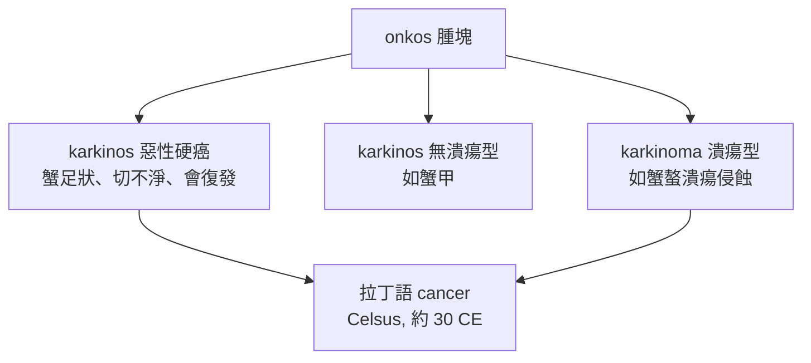

## -0400 - 希波克拉底的螃蟹（karkinos：癌症命名的誕生與體液腫瘤學）

## 案件摘要

**本案偵破的是一個名字的誕生，以及一套統治腫瘤學近 2000 年的錯誤理論。**

約西元前 400 年，希波克拉底（Hippocrates，約前 460–前 370）在科斯島的醫學學派以 $ \kappa\alpha\rho\kappa\iota\nu o\varsigma $（karkinos，螃蟹）命名惡性腫瘤：晚期乳癌表面怒張的靜脈從腫塊向四周伸延，「像一隻螃蟹的腳」。羅馬塞爾蘇斯（Celsus，約 30 年）將其譯為拉丁文 **cancer**；蓋倫（Galen，129–200）另用 $ \omicron\gamma\kappa o\varsigma $（onkos，腫塊）指一切腫脹——這就是 **oncology（腫瘤學）** 的詞源。與命名同時交棒的，是**黑膽汁致癌說**：癌症是體液失衡的結果（詳見 `0170-蓋倫黑膽汁說.md`）。

## 前因 -- 為什麼會有這個案子

- **自然哲學取代神罰**。希波克拉底學派主張「疾病皆有自然原因」（《聖病論》），把腫瘤從神靈懲罰轉為可觀察、可分類的自然現象——這是腫瘤可以被「偵辦」的前提。
- **體液病理學框架**。四體液說（血液、黏液、黃膽汁、黑膽汁）是當時唯一的系統性病理理論；一切疾病都必須被翻譯成「某種體液過多或失衡」。
- **臨床觀察的積累**。《希波克拉底文集》記載了乳癌、皮膚癌、直腸癌的表現；乳癌硬腫與淺表靜脈怒張的「蟹足」形象，來自真實床邊觀察。
- **外科的初步嘗試**。文集明言：表淺癌症可以切除，「但藏在深處者，切除後病人死得更快」——第一次記錄了癌症手術後復發與轉移的臨床事實。

## 線索與推理 -- 數學式、程式、理論

**線索一：命名即分類。** 希臘醫生把「異常腫塊」分成三層：

**線索二：體液腫瘤學的「理論」。** 黑膽汁鬱積致癌的推理鏈：屍體中腫瘤常含黑色液體 → 黑膽汁為四體液中最「重」最易鬱積 → 鬱積處生熱、腐化、成瘤。用現代語言改寫其「數學」：

$$ \text{腫瘤體積} \propto \int_{t_0}^{t} Q_{\text{黑膽汁}}(\tau)\, d\tau - \Phi_{\text{排泄}}(t) $$

即腫瘤大小是黑膽汁累積量與排泄通量之差；治療自然就是「清空體液」——瀉藥、放血、催吐。這套公式錯在變量，卻對在**結構**：它第一次把腫瘤描述成「某種物質的動態累積過程」，而現代腫瘤學的核心方程（細胞群體動力學）形式上完全同構：

$$ \frac{dN}{dt} = rN\left(1 - \frac{N}{K}\right) $$

**線索三：復發與轉移的首次記錄。** 文集《疾病七》記載乳癌切除後病灶在對側與子宮「重現」——這是**轉移（metastasis）概念在文獻中的第一次現身**，比 Paget 的種子土壤學說（見 `1889-佩吉特種子土壤學說.md`）早 2200 年。

## 結案 -- 後果與影響

- **詞彙即遺產**。cancer、oncology、carcinoma、carcinogen 全部源自本案；「螃蟹」意象成為癌症的文化符號（巨蟹座、現代抗癌標誌）。
- **體液致癌說統治 1800 年**。直到魏爾嘯（見 `1858-魏爾嘯細胞病理學.md`）用顯微鏡推翻，醫生治療癌症的手段始終是瀉藥與放血，外加燒灼與不徹底的切除。
- **「不可治」的臨床傳統**。希波克拉底「深部癌症不切為宜」的原則，使整個古代—中世紀外科對癌症態度保守，客觀上也避免了大量不必要的創傷。
- **預後觀察的起點**。文集對病程、復發、死因的系列記錄，是腫瘤自然史研究的開端——現代癌症登記與預後統計的方法論祖先。
- **一句話結案**：希波克拉底沒有抓到兇手，但他**給兇手拍了通緝照、寫了犯案特徵**；而黑膽汁說是他遞交的第一份錯誤筆錄——錯誤但系統，足以讓後人接手重審。

## 關鍵人物與文獻

- **Hippocrates（約前 460–前 370）**——科斯島醫生，「醫學之父」；《希波克拉底文集》中《論疾病》《預後》等篇載有癌症描述。
- **Celsus（約 25 BCE–50 CE）**——《論醫學》拉丁譯 cancer 並記載乳癌切除術，羅馬外科百科全書作者。
- **Galen（129–200）**——見 `0170-蓋倫黑膽汁說.md`。
- 原始文獻——*Hippocratic Corpus*: *Diseases*, *Aphorisms*；Celsus, *De Medicina*（1478 年首印）。
