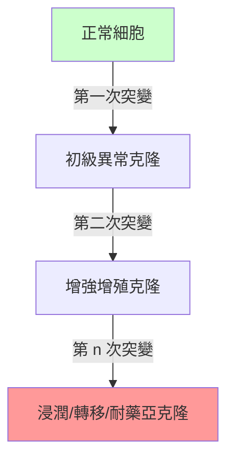

## 1858 - 魏爾嘯《細胞病理學》（Omnis cellula e cellula：癌症的細胞定位與慢性刺激爭論）

## 案件摘要

**本案偵破的是醫學史最著名的一句判詞：一切細胞來自細胞。**

1858 年，Rudolf Virchow（1821–1902）在柏林出版《細胞病理學》（*Die Cellularpathologie in ihrer Begründung auf physiologische und pathologische Gewebelehre*，講稿 20 講）。他把人體定義為「細胞組成的細胞國家」：疾病不是體液混亂（蓋倫），不是自由凝結的芽基（其師 Müller），而是**細胞層次上正常生命活動的變形**。對癌症而言，本案的兩項裁定影響至今：(1) 腫瘤是**細胞的過度增殖**，增殖是既有細胞分裂的產物；(2) 他提出「慢性刺激」（chronic irritation）可誘發腫瘤——當時被視為致癌機制的候選主犯。他同時命名了 leukemia（白血病，1845）、thrombosis、embolism，創辦《Virchows Archiv》（1847，至今仍在出版）。

## 前因 -- 為什麼會有這個案子

- **Müller 的 blastema 說留下懸案**（見 `1838-米勒腫瘤細胞學說.md`）：細胞若能自無結構液體自發生成，則生命論與自然發生說仍有一扇後門。
- **「自由細胞形成」的流行**。1830–40 年代多數病理學家相信膿液、癌組織中的細胞可以在細胞外液中原地凝成。
- **Remak 與 Kölliker 的顯微觀察**。Robert Remak 直接觀察到蛙血細胞與胚胎組織的**細胞分裂**全程；1845 年他已主張細胞以分裂增殖——魏爾嘯的理論建立在這些觀察之上。
- **政治—公共衛生背景**。魏爾嘯 1848 年因上西里西亞斑疹傷寒調查報告觸怒當局，被「流放」到柏林病理學講席；他終身堅持「醫學是社會科學，政治是更廣義的醫學」。

## 線索與推理 -- 數學式、程式、理論

**線索一：omnis cellula e cellula 的邏輯。** 這是一個全稱命題的否定式證明：

$$ \neg(\exists\, \text{無源細胞}) \;\Longrightarrow\; \forall\, \text{病理細胞},\; \exists\, \text{母細胞} $$

推論直落：**癌細胞必有一個正常細胞祖先**，且其後代以分裂方式傳承——這正是「腫瘤克隆性」概念的祖先。現代克隆演化模型（單細胞起源、亞克隆分化、突變累積）在邏輯上就是 Virchow 命題的分子生物學版本：

**線索二：慢性刺激說——推理正確前提下的錯誤指認。** Virchow 觀察到癌常發生於長期炎症、潰瘍、疤痕處（如老胃潰瘍邊緣），遂主張「慢性刺激使細胞過度增殖而癌變」。用現代眼光重審：

| Virchow 主張 | 現代裁定 |
|---|---|
| 慢性刺激→增殖→癌 | 基本正確：慢性炎症（HBV、HPV、IBD、H. pylori）確是明確致癌因素 |
| 刺激本身（非細胞內因）是主犯 | 錯誤：真正的作案人是細胞內的突變累積（見 `1902-Boveri體細胞突變說.md`） |
| 腫瘤=增殖失控 | 完全正確，統治至今 |

他把「環境誘因」當成「直接病因」，卻正確鎖定了「細胞增殖」這一犯罪行為本身。

**線索三：反對他人時的自我失誤。** 魏爾嘯強烈反對典範轉移中的兩位後來者：他抵制達爾文學說在醫學的應用，並低估了細菌學（曾稱結核桿菌發現「意義有限」）——提醒我們偵探本人也會成為下一個案件的障礙。

## 結案 -- 後果與影響

- **病理學現代化完成**。「病理=形態學」的學科定位延續 150 年；今日的病理報告（組織學類型、分化程度、脈管侵犯）仍是 Virchow 式描述語言。
- **腫瘤治療獲得概念地基**。既然癌是細胞病變，那麼「切掉所有病變細胞」（Halsted，見 `1894-Halsted根治性乳房切除術.md`）與「毒殺分裂細胞」（氮芥化療，見 `1943-氮芥與化療的誕生.md`）都成為邏輯上自洽的策略。
- **慢性刺激說的當代回響**。炎症—癌症關聯如今是成熟領域（NF-κB、IL-6/JAK/STAT、免疫監視逃逸），2022 年後仍每年產生大量文獻——錯案的犯罪動機分析被部分平反。
- **公共衛生遺產**。柏林的下水道工程（魏爾嘯倡議）、現代社會醫學概念，與其病理學同出一源：疾病必須在細胞與社會兩個層次同時偵辦。
- **一句話結案**：魏爾嘯把癌的戶籍落在「細胞」名下，並給出「增殖失控」的行為側寫；至於兇手（突變）的身份要到 1902 年 Boveri 檢查「犯罪現場的染色體」才初次浮出。

## 關鍵人物與文獻

- **Rudolf Ludwig Virchow（1821–1902）**——柏林病理學教授、《醫學改革》主編、德國進步黨創始人之一、柏林自由大學（柏林大學分校）創辦者；「醫學上的 pope」。
- **Robert Remak（1815–1865）**——細胞分裂的實際發現者之一；其貢獻長期被魏爾嘯的敘事遮蔽，20 世紀後期史學為之平反。
- **Julius Cohnheim（1839–1884）**——魏爾嘯學生，1867 年提出「胚胎殘餘說」（腫瘤源自錯位的胚胎細胞），是腫瘤幹細胞概念的 19 世紀祖先。
- 原始文獻——Virchow, *Die Cellularpathologie*, Berlin: Hirschwald, 1858（英譯 *Cellular Pathology*, Chance, 1860）；*Virchows Archiv* 創刊 1847。
