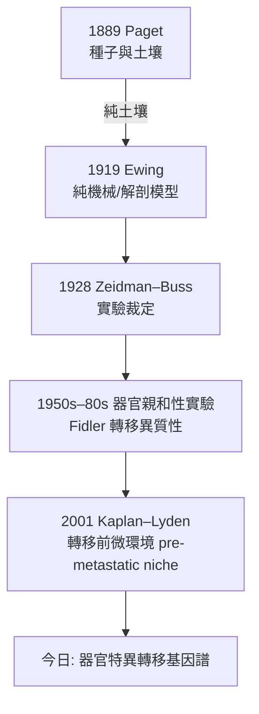

## 1889 - 佩吉特《乳癌的播散》（種子與土壤：轉移機制的第一份理論卷宗）

## 案件摘要

**本案偵破的是一個至今仍是腫瘤學核心的謎題：為什麼乳癌總愛轉移到骨頭，而轉移到哪裡並不完全由血流的隨機沖刷決定？**

1889 年，倫敦聖巴多羅買醫院的外科醫生 Stephen Paget（1855–1926）在《柳葉刀》發表《乳癌的繼發播散之分布》（*The Distribution of Secondary Growths in Cancer of the Breast*）。他統計了 735 例死於乳癌的屍檢記錄：骨轉移 185 例，且明顯好發於富血供的椎體與骨盆，而脾臟幾乎倖免。他的結論只有一句被引用至今的話：

> 「當一株植物播種時，幼苗能在各處生長嗎？不。**種子被帶到各處，但它們只能在被適合其生長之處發芽。**」

這就是**種子與土壤學說（seed and soil hypothesis）**：轉移不僅取決於癌細胞（種子）的播撒，還取決於靶器官微環境（土壤）是否接納。

## 前因 -- 為什麼會有這個案子

- **轉移已是公認事實**。自 Waldeyer（1867）確證癌細胞經淋巴與血行播散後，主流機械論假說是「栓子假說」：轉移應嚴格沿血流方向分布。
- **屍檢數據在堆積**。聖巴多羅買醫院累積了大量癌症死亡屍檢——當時世界最大規模之一；Paget 的父親 Sir James Paget 也是著名外科醫生（Paget 病命名者），家中病案俯拾皆是。
- **對手的挑戰**。1889 年幾乎同時，劍橋的解剖學講師 Herbert Snow 提出「機械濾過說」：腫瘤栓子被毛細血管床物理截留，故好發肺、肝——純粹的流體力學解釋。
- **Halsted 根治手術的時代氛圍**。1880–90 年代外科界正走向「把癌切得更大更淨」的路線（見 `1894-Halsted根治性乳房切除術.md`），隱含假設是「癌是純局部疾病」——Paget 的數據對此構成潜在反駁。

## 線索與推理 -- 數學式、程式、理論

**線索一：735 例的統計推理。** Paget 用分布數據反駁純機械模型。若轉移只由血流灌注定，則轉移概率應正比於各器官血流量；實際數據偏離顯著：

| 器官 | 血流占比（近似） | 乳癌轉移頻率 | 是否符合機械說 |
|---|---|---|---|
| 肝 | 中（門脈系） | 高 | 部分符合 |
| 脾 | 中 | **極低** | **否**（最關鍵反例） |
| 骨（椎體/骨盆） | 低 | **高**（185/735） | **否** |
| 腎 | 高 | 低 | 否 |

脾臟血流豐富卻幾乎沒有轉移，椎體血流不占優勢卻是轉移大戶——機械濾過說無法解釋，必然存在「器官對種子的親和性」。

**線索二：用現代分子語言復原 Paget 方程。** 轉移效率可寫成乘積形式：

$$ P(\text{轉移至器官 } i) = P(\text{播撒至 } i) \times P(\text{著床存活} \mid i) = F_i \times S_i $$

Paget 的洞見是：$ S_i $（土壤因子）與 $ F_i $（血流因子）**獨立可變**。今日的分子對應物——CXCR4/CXCL12（乳癌→骨/肺）、PTHrP-RANKL（乳癌→骨溶骨）、整合素譜（器官特異著床）、器官趨化因子圖譜——全部是 $ S_i $ 的具體化。

**線索三：與 Ewing 的百年論戰。** 1919 年 James Ewing 以「解剖血流模型」反擊（部分器官確由血流分布解釋）；此案以 1928 年 Zeidman 與 Buss 的實驗裁定：把腫瘤細胞注射入血流，其在各器官的著床分布**不與血管床容量成正比**——種子與土壤說勝訴，但真相是合併模型：$ P = F \times S $，兩個因子都真實存在。

## 結案 -- 後果與影響

- **腫瘤微環境研究的開山卷宗**。今日的癌相關成纖維細胞（CAF）、腫瘤相關巨噬細胞（TAM）、外泌體導向的轉移前小生境、骨髓微環境與多發性骨髓瘤——全部是「土壤」的當代版本。
- **直接影響治療策略**。雙膦酸鹽與 denosumab 預防乳癌/前列腺癌骨轉移，正是「改造土壤使種子無法發芽」的藥物化實現。
- **預言了器官特異性轉移基因**。2000s 年代 Massagué 團隊發現的轉移器官趨向基因（如乳癌轉骨的 CXCR4、CTGF），使 Paget 的隱喻變成可操作的分子靶點清單。
- **與 Halsted 的張力**。種子土壤說暗示「局部徹底切除也擋不住全身播種」，此直覺在 20 世紀下半葉由 Fisher 的系統性觀點證實（見 `1943-氮芥與化療的誕生.md` 與輔助化療的興起）。
- **一句話結案**：Paget 證明轉移不是被動的漂流事故，而是**種子對土壤的擇居**——癌細胞不是隨機流浪漢，而是帶著房產偏好的入侵者。

## 關鍵人物與文獻

- **Stephen Paget（1855–1926）**——聖巴多羅買醫院外科醫生、業餘作家；除種子土壤說外，著有《實驗生理學導論》，晚年寫作與醫學史。
- **Herbert Snow（1855–1932）**——機械濾過說的辯護者，倫敦癌症醫院（今 Royal Marsden）外科醫生。
- **James Ewing（1866–1943）**——紐約 Memorial 醫院病理主任，《腫瘤病論》（*Neoplastic Diseases*, 1919）作者；Ewing 肉瘤以其命名。
- **Irving Zeidman & Belding Buss**——1928 年實驗轉移研究，為論戰提供實驗證據。
- 原始文獻——Paget S., "The distribution of secondary growths in cancer of the breast", *Lancet* 1:571–573, 1889；Fidler IJ, "Seed and soil revisited", *Adv Cancer Res*, 2003。
