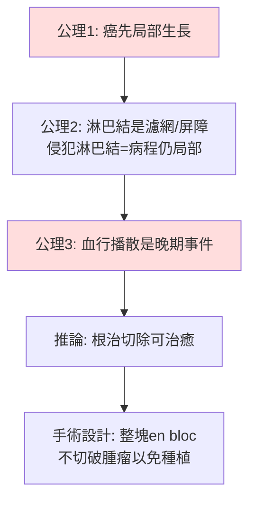

## 1894 - Halsted 根治性乳房切除術（麻醉與消毒之後：腫瘤外科的「切到極致」時代）

## 案件摘要

**本案偵破的是外科腫瘤學最大的制度建築：以解剖學原則為基礎的根治手術哲學。**

1894 年，約翰霍普金斯醫院的 William Halsted（1852–1922）在《約翰霍普金斯醫院通報》發表乳癌根治性乳房切除術（radical mastectomy）的 50 例報告（與 Meyer 同期發表）：整塊切除**乳房＋胸大肌＋全部腋窩淋巴結**（1898 年後加切胸小肌）。其理論依據是「腫瘤按解剖學同心擴散」假說：乳癌先局部生長、再經淋巴管按序擴散，若在離心擴散到全身前把局部與區域淋巴整塊連續切除，即可治癒。Halsted 術式使乳癌局部復發率從當時的 60–80% 降到約 6%——但推到極致的「越大越好」哲學，要到 100 年後才被 Fisher 的對照試驗推翻。

## 前因 -- 為什麼會有這個案子

- **麻醉（1846 Morton）與消毒（1867 Lister）解除兩大枷鎖**。在手術不再意味著疼痛與敗血症之後，「切多大」成為純粹的醫學—解剖問題。
- **Berg 的德國先行數據**。1867 年 Charles Moore 主張乳癌應整塊廣切；德國的 Heidenhain（1889）與 Handley（1907，兩手術原理「離心播散律」）描述了乳癌在乳房內與淋巴管的連續蔓延。
- **Halsted 的德國留學**。1878–80 年他在維也納 Billroth、漢堡 Esmarch 處受訓，把德國的嚴謹實驗外科帶回美國；1880s 在紐約開創了無菌操作、止血鉗、局部浸潤麻醉（神經阻滯的發明者之一）。
- **可卡因與手術室的現代化**。Halsted 本人因可卡因（後嗎啡）成癮終身——這位最冷靜精確的外科改革者私下與藥物成癮搏鬥一生，是醫學史的著名悲劇側寫。

## 線索與推理 -- 數學式、程式、理論

**線索一：離心擴散模型。** Halsted 的致癌—播散模型可用幾何形式寫出：

$$ R_{\text{復發}} \approx 1 - \prod_{k=1}^{n} \left(1 - p_k\right), \quad p_k = P(\text{殘留癌細胞於解剖層 } k) $$

切除的解剖層 $ k $ 越多（皮膚→乳房→胸大肌→淋巴結→胸小肌），殘留概率乘積越小，復發率應單調下降。1880s 數據支持：Billroth 術式局部復發率約 80%；Halsted 首批 50 例僅 3 例局部復發——直覺上「切更多＝更好」被初步驗證。

**線索二：完整的推理鏈與其隱含公理。**

隱含公理 3——血行播散只是晚期現象——是整座建築的裂縫。Fisher（1970s）將證明：**微轉移在診斷時即已存在**於相當比例的病人，淋巴結是預後指標（indicator）而非屏障（barrier）。

**線索三：系統性觀點的後來反擊。** 乳癌的自然史符合「早期播散模型」：

| 模型 | 預言 | 實測（NSABP B-04, 1985；Veronesi 1981） |
|---|---|---|
| Halsted 模型 | 根治術應優於較小手術+放療 | **20 年存活率無顯著差異** |
| Fisher 系統模型 | 局部手術範圍不影響全身轉移 | 與實測吻合 |

1985 年後，改良根治術→保留乳房手術（lumpectomy＋放療）成為標準，百年建築完成拆除。

## 結案 -- 後果與影響

- **「腫瘤外科原則」的制度化**。整塊切除、不觸碰腫瘤、淋巴清掃、無瘤技術（no-touch technique 由 Cole 1950s 系統化）——今日腫瘤外科的骨幹仍是 Halsted 語法。
- **美國外科學派崛起**。Johns Hopkins 模式（住院醫師制度、屍檢對照、病案登記）隨 Halsted 學派輸出全球；他的住院醫師 Cushing、Dandy 開創了神經外科。
- **對「越大越好」的教訓**。根治術時代也生產了上頜骨全切、半骨盆離斷等激進手術；20 世紀後期「多學科綜合治療＋最小有效切除」的路線（保乳、前哨淋巴結活檢）是對本案的改判。
- **前哨淋巴結活檢（1990s Giuliano/Krag）**——把「清掃一切」改為「先查第一站」，若陰性則不再清掃：Halsted 公理 2 的最終翻案。
- **一句話結案**：Halsted 用解剖學邏輯蓋起腫瘤外科的第一座大廈，復發率數據短期內全對、長期存活率上全錯——**局部復發率的下降不等於治癒率的上升**，這是本案留給所有腫瘤科醫生的最重要教訓。

## 關鍵人物與文獻

- **William Stewart Halsted（1852–1922）**——Johns Hopkins 首任外科主任；乳癌根治術、腹股溝疝修補、甲狀腺手術與住院醫師制度的奠基者；終身與可卡因/嗎啡成癮共存。
- **Charles Moore（1821–1870）**——1867 年主張乳癌廣泛切除的倫敦外科醫生，本案的思想先驅。
- **Bernard Fisher（1913–2012）**——NSABP 創立者，以隨機對照試驗推翻 Halsted 範式；亦捲入 1990s 資料造假風波（其下屬 Poisson 造假，Fisher 本人未被認定造假但被追責）——科學自我修正的另一面。
- 原始文獻——Halsted WS, "The results of operations for the cure of cancer of the breast", *Johns Hopkins Hosp Rep* 4:297–350, 1894–95；Fisher B et al., *NEJM* 312:665, 1985。
