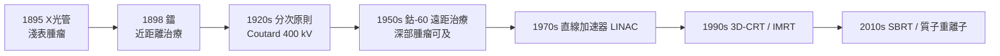

## 1896 - 第一例放射治療（發現 X 光後 3 天開始的醫療遠征）

## 案件摘要

**本案偵破的是人類第一次「隔著皮膚殺死身體內部的腫瘤」。**

1895 年 11 月 8 日，Würzburg 的 Wilhelm Röntgen（1845–1923）發現 X 射線；1896 年 1 月起，放射治療的醫療應用在**發現後數日到數月內**即席捲全球。1896 年 1 月 29 日，芝加哥學生 Emil Grubbé 為一位患乳癌的婦女施行了可能是最早的 X 光照射治療（其優先權有爭議，但文獻記錄完整）；同年維也納 Freund 以 X 光治療多毛痣；1899 年瑞典 Stenbeck 與 Sjögren 用分次照射**治癒**一例皮膚基底細胞癌，病人存活多年——放射治療從「看見骨骼」的診斷奇技一躍成為癌症的治療武器。1896 年 3 月，Becquerel 發現鈾射線；1898 年居里夫婦發現鐳，放射腫瘤學的原料庫開張。

## 前因 -- 為什麼會有這個案子

- **陰極射線研究的時代競速**。1890s 歐洲物理實驗室競相研究陰極射線；Röntgen 觀察到鋇亞鉑酸鹽螢光屏在未通電的管旁發光，追蹤出一種能穿透紙、肉、木板的新射線。
- **「能穿透皮膚」的即時醫療想像**。X 光照片（1895.12.22 的手骨照）轟動全球，醫生立刻追問：能穿透的東西，能否用來治療看得見的腫瘤？
- **腫瘤外科的天花板**。Halsted 式根治手術（見 `1894-Halsted根治性乳房切除術.md`）對深部腫瘤、不適合手術者無能為力；物理學送來了「無創深部治療」的第一把鑰匙。
- **鐳的加入**。1898 年居里夫婦分離出鐳；1903 年 Danlos 與 Bloch 首先將鐳置入腫瘤內——近距離放射治療（brachytherapy）的起點。

## 線索與推理 -- 數學式、程式、理論

**線索一：為何射線能殺癌細胞？1900s 的機制偵查。** 當時無人知道機制，真正答案是**電離損傷 DNA**：

$$ \text{吸收劑量 } D = \frac{\Delta E}{m}\ [\text{Gy} = \text{J/kg}], \qquad \text{存活率} \; S = e^{-\alpha D - \beta D^2} $$

（線性二次模型 LQM，1920s–70s 才定型。）X 光在細胞內引發自由基、造成 DNA 雙鏈斷裂，分裂旺盛的腫瘤細胞修復能力較弱而被選擇性清除——「殺分裂中的細胞」正是放射治療的治療指數來源。

**線索二：分次照射的經驗發現。** 早期一次大劑量照射造成嚴重皮膚壞死；Stenbeck 等人偶然的「分次、小劑量、多日」方案反而療效更好、副作用更小。1920s 法國 Regaud 與 Coutard 在鐳研究所確立分次放射治療（fractionation）原則——利用正常組織與腫瘤組織**亞致死損傷修復與再增殖**的時間差：

$$ \text{正常組織修復快、腫瘤修復慢} \Rightarrow \text{每日小劑量累積} \Rightarrow \frac{\text{腫瘤致死}}{\text{正常組織損傷}} \uparrow $$

**線索三：從 X 光管到鈷-60 到直線加速器。**

## 結案 -- 後果與影響

- **放射腫瘤學成為獨立學科**。今日約半數癌症病人在病程中接受放療；早期喉癌、前列腺癌、宮頸癌、霍奇金淋巴瘤等，放療可單獨治癒。
- **諾貝爾獎的密集期**。1901 Röntgen（首屆物理獎）、1903 Becquerel 與居里夫婦、1911 居里夫人（化學獎，鐳的隔離）——癌症治療從物理學獎的衍生物起步。
- **代價與防護**。早期放射工作者（X 光技師、居里夫人）大量罹患白血病與皮膚癌；1928 年國際 X 射線防護委員會（今 ICRP 前身）成立——職業防護制度是本案的黑色副產品。
- **放療＋外科＋化療的三駕馬車成型**。1930s 後的綜合治療（術前/術後放療、同步化放療）讓「局部控制」與「系統控制」分工——腫瘤學的治療三角由此確立。
- **一句話結案**：放射治療證明了**腫瘤可以在體內被精確地、非接觸地殺死**——這個 1896 年的突然事實，至今仍是放療這門「用物理學治癌」的學科的全部哲學起點。

## 關鍵人物與文獻

- **Wilhelm Conrad Röntgen（1845–1923）**——Würzburg 大學物理學教授，1901 年首屆諾貝爾物理學獎。
- **Emil Grubbé（1875–1960）**——芝加哥醫學生，1896 年 1 月率先（或最早之一）用 X 光治療乳癌；其優先權因缺乏旁證長期存疑。
- **Marie & Pierre Curie**——1898 年發現鐳與釙；Marie 兩獲諾貝爾獎，因長期放射暴露死於再生不良性貧血（1934）。
- **Henri Coutard（1876–1950）**——確立分次放射治療原則的法國先驅。
- 原始文獻——Röntgen, "Über eine neue Art von Strahlen", *Sitzungsber. Würzburger Phys.-med. Ges.*, 1895；Coutard H., *AJR*, 1932（分次放療原理）。
