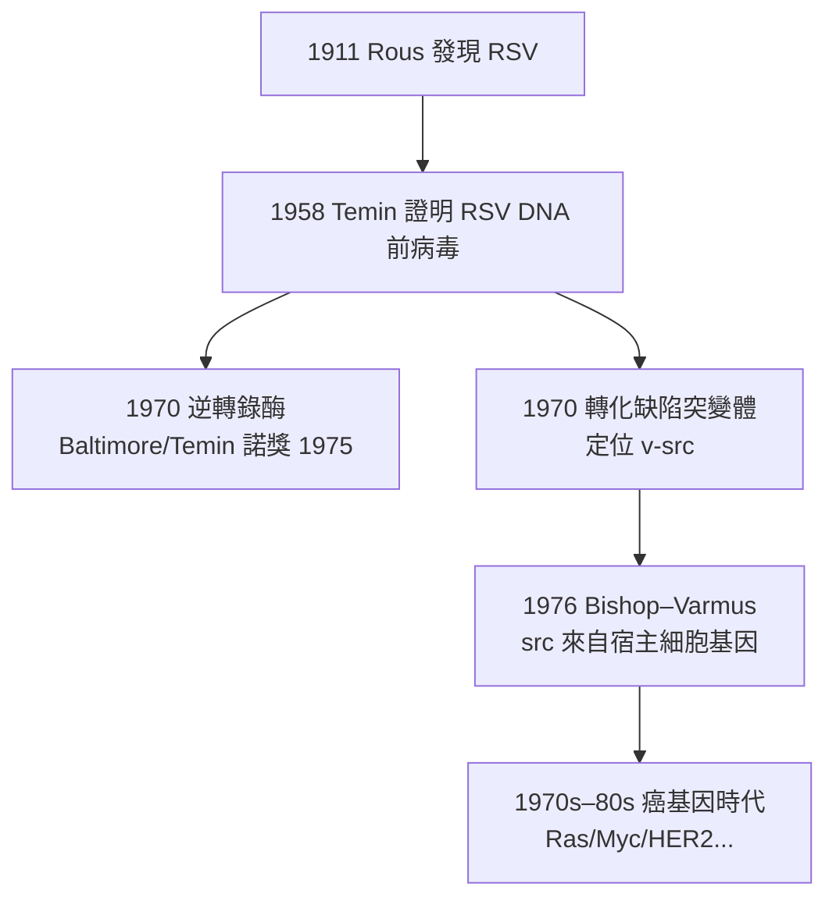

## 1911 - 勞斯肉瘤病毒（一個雞的腫瘤、一台濾過器，與被冷落半世紀的病毒致癌說）

## 案件摘要

**本案偵破的是一個超前時代的發現：腫瘤可以由一種「能通過細菌濾器」的微粒傳染——病毒致癌的第一份鐵證。**

1911 年，洛克菲勒醫學研究所的 Peyton Rous（1879–1970）報告：把普利茅斯岩雞（Plymouth Rock hen）的梭形細胞肉瘤無細胞濾液（經 Berkefeld 濾器，孔徑小到連細菌都過不去）注射入同系雞體，可以誘發同樣的肉瘤。兇手後來被命名為 **Rous sarcoma virus（RSV，勞斯肉瘤病毒）**。這個發現當時被主流病理學（包括 Virchow 學派傳人與 Ewing）斥為「雞的怪事」，Rous 甚至因此放下腫瘤研究改做其他方向——直到 1950s 病毒致癌研究復興，1966 年（發現後 55 年）他獲諾貝爾生理學或醫學獎。

## 前因 -- 為什麼會有這個案子

- **1908 年的先聲**。丹麥的 Ellermann 與 Bang 證明雞白血病可經無細胞濾液傳播——但當時「白血病是否是腫瘤」本身有爭議，故未引起重視。
- **1909 年 8 月的病案**。長島一位農民帶來一隻胸部腫大的母雞；Rous 解剖發現梭形細胞肉瘤，並注意到同籠雞也可能發病——腫瘤會不會傳染？
- **濾過性病毒（filterable virus）概念已成熟**。1892 年 Ivanovsky、1898 年 Beijerinck 確立「比細菌更小的可濾過病原」；口蹄疫（1898 Loeffler–Frosch）已證明動物病毒存在。
- **體液說幽靈仍在其位**。「腫瘤可傳染」與主流的「慢性刺激/組織病變」範式衝突，Ewing 明確反對——科學共同體的保守性即將讓這份鐵證冷凍半個世紀。

## 線索與推理 -- 數學式、程式、理論

**線索一：三步鎖鏈的排除法推理。** Rous 的推理是把腫瘤「提取物」的傳染性做逐級排除：

$$ \text{腫瘤勻漿} \xrightarrow{\text{離心去除細胞}} \text{上清} \xrightarrow{\text{Berkefeld 濾器}} \text{無細胞濾液} \xrightarrow{\text{接種}} \text{新肉瘤} $$

能通過濾器→非細菌；無細胞仍能傳病→病原是可濾過微粒（病毒）。這在 1911 年是**把 Koch 法則推到極限**的乾淨推理。

**線索二：病理學共同體為何拒收？** 因為 RSV 的宿主譜極窄（幾乎只感染雞），無法解釋人類腫瘤；而當時多數人類腫瘤在流行病學上顯然不傳染。用現代語言說，Rous 遇到的是**證據充分但外推性不足**的困境——這不是錯誤，而是需要時間等待「腫瘤病毒譜系」的補全。

**線索三：RSV 的分子遺產（1970s 的兌現）。** 1970 年 Martin、1971 年 Vogt 發現 RSV 的**轉化缺陷突變體**；1970 年 Baltimore 與 Temin 發現逆轉錄酶（RSV 是逆轉錄病毒，RNA→DNA）；1976 年 Bishop–Varmus 在 RSV 中找到 **src 癌基因**（見 `1976-癌基因src的發現.md`）——原癌基因（proto-oncogene）概念的直接源頭：

## 結案 -- 後果與影響

- **病毒致癌譜系的建立**。1933 Shope 兔乳頭瘤病毒、1936 Bittner 小鼠乳癌因子（乳汁傳播的 MMTV）、1950s 多瘤病毒與腺病毒——動物腫瘤病毒成為研究致癌機制的標準工具箱。
- **人類腫瘤病毒的確認**。1964 Epstein–Barr 病毒（Burkitt 淋巴瘤）、1970s HBV（肝癌）、1980 HTLV-1（成人 T 細胞白血病）、1984 HPV-16/17（宮頸癌，zur Hausen，見 `2006-HPV疫苗嘉喜.md`）、2020 Kaposi 肉瘤皰疹病毒（HHV-8）——全球約 10–15% 的人類癌症與病毒感染相關，且**這部分癌症可以靠疫苗預防**。
- **現代分子腫瘤學的技術母體**。逆轉錄病毒載體至今是基因治療（包括 CAR-T 的轉導系統，見 `2012-CAR-T與Emily Whitehead.md`）的工具；RSV 這隻雞的病毒成為基因工程的搬運工。
- **一句話結案**：Rous 用一台濾過器證明腫瘤可以由最微小的病原傳遞，卻被科學共同體冷凍了 55 年——本案提醒所有偵探：**一個太超前的真相，需要等待偵查技術（與同行的想象力）跟上**。

## 關鍵人物與文獻

- **Peyton Rous（1879–1970）**——洛克菲勒醫學研究所成員，1966 年諾貝爾生理學或醫學獎（與 Huggins 同獲）；享年 85 歲，是諾獎史上獲獎距離發現時間最長的紀錄之一（55 年）。
- **Vilhelm Ellermann & Oluf Bang**——1908 年證明雞白血病可經濾液傳播的丹麥先行者。
- **Renato Dulbecco（1914–2012）**——腫瘤病毒研究第二代宗師（1975 諾獎），培養出 Bishop、Varmus、Vogt、Stoker 等一代癌基因獵人。
- 原始文獻——Rous P., "A sarcoma of the fowl transmissible by an agent separable from the tumor cells", *J Exp Med* 13:397–411, 1911。
