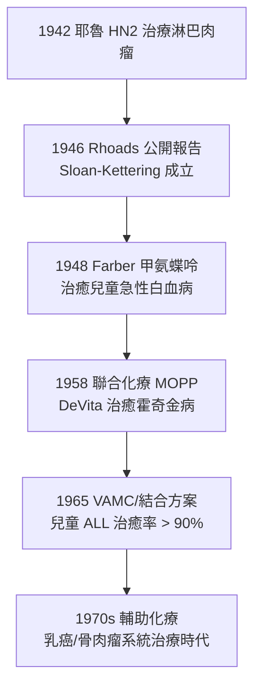

## 1943 - 氮芥與化療的誕生（毒氣戰的廢墟裡長出的第一劑「全身治癌藥」）

## 案件摘要

**本案偵破的是腫瘤治療第三支柱——化學治療——的出身：它不是從實驗室的靈感，而是從兩次毒氣事故的病理報告中誕生。**

1943 年 12 月 2 日，納粹空軍轟炸義大利巴里港（Bari），盟軍運輸船 *John Harvey* 號上秘密搭載的 100 噸芥子氣炸彈洩漏，數百名水兵出現嚴重的骨髓抑制與淋巴組織破壞——美國毒氣專家 Alexander 等的病理調查報告明確記錄「淋巴細胞與骨髓細胞最先被殲滅」。此前耶魯的 pharmacologists Goodman 與 Gilman（受 1930s 發現氮芥抑制實驗動物淋巴組織的啟發）已與胸外科醫生 Lindskog 合作，於 1942–43 年用氮芥（nitrogen mustard, HN2）治療一例晚期淋巴肉瘤病人，獲得**短暫但明確的腫瘤消退**——人類第一例化學治療使惡性腫瘤客觀縮小。1946 年 Rhoads 在《JAMA》發表系統報告，化療作為學科正式起步。

## 前因 -- 為什麼會有這個案子

- **一戰毒氣的醫學線索**。硫芥（Mustard gas）在 1917 年造成數十萬傷亡；戰後報告即注意到受曝者**白細胞減少、淋巴組織萎縮**——「能系統性殺滅分裂旺盛細胞」的物質已經存在。
- **1930s 的化學改良**。1929–30s 起英美（含艾爾利希化療傳統，見 `../性病的歷史/1910-埃爾利希洒爾佛散606.md`）發展氮芥（把硫換成氮，穩定性提高）；1935–42 年 Goodman & Gilman 在耶魯動物實驗證實其對小鼠淋巴瘤的抑制作用。
- **戰時保密**。氮芥是化學武器，研究以密碼名（「Crossroads」等）進行，臨床結果直到 1946 年才公開——本案的「案發時間」有 1942（治療）與 1946（公開）兩個時間戳。
- **外科與放療的局限**。1940s 腫瘤治療僅有手術與放療，皆為**局部**手段；白血病、淋巴瘤、廣泛轉移者完全無藥可治——醫學界急需「全身治療」。

## 線索與推理 -- 數學式、程式、理論

**線索一：為什麼毒氣會「選擇性」殺癌細胞？** 氮芥的作用機制是形成反應性 aziridinium 離子，對 DNA 鳥嘌呤 N7 烷基化、造成交叉連接（crosslink），阻斷複製：

$$ \text{氮芥} \to \text{aziridinium} \to \text{DNA 交叉聯結} \to \text{複製中止} \to \text{細胞死亡} $$

治療指數的來源是**增殖速度差**：腫瘤細胞與造血組織分裂快、對烷化劑最敏感——這正是巴里港病人骨髓被毀、而皮膚腸道相對次要（當時看來）的病理學倒影。今日寫成指數殺傷動力學：

$$ S = e^{-kD}, \quad \text{每次給藥按固定比例殺滅細胞（log-kill, Skipper 1964）} $$

**線索二：巴里港報告的雙重角色。** 它既是**意外的臨床試驗**（數百例「給藥」的流行病學數據），又提供了病理機制的系統屍檢證據——戰爭病理學意外完成了動物實驗無法完成的人體劑量—毒性曲線。

**線索三：從 HN2 到聯合化療的產業鏈。**

**線索四：與 Halsted 範式的哲學碰撞。** 氮芥證明「血液裡的藥能縮小腫瘤」→ 癌症是**全身性細胞增殖病**（Boveri 細胞說的治療版）→ 直接為 Bernard Fisher 1960s–70s 的系統治療理論（見 `1894-Halsted根治性乳房切除術.md`）提供藥理學武器：輔助化療徹底改寫了乳癌、骨肉瘤、兒童腫瘤的存活曲線。

## 結案 -- 後果與影響

- **腫瘤內科（medical oncology）誕生**。1950s–70s 醫院設立化療門診與內科腫瘤科；ASCO（1964）成立；腫瘤學從外科分支變成獨立的多學科醫學。
- **可治癒的腫瘤清單**。絨毛膜癌（Li 1956，甲氨蝶呤治癒）、霍奇金淋巴瘤、兒童 ALL、睪丸癌（1977 Einhorn 順鉑）——化療把一批「絕症」改寫為可治癒，這是放療與手術不曾完成的壯舉。
- **代價：治療指數的天花板**。烷化劑的骨髓抑制、脫髮、噁心與**繼發第二原發癌**（治療相關白血病）暴露了化療的雙刃性；止吐藥（5-HT3 拮抗劑 1990s）與 G-CSF 緩解了毒性問題。
- **方法論遺產**。劑量—反應曲線、隨機對照試驗、聯合用藥的藥理邏輯——全部從本案的「毒氣—骨髓」線索出發；Skipper 的 log-kill 假說與 Norton–Simon 假說是這條線的數學收束。
- **一句話結案**：氮芥的故事是醫學史最黑色的一課——**殺人武器的病理學報告，意外成為救人藥物的處方依據**；「殺滅分裂中的細胞」這一化療哲學，統治了腫瘤內科 40 年，直到標靶與免疫治療（見 `2001-基利克與慢性粒細胞白血病.md`、`2011-免疫檢查點抑制劑.md`）改寫規則。

## 關鍵人物與文獻

- **Louis Goodman（1906–2000）與 Alfred Gilman（1908–1984）**——耶魯藥理學家，《治療藥理學的藥理基礎》（Goodman & Gilman's Pharmacological Basis of Therapeutics，1955 初版）作者；受 US Army 資助研究氮芥。
- **Gustaf Lindskog（1902–2002）**——耶魯胸外科醫生，1942 年 8 月執行第一例氮芥治療（一例晚期淋巴肉瘤）。
- **Cornelius Rhoads（1899–1959）**——Memorial 醫院院長、Sloan-Kettering 研究所首任所長，化療運動的組織者；1930s 波多黎各「滅絕言論」爭議使其形象極具爭議。
- **Sidney Farber（1903–1973）**——「兒童腫瘤化療之父」，1948 年葉酸拮抗劑治白血病；Boston 的 Dana-Farber 腫瘤研究所以其命名。
- 原始文獻——Rhoads CP et al., "Nitrogen mustard in the treatment of neoplastic disease", *JAMA* 131:656, 1946；Alexander SF et al., "Medical treatment of mustard gas casualties", *Ann Intern Med*, 1947。
