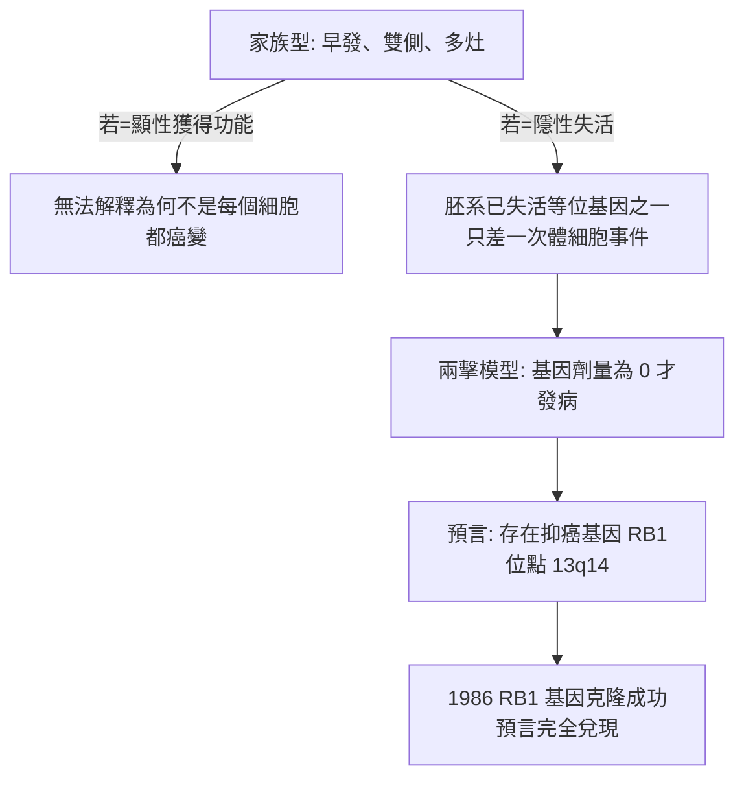

## 1971 - Knudson 兩擊論（用兒童腫瘤的統計數據推算出抑癌基因的存在）

## 案件摘要

**本案偵破的是腫瘤學最優雅的一次「純數學破案」：沒有顯微鏡、沒有 DNA 測序，只用一組發病年齡曲線，推算出細胞裡藏著一個「防癌基因」。**

1971 年，休士頓 MD Anderson 的兒科醫生—遺傳學家 Alfred Knudson（1922–2016）在《PNAS》發表對**視網膜母細胞瘤（retinoblastoma, RB）**的分析。他把 48 例病人的發病年齡分為「遺傳性（雙側/多發）」與「散發性（單側）」兩組，發現一個數學事實：**兩組的發病年齡分布可以用同一個二項過程解釋——腫瘤需要同一細胞中的兩次「事件」（hits）**。遺傳型病人出生時已帶一次胚系突變（第一擊免費），只需一次體細胞突變即發病，故早發、多發；散發型需兩次獨立體細胞突變，故晚發、單發。這就是**兩擊假說（two-hit hypothesis）**——抑癌基因（tumor suppressor gene）概念的誕生。

## 前因 -- 為什麼會有這個案子

- **視網膜母細胞瘤的特殊性**。發病率約 1/20000 活產，且存在明顯的「家族性＋雙側＋嬰兒期」與「散發性＋單側＋幼兒期」雙峰分布——自然史的數據乾淨得像實驗設計。
- **癌基因概念剛誕生但解釋不了它**。Rous 病毒 src（見 `1911-勞斯肉瘤病毒.md`）是顯性的「加速基因」，但 RB 的遺傳方式提示另一種邏輯：某種「失去才致病」的隱性因子。
- **Knudson 的雙重訓練**。他是加州理工學院數學學士、哥倫比亞醫學博士，兼備兒科腫瘤臨床與群體遺傳學訓練——正是「用統計推機制」的組合。
- **當時流行「多步致癌」敘事**。Armitage–Doll（1954）的多階段模型已用年齡—發病率曲線推測癌症需要 6–7 個獨立事件，但只是抽象的流行病學模型，無具體基因對應。

## 線索與推理 -- 數學式、程式、理論

**線索一：發病年齡曲線的偵查。** Knudson 對兩組病人擬合相同的事件數模型。設體細胞突變率為 $ \mu $，視網膜細胞總數 $ N $：

$$ P(\text{遺傳型發病}) = 1 - e^{-N\mu t} \quad (\text{只需 1 次事件}) $$
$$ P(\text{散發型發病}) = 1 - e^{-\frac{N\mu^2 t^2}{2}} \quad (\text{需 2 次事件}) $$

實測曲線與「遺傳型 1 擊、散發型 2 擊」的擬合極佳——Knudson 無需任何分子實驗，僅憑年齡分布就測出了「需要兩次失活事件」這一微觀機制。

**線索二：推理的完整邏輯鏈。**

**線索三：RB1 基因的後續驗證（1986–87）。** Cavenee 與 Dryja（麻省總醫院/哈佛）用 RFLP 連鎖分析定位 RB1 到 13q14；1986 年 Friend、Lee、Dryja 克隆 RB1 cDNA。關鍵檢驗：把野生型 RB1 導入 RB 腫瘤細胞，腫瘤表型被**逆轉**——「失活的基因可以被補回而治療細胞」，證明其性質是抑制性而非顯性致癌。RB1 蛋白隨後被證明是細胞週期 G1/S 關卡的守門人（與 E2F、cyclin D/CDK4 軸心互作），人乳頭瘤病毒 E7 蛋白（見 `2006-HPV疫苗嘉喜.md`）直接降解 RB——「兩擊」的分子機制最終與病毒致癌學說在 RB 蛋白處匯合。

## 結案 -- 後果與影響

- **抑癌基因成為腫瘤學三大支柱之一**。繼 RB1 之後：p53（1979，見 `1979-p53守護者基因.md`）、APC（結腸癌）、BRCA1/2（1994–95，乳癌/卵巢癌遺傳易感）——當代腫瘤學的「癌基因（油門）＋抑癌基因（剎車）」二元模型由此成形。
- **遺傳性腫瘤症候群的理論基礎**。Li–Fraumeni 症候群、家族性腺瘤性息肉病、BRCA 症候群——全部符合「胚系一次突變＋體細胞一次突變」的兩擊邏輯，並直接催生遺傳諮詢、預防性手術（Angelina Jolie 2013）與胚系檢測產業。
- **方法論遺產：用人群數據推機制**。Knudson 之後，「年齡—發病率曲線」「家族聚集性分析」成為尋找致癌事件數與基因位點的標準工具；他的模型也是多步致癌數學（Armitage–Doll）的第一個具體基因版本。
- **臨床直接受益**。兩擊模型解釋了為何 RB 患兒的健側眼需終身監控（第二擊隨時可能到來）、為何父母攜帶胚系突變的子女應做基因檢測；今日視網膜母細胞瘤的治癒率已超 95%。
- **一句話結案**：Knudson 沒有動一根試管，僅憑 48 份病歷與一組年齡曲線，就**從統計學的縫隙裡推算出一個基因的存在**——這是流行病學推理在腫瘤學史上最漂亮的一次破案。

## 關鍵人物與文獻

- **Alfred G. Knudson（1922–2016）**——兒科醫生、遺傳學家，Fox Chase 癌症中心；兩擊假說為其終身代表作；亦提出「腫瘤抑制基因的單倍體不足」等概念。
- **Thaddeus Dryja & Webster Cavenee**——1980s RB1 位點定位與雜合性缺失（LOH）分析的核心人物。
- **Stephen Friend, Yuen-Kai Lee**——1986 年 RB1 cDNA 克隆；Friend 後轉向基因組醫學（Sage Bionetworks 創辦人）。
- 原始文獻——Knudson AG, "Mutation and cancer: statistical study of retinoblastoma", *PNAS* 68:820–823, 1971；Friend SH et al., "A human DNA segment with properties of the gene that predisposes to retinoblastoma and osteosarcoma", *Nature* 323:643, 1986。
