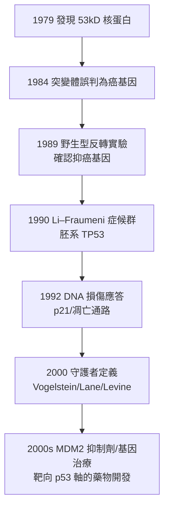

## 1979 - p53 守護者基因（從「癌基因」的烏龍、到「基因組守護者」的三十年平反）

## 案件摘要

**本案偵破的是腫瘤學史上最戲劇性的一次身份改判：一個被誤認為癌基因的蛋白，實為整個基因組的守護者。**

1979 年，六個實驗室（包括英國 David Lane、Lionel Crawford，美國 Arnold Levine、Lloyd Old 等）獨立報告了一個 53 kDa 的核蛋白，它在 SV40 病毒轉化的細胞中與病毒大 T 抗原形成複合物，在多種腫瘤細胞中**高量表達**——最初被歸類為癌基因（當時認為「腫瘤中高量=促癌」）。但 1980s 後期一系列反轉實驗揭示真相：野生型 p53 抑制轉化，腫瘤中的 p53 高量表達是**突變而失去功能的無效形式堆積**；TP53 是抑癌基因——而且是最重要的那個。1990 年 Li–Fraumeni 症候群確認為胚系 TP53 突變；1992 年它被證明是 DNA 損傷應答的核心；2000 年 Vogelstein 與 Lane 正式冠名「**基因組的守護者（guardian of the genome）**」。

## 前因 -- 為什麼會有這個案子

- **SV40 大 T 抗原的線索**。1970s 研究小型 DNA 腫瘤病毒（SV40、多瘤病毒）時，發現病毒編碼的「腫瘤抗原」與宿主多個細胞蛋白形成複合物——順藤摸瓜是當時找宿主致癌因子的重要手段。
- **Knudson 兩擊論剛確立**（見 `1971-Knudson兩擊論.md`）：抑癌基因「存在」已被理論預言，但 RB1 尚未克隆，第二個抑癌基因的身份仍懸而未決。
- **「高表達=癌基因」的時代偏見**。癌基因學說（1976 src，見 `1976-癌基因src的發現.md`）大熱，「腫瘤細胞裡的異常高量表達蛋白」被本能歸類為促癌因子——本案的第一次錯判來自範式慣性。
- **DNp53 突變體的意外助攻**。1984 年有人將克隆的 TP53 基因轉染細胞發現「促進轉化」——事後才知道用的是鼠類**突變型** p53（克隆源於腫瘤細胞），錯誤本身成了案情的關鍵線索。

## 線索與推理 -- 數學式、程式、理論

**線索一：野生型 vs 突變型的功能判別。** 1989 年 Finlay、Levine 與 Hinds、Weinberg 等的平行實驗完成改判：

```python
# 1989 反轉實驗的邏輯復原
wt_p53  = clone_from_normal_cell()   # 野生型 TP53
mut_p53 = clone_from_tumor_cell()    # 腫瘤來源（突變）TP53
assert transfection(wt_p53, transformed_cell)  → 抑制集落形成   # 促癌說破產
assert transfection(mut_p53, cell)              → 顯性負效應轉化  # 解釋「高表達」之謎
# 裁定: TP53 = 抑癌基因; 腫瘤中高量的 p53 是「殘廢的守護者」堆積
```

**線索二：p53 的守護機制。** p53 是轉錄因子，透過監測基因組損傷（ATM/ATR 激酶級聯）啟動「停機檢修或自毀」：

$$ \text{DNA 損傷} \to p53 \uparrow \to \begin{cases} p21^{Cip1} \uparrow \Rightarrow \text{細胞週期阻滯（G1/S 關卡）} \\ BAX, PUMA \uparrow \Rightarrow \text{細胞凋亡} \end{cases} $$

即 p53 的功能是**在突變累積成腫瘤之前處決帶傷細胞**——這是 Knudson 兩擊論在分子層面的具體執行者之一：RB1 守 G1/S 關卡的「剎車」，p53 守基因組完整性與死刑判決。

**線索三：與癌症的普遍關聯。** 1990s 大規模測序揭示 TP53 是人類癌症中**突變頻率最高的基因**（約 50% 腫瘤攜帶突變；某些癌型 >90%）；Li–Fraumeni 家族（胚系突變者）多種早發腫瘤（乳癌、肉瘤、白血病、腦瘤）——Knudson 式的兩擊邏輯在 TP53 上完全復現。



## 結案 -- 後果與影響

- **改寫癌變的分子模型**。Vogelstein 的結直腸癌多步模型（1988–90：APC→KRAS→TP53→…）把「癌基因＋抑癌基因的接力突變」變成可逐步驗證的路線圖——突變累積學說的分子版教科書。
- **藥物開發的艱難與突破**。p53「無藥可靶」（轉錄因子、無口袋）曾讓它成為著名難靶；1990s–2000s 的 MDM2 抑制劑（nutlin 類，2004）恢復 p53 功能、2010s 之後 p53 軸向藥物（如 reactivators、PRIMA-1/eprenetapopt）進入臨床——「再激活守護者」成為標靶治療的新戰術。
- **診斷與預防遺產**。TP53 突變是癌症預後、化療敏感性與 Li–Fraumeni 症候群篩檢的核心指標；2020 年 Li–Fraumeni 症候群的胚系檢測已進入標準遺傳諮詢。
- **一句話結案**：p53 案是腫瘤學最深刻的一次身份反轉——**看起來像罪犯的，往往是被迫執行死刑失敗的警察**；「腫瘤裡高表達 ≠ 促癌」的教訓，成為之後所有功能實驗的基本戒律。

## 關鍵人物與文獻

- **David Lane（1952–）**——Dundee/倫敦，1979 年發現者之一，「guardian of the genome」命名者之一；英國 Cancer Research UK 首席科學家。
- **Arnold Levine（1939–）**——Princeton/ Rockefeller；p53 生物學的宗師級人物，2004 年後轉向 p53 多態性與人群研究。
- **Bert Vogelstein（1949–）**——Johns Hopkins；結直腸癌多步模型與 TP53 在癌症中的系統性鑑定，是「癌症驅動基因」概念的建立者；2010s 後領導液體活檢（CancerSEEK）。
- **Lloyd J. Old（1933–2011）**——Ludwig 癌症研究所；p53 抗體的早期開發者，亦是腫瘤免疫學（MAGE、CA-125）的宗師。
- 原始文獻——Lane DP & Crawford LV, "T antigen is bound to a host protein in SV40-transformed cells", *Nature* 278:261, 1979；Levine AJ et al., "The p53 tumour suppressor gene", *Nature* 351:453, 1991；Vogelstein B, Lane D, Levine AJ, "Surfing the p53 network", *Nature* 408:307, 2000。
