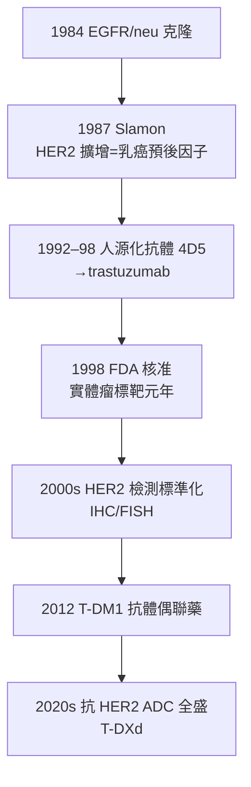

## 1987 - HER2 的發現（從癌基因到乳癌的標靶：Dennis Slamon 的二十年訴訟與勝利）

## 案件摘要

**本案偵破的是「實體瘤也能被分子分型」的第一個範例：乳癌不是一種病，而是至少四種不同的基因病。**

1987 年，UCLA 的 Dennis Slamon（1948–）與 Genentech 的 Axel Ullrich 團隊在《Science》發表：**HER2/neu（ERBB2）**基因在約 25–30% 的乳癌中擴增（基因拷貝數增加數十倍），且擴增與**復發早、存活短**獨立相關——這是實體瘤中第一個被確認的「擴增型癌基因＋預後因子」。十年後，1998 年，靶向 HER2 的單株抗體 **trastuzumab（曲妥珠單抗，商品名 Herceptin 賀癌平）**獲 FDA 核准：HER2 陽性轉移性乳癌的存活期被顯著延長，標靶治療從慢性粒細胞白血病（見 `2001-基利克與慢性粒細胞白血病.md`）的血癌範例正式走進實體瘤。

## 前因 -- 為什麼會有這個案子

- **ERBB 家族的線索**。1984 年 Ullrich 團隊克隆人類 EGFR（ERBB1）；同年 Weinberg 實驗室鑑定大鼠 neu 基因（來自化學誘發的神經母細胞瘤）；1985 年兩者確認同家族——HER2 是 EGFR 的「孤兒受體」（ligand-less orphan receptor）。
- **乳癌的分子亞型懸案**。1980s 乳癌的治療仍以解剖分期＋雌激素受體（ER）狀態分層；大量病人在同一分期下預後迥異，暗示存在未知的分子分層變量。
- **Slamon 的堅持**。他主張用腫瘤標本做**回溯性基因分析**（當時非主流），收集 1980s 乳癌手術標本配對臨床隨訪——正是「組織庫＋分子檢測＋臨床數據」三合一的現代轉化研究原型。
- **Genentech 的生技工業背景**。1980s Genentech 是單株抗體與重組蛋白的先驅；HER2 的細胞外域是抗體藥物的理想靶點，公司的研發管線與學術發現首次深度耦合。

## 線索與推理 -- 數學式、程式、理論

**線索一：擴增即劑量。** 癌基因活化的四種方式（見 `1976-癌基因src的發現.md`）中，HER2 走的是「拷貝數放大」路線：

$$ \text{HER2 拷貝數} \times 10\text{–}100 \Rightarrow \text{受體自發二聚化} \Rightarrow \text{PI3K/MAPK 信號持續開啟} $$

不需要配體、不需要突變，**只要基因劑量夠大，受體自己「濃度過高」就會自聚並持續傳信**——這解釋了為何同一個基因在不同腫瘤中以不同機制（突變/擴增/易位）成為驅動因子。

**線索二：預後關聯的統計推理。** 1987 年論文的核心是 189 例病人的回溯隊列：

| 指標 | HER2 陰性 | HER2 擴增 |
|---|---|---|
| 無病存活（3 年） | 約 70% | 約 45% |
| 總存活 | 顯著較長 | 顯著較短 |

Cox 回歸證明 HER2 擴增是**獨立於淋巴結狀態與 ER 狀態的預後因子**——一個分子標記第一次在實體瘤中獨立「分層」病人。

**線索三：從預後因子到預測因子（治療靶點）的關鍵跳躍。** Slamon 團隊與 Genentech 合作開發鼠源單株抗體 4D5（後人源化為 trastuzumab），機制為：結合 HER2 細胞外域 → 阻斷信號＋抗體依賴細胞毒殺（ADCC）→ 誘導腫瘤細胞停滯。1998 年 Slamon 的隨機對照試驗（H0648g）顯示：trastuzumab＋化療使轉移性乳癌的一年死亡率下降、中位存活延長約 5 個月——**「分子標記陽性才給藥」的伴隨診斷（companion diagnostic）模式由此定型**。

## 結案 -- 後果與影響

- **乳癌治療進入分子分型時代**。Luminal A/B（ER+）、HER2 型、三陰性（TNBC）——今日乳癌的分類與治療決策完全由分子亞型主導；Perou–Sørlie 2000 年的基因表達分型（PAM50）完成最終版圖。
- **伴隨診斷的制度化**。「先檢測、後用藥」（IHC 0/1+/2+/3+、FISH 擴增判定）成為 FDA 監管的新類別；HER2 檢測的假陽性/假陰性之爭（2007 年 ASO/CAP 標準化）是所有分子檢測質控的先聲。
- **心臟毒性的教訓**。trastuzumab 與蒽環類合併使用的心功能不全風險，催生了腫瘤心臟學（cardio-oncology）這門新亞科——標靶藥不是「無毒魔法子彈」。
- **學界—產業的深水區**。Genentech 與 Slamon 之間的專利分成糾紛持續多年；Slamon 本人的故事被 2008 年電影《Living Proof》改編——轉化醫學的個人英雄敘事與產業利益之間的張力，是本案的另一份檔案。
- **一句話結案**：HER2 案證明了**在實體瘤中「找到分子開關→製造開關的鑰匙→只給帶此開關的病人用」**的完整路徑可行——從此腫瘤科醫生開診單之前，必須先問一句：「你的腫瘤是哪一種基因病？」

## 關鍵人物與文獻

- **Dennis Slamon（1948–）**——UCLA 腫瘤內科醫生與科學家；Revlon/UCLA Women's Cancer Research Program 創立者；2004 年 Lasker 獎。
- **Axel Ullrich（1943–）**——Genentech/馬克斯·普朗克研究所；EGFR、HER2、VEGF 受體的克隆者，生技工業史上最高產的受體生物學家之一。
- **Robert Weinberg（1942–）**——MIT Whitehead 研究所；neu 基因與 ras 克隆的核心人物，癌基因時代的教科書作者。
- 原始文獻——Slamon DJ et al., "Human breast cancer: correlation of relapse and survival with amplification of the HER-2/neu oncogene", *Science* 235:177, 1987；Slamon DJ et al., "Use of chemotherapy plus a monoclonal antibody against HER2 for metastatic breast cancer that overexpresses HER2", *NEJM* 344:783, 2001。
