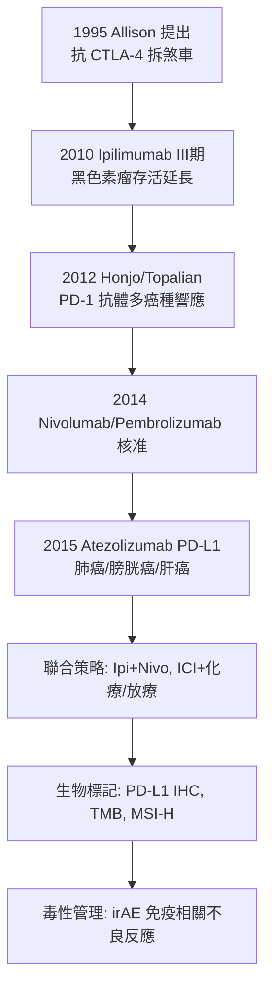

## 2011 - 免疫檢查點抑制劑 Ipilimumab（鬆開免疫系統的煞車：腫瘤免疫治療的革命）

## 案件摘要

**本案偵破的是腫瘤治療最深刻的哲學轉向：不直接攻擊癌細胞，而是解除免疫系統身上的「煞車」，讓病人自己的免疫細胞去殺癌。**

2011 年 3 月，FDA 核准 **ipilimumab（伊匹木單抗，Yervoy）**治療轉移性黑色素瘤——第一個明確延長晚期實體瘤總存活曲線的免疫檢查點抑制劑。其機制為阻斷 CTLA-4 這個「免疫煞車」分子。真正的爆發在 2012 年：James Allison（1948–）與日本本庶佑（Tasuku Honjo，1942–）分別鑑定的 **PD-1/PD-L1** 通路抑制劑（nivolumab 2014、pembrolizumab 2014）在多種晚期實體瘤展現持久緩解；部分黑色素瘤病人的**10 年存活率達 20% 以上**——在化療時代這是不可思議的「曲線尾部」。2018 年 Allison 與本庶佑獲諾貝爾生理學或醫學獎。

## 前因 -- 為什麼會有這個案子

- **免疫監視學說的百年醞釀**。1909 年 Ehrlich、1957 年 Burnet 與 Thomas 相繼提出「免疫系統持續巡邏並清除癌變細胞」；1990s Smyth 與 Schreiber 用基因敲除小鼠證明**免疫監視是事實**，並提出「免疫編輯」三階段（清除—平衡—逃逸）。
- **陰性結果的教訓**。1980s 的 IL-2 高劑量治療（Rosenberg）與腫瘤疫苗皆效果有限且毒性大——「增強免疫」的正面加法策略碰壁。
- **T 細胞活化的雙信號理論**。1980s 確認 T 細胞活化需 TCR 信號＋共刺激信號（CD28）；1991 年 CTLA-4 被發現為**抑制性**共受體——「煞車分子」的物理存在被確認。
- **Allison 的關鍵轉向**。1995 年他在 UC Berkeley 的實驗室提出革命性設想：**不解鎖「油門」，而是拆除「煞車」**——用抗 CTLA-4 抗體解除免疫抑制，讓已存在的抗腫瘤 T 細胞充分活化。這是「免疫治療做減法」的第一份設計圖。

## 線索與推理 -- 數學式、程式、理論

**線索一：免疫煞車的機制圖。** T 細胞的活化與抑制由正負兩套信號共同決定：

$$ A_{\text{活化}} = \underbrace{TCR \times MHC}_{\text{信號 1}} \times \underbrace{CD28(B7)}_{\text{油門}} \; - \; \underbrace{CTLA4 \times B7 + PD1 \times PDL1}_{\text{煞車}} $$

CTLA-4 在淋巴結中與 CD28 競爭結合 B7（啟動期的煞車）；PD-1 則在組織與腫瘤微環境中感應 PD-L1（效應期的煞車）。腫瘤的逃逸策略正是**高表達 PD-L1**——把自己偽裝成「有煞車的合法細胞」。

**線索二：為何 ipilimumab 效應「慢但持久」？** 化療與標靶藥的腫瘤縮小是藥物直接細胞毒；免疫治療的緩解曲線呈現「假性進展」（初期腫瘤因浸潤淋巴細胞而增大，之後崩解）——評估準則需另行發明（irRC，2009）。其長期生存曲線呈**平台狀**而非指數衰減：

$$ S(t) \to S_{\infty} \approx 20\% \quad (\text{免疫治療的記憶性緩解}) $$

這個「平台尾」是免疫記憶的臨床指紋——殺癌的是病人自己的免疫系統，一旦啟動便有記憶。

**線索三：聯合與生物標記的迭代。**

## 結案 -- 後果與影響

- **免疫腫瘤學（IO）成為第四支柱**。手術、放療、化療、標靶之外，免疫治療成為系統治療的新支柱；約 20–40% 的肺癌、黑色素瘤、腎癌、膀胱癌病人獲持久緩解。
- **MSI-H/tumor-agnostic 核准（2017）**。pembrolizumab 獲准用於「微衛星不穩定性高」的任何癌型——FDA 歷史上第一次**按基因特徵而非腫瘤部位**核准藥物，腫瘤學正式進入組織無關時代。
- **代價：免疫相關不良反應（irAE）**。解除煞車同時引發自體免疫攻擊：腸炎、肝炎、肺炎、甲狀腺炎、心肌炎（罕見但致命）——免疫治療的毒性譜是全新的，催生 irAE 管理指引與「免疫相關內分泌病」新專科。
- **陰性側：原發性耐藥與超進展**。約 60–70% 病人無響應；腫瘤突變負荷低、缺乏腫瘤浸潤淋巴細胞（「冷腫瘤」）者療效差——微環境（見 `1889-佩吉特種子土壤學說.md`）與微生物組（腸道菌群影響 ICI 療效，2015–18）成為新的偵查戰場。
- **一句話結案**：Allison 與本庶佑的洞見是——**不必自己上場殺癌，只需卸下免疫系統的煞車**；這把治療的邏輯從「我們對付腫瘤」翻轉為「喚醒病人自己對付腫瘤」，是繼麻醉（手術）、物理（放療）、化學（化療/標靶）之後，腫瘤治療的第四種基本力。

## 關鍵人物與文獻

- **James Allison（1948–）**——MD Anderson 免疫學主任；1996 年關鍵動物實驗（Leach、Krummel 共作）；2018 諾獎；口琴演奏家，諾獎慶典上登台吹奏。
- **本庶佑（Tasuku Honjo, 1942–）**——京都大學；1992 年發現 PD-1，2000 年與 Chen 等確立其配體 PD-L1；2018 諾獎；京都大學本庶佑紀念講座至今推動免疫代謝研究。
- **Gordon Freeman & Lieping Chen**——PD-L1/PD-L2 配體鑑定的核心貢獻者，把 PD-1 通路從基因變成藥物靶點。
- **Jedd Wolchok**——MSKCC 臨床試驗領袖，ipilimumab/nivolumab 聯合策略的臨床推手。
- 原始文獻——Leach DR, Krummel MF, Allison JP, "Enhancement of antitumor immunity by CTLA-4 blockade", *Science* 271:1734, 1996；Hodi FS et al., "Improved survival with ipilimumab in patients with metastatic melanoma", *NEJM* 363:711, 2010；Topalian SL et al., "Safety, activity, and immune correlates of anti-PD-1 antibody in cancer", *NEJM* 366:2443, 2012。
