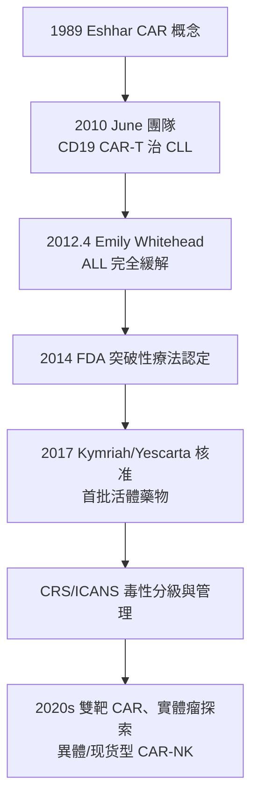

## 2012 - CAR-T 與 Emily Whitehead（把病人的免疫細胞改造成「活體藥物」）

## 案件摘要

**本案偵破的是腫瘤治療的活體革命：不是給藥，而是**改造病人自己的細胞**成為武器。**

2012 年 4 月，5 歲的 Emily Whitehead 在費城兒童醫院接受了她生命中的第二次臨床試驗——**CAR-T 細胞治療**（嵌合抗原受體 T 細胞）。她患的是復發難治性急性淋巴母細胞白血病（ALL），兩次復發、化療已無路可走。Carl June（1953–）團隊把她的 T 細胞在體外用逆轉錄病毒轉導入 **CD19 靶向的嵌合抗原受體**，回輸後她經歷了幾乎致命的細胞因子釋放症候群（CRS），隨後白血病完全緩解——**且持續至今（十年以上無病）**。此案直接催生 2017 年 FDA 核准 tisagenlecleucel（Kymriah），CAR-T 成為第一批「活體藥物（living drug）」。

## 前因 -- 為什麼會有這個案子

- **Zelig Eshhar 的原創概念**（1980s–90s，魏茨曼研究所）：把抗體的抗原結合域「嫁接」到 T 細胞的受體上，賦予 T 細胞「抗體般的辨識＋T 細胞的殺傷」——**CAR 的思想原型**。
- **CD19 的靶點選擇**。1990s 確認 CD19 幾乎只在 B 細胞系表達——攻擊 CD19 即「連正常 B 細胞一起清除」，病人可耐受（B 細胞缺乏可用免疫球蛋白替代）——**可犧牲的正常組織**是 CAR-T 治療指數的祕密。
- **Carl June 的職業轉折**。HIV 研究者出身（1990s 嘗試基因改造 T 細胞治療愛滋），妻子 Julia 1995 年死於卵巢癌；他轉向腫瘤免疫，與 David Porter、Bruce Levine 在賓大建立 GMP 細胞製造平臺——**細胞製造能力**是本案的關鍵工程基礎。
- **Emily 的絕境**。2012 年她的 ALL 已兩次復發，標準方案宣告失敗；父母透過 A.B. Whitehead 家族基金會的網路找到賓大試驗——本案的病人是試驗的真正主人公。

## 線索與推理 -- 數學式、程式、理論

**線索一：CAR 的結構設計。** 嵌合抗原受體是把兩種免疫邏輯拼接的「雜交受體」：

$$ \text{CAR} = \underbrace{scFv(\text{抗體抗原結合域})}_{\text{辨識（不需 MHC）}} + \underbrace{\text{hinge/TM}}_{\text{穿膜}} + \underbrace{CD3\zeta + \text{共刺激域}(4\text{-}1BB/CD28)}_{\text{激活信號}} $$

第二代 CAR 加入 4-1BB（June 團隊選擇）使 T 細胞在體內**持續增殖並形成記憶**——這是 Emily 體內 CAR-T 十年後仍可檢出的原因：治療物本身就是記憶免疫。

**線索二：劑量—反應的新數學。** CAR-T 不服從藥物動力學的指數衰減，而是**在體內自我複製**：

$$ N_{\text{CAR-T}}(t) \approx N_0 \cdot e^{(r-d)t} \quad (\text{體內擴增峰值可達 } 10^4\text{–}10^5 \text{ 倍}) $$

治療效果與「擴增峰值＋持續存在時間」相關；副作用 CRS 的嚴重度亦與擴增動力學相關——**劑量管理第一次變成「細胞生長管理」**。2010 年 Emily 之前的成人試驗（2011 年慢性淋巴細胞白血病病人）已證明 CRS 可用抗 IL-6 受體抗體（tocilizumab）控制——工程化的副作用管理是本案的第二發明。

**線索三：從個案到產業的閉環。**

## 結案 -- 後果與影響

- **復發難治 ALL/B 細胞淋巴瘤的治療格局改寫**。兒童復發難治 ALL 的 CAR-T 緩解率約 80–90%，長期無病存活顯著高於既往；大 B 細胞淋巴瘤二線治療進入 CAR-T 選項。
- **「活體藥物」的監管與定價難題**。Kymriah 定價 47.5 萬美元/例；「個性化製造、不可複製、冷鏈時限」的細胞治療對藥政體系是全新挑戰；CMS 的「療效掛鉤付款」試驗（2019）是支付創新的先聲。
- **實體瘤的艱難前沿**。實體瘤缺乏可犧牲的特異靶抗原（on-target off-tumor 毒性）、腫瘤微環境免疫抑制（見 `1889-佩吉特種子土壤學說.md`）——2020s 的實體瘤 CAR-T 仍在偵查階段；GD2（神經母細胞瘤）、Claudin18.2（胃癌）是最先突破的方向。
- **Emily 的公眾意義**。Whitehead 家族成立 Emily Whitehead Foundation 推動兒童免疫治療研究；2017 年她與 Carl June 同台 FDA 諮詢委員會投票現場（10:0 通過）——病人、家庭、科學家與監管者同席的罕見歷史時刻。
- **一句話結案**：CAR-T 案把「藥」的定義改寫為——**可以被培養、被擴增、被記憶的活著的治療者**；Emily 的十年無病是免疫治療最動人的「曲線尾」，也是細胞治療工程學的第一張產品證書。

## 關鍵人物與文獻

- **Carl H. June（1953–）**——賓州大學 Perelman 醫學院；美國海軍醫學研究出身、HIV 免疫治療轉腫瘤免疫；2014 Breakthrough Prize、2015 Lasker 獎；其妻 Julia 的病逝是他轉向腫瘤研究的私人動機。
- **Zelig Eshhar（1945–）**——魏茨曼研究所；CAR 原型「T-body」的發明者，被譽為「CAR-T 之父」。
- **Michel Sadelain（1960–2025）**——Memorial Sloan-Kettering；第二代 CAR 的共刺激域設計與 CD19 選靶的關鍵學者（4-1BB 系統的競爭設計者），2024 年 Breakthrough Prize。
- **Emily & Tom & Kari Whitehead**——世界第一例 CAR-T 治療的兒童及其父母；其病案是整個細胞治療產業的敘事起點。
- 原始文獻——Porter DL, Levine BL, Kalos M, Bagg A, June CH, "Chimeric antigen receptor-modified T cells in chronic lymphoid leukemia", *NEJM* 365:725, 2011；Maude SL et al., "Chimeric antigen receptor T cells for sustained remissions in leukemia", *NEJM* 371:1507, 2014。
