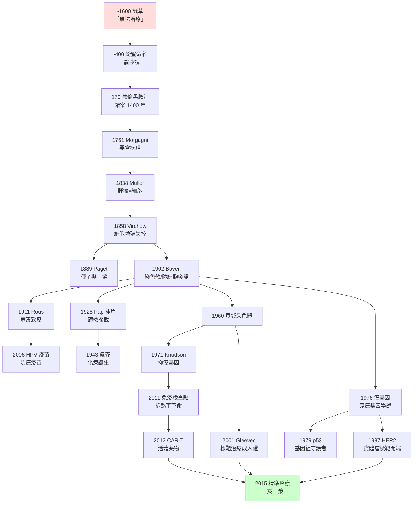

# 腫瘤科的歷史：從埃及紙草的「無法治療」到 CAR-T 與精準醫療

> 本書以「推理探案」的體例，為人類腫瘤學史上的每個關鍵事件寫一篇 wiki：
> 謎題是什麼（癌為何失控生長？為何轉移到特定器官？為何復發？）？
> 偵探是誰（埃及醫生、解剖學家、病毒學家、遺傳學家、臨床醫生）？
> 線索與推理是什麼（屍檢、顯微鏡、染色體、統計曲線、基因測序）？
> 每篇檔名以年份開頭（4 位數，西元前以 `-` 開頭）。

## 雙線主軸

| 線 | 演變 |
|---|---|
| **病因認知線** | 神罰/不可治 → 黑膽汁體液說 → 器官/組織病理 → 細胞病理 → 染色體與體細胞突變 → 病毒致癌 → 癌基因與抑癌基因 → 微環境與免疫監視逃逸 |
| **治療手段線** | 無藥可醫 → 外科切除 → 放射治療 → 化學治療 → 荷爾蒙治療 → 標靶治療 → 免疫治療 → 細胞治療（CAR-T）與精準醫療 |

## 核心理論的接力（每篇 wiki 的「背後理論」總索引）

- **體液致癌說**（Galen）：黑膽汁鬱積 → 錯案統治 1400 年（`0170`）
- **器官—組織—細胞病理學**（Morgagni → Bichat → Müller → Virchow）：疾病定位的層層下探（`1761` `1838` `1858`）
- **種子與土壤學說**（Paget）：轉移的器官親和性、腫瘤微環境（`1889`）
- **體細胞突變說**（Boveri）：染色體失衡→惡性，突變累積模型的開端（`1902`）
- **病毒致癌說**（Rous → zur Hausen）：濾過性病原、癌基因的搬運工、可疫苗預防的癌症（`1911` `2006`）
- **兩擊論／抑癌基因**（Knudson）：隱性失活、RB1、p53（`1971` `1979`）
- **原癌基因學說**（Bishop–Varmus）：癌基因是我們自己的基因、突變累積與驅動基因（`1976` `1987`）
- **免疫監視／免疫編輯**（Burnet → Schreiber → Allison/本庶佑）：免疫煞車、檢查點、逃逸與再激活（`2011` `2012`）
- **精準醫療／驅動基因—靶向藥物閉環**（費城染色體 → Gleevec → NCI-MATCH）（`1960` `2001` `2015`）

---

## 年表（非常詳細版）

### 第一篇：古代的絕症與體液理論——「無法治療」三千年

| 年份 | 事件 | 意義 | wiki |
|---|---|---|---|
| 約前 1600 | 埃及《艾德溫史密斯紙草》病例 39：男性乳房硬塊，「無法治療的疾病」 | 人類最早的癌症病案與「絕症」診斷書 | [-1600-艾德溫史密斯紙草與乳癌](-1600-艾德溫史密斯紙草與乳癌.md) |
| 約前 3000–前 500 | 木乃伊考古：骨肉瘤、前列腺癌、乳癌骨轉移的實物證據 | 癌症在古代人群真實存在 | 同上 |
| 約前 400 | 希波克拉底以 karkinos（螃蟹）命名惡性腫瘤；記載切除後復發與轉移 | 癌症命名與自然史觀察的起點 | [-0400-希波克拉底螃蟹與癌症命名](-0400-希波克拉底螃蟹與癌症命名.md) |
| 約 170 | 蓋倫系統化黑膽汁致癌說：鬱積→凝固→硬瘤；主張晚期不可切除 | 體液致癌說統治 1400 年；「全身性疾病」直覺的第一次表述 | [0170-蓋倫黑膽汁說](0170-蓋倫黑膽汁說.md) |
| 9–12 世紀 | Rhazes、Avicenna《醫典》繼承並精緻化黑膽汁說 | 伊斯蘭醫學的接力、封閉循環 | 同上 |
| 1543 | Vesalius《人體七書》以實地解剖動搖蓋倫解剖學 | 權威理論的第一道裂縫 | 同上 |

### 第二篇：病理解剖的誕生——把疾病定位到器官、組織、細胞

| 年份 | 事件 | 意義 | wiki |
|---|---|---|---|
| 1761 | Morgagni《論身體的部位》700 餘例屍檢對照：症狀↔器官損害 | 器官病理學（anatomo-clinical method）誕生 | [1761-莫爾加尼器官病理學](1761-莫爾加尼器官病理學.md) |
| 1801 | Bichat《論膜》：把部位細分為 21 種組織 | 組織病理學的中繼站 | 同上 |
| 1838 | Müller《論腫瘤的結構性質》：腫瘤由細胞構成；癌/肉瘤分類雛形 | 腫瘤組織學第一份系統筆錄（blastema 說半正確） | [1838-米勒腫瘤細胞學說](1838-米勒腫瘤細胞學說.md) |
| 1858 | Virchow《細胞病理學》：omnis cellula e cellula；慢性刺激說 | 癌症=細胞增殖失控；病理學現代化完成 | [1858-魏爾嘯細胞病理學](1858-魏爾嘯細胞病理學.md) |
| 1867 | Thiersch/Waldeyer 確證上皮癌源於表皮；轉移=癌細胞經淋巴/血行播散 | 轉移的細胞學機制確立 | 同上 |
| 1889 | Paget 統計 735 例乳癌屍檢，提出種子與土壤學說 | 轉移的器官親和性；微環境研究開山 | [1889-佩吉特種子土壤學說](1889-佩吉特種子土壤學說.md) |
| 1919–1928 | Ewing 機械模型反擊；Zeidman–Buss 實驗裁定 F×S 合併模型 | 論戰的實驗裁決；轉移前微環境的遠期伏筆 | 同上 |

### 第三篇：手術與放射——局部治療的兩大支柱

| 年份 | 事件 | 意義 | wiki |
|---|---|---|---|
| 1846/1867 | 麻醉（Morton）與消毒（Lister） | 手術範圍的問題只剩「切多大」 | [1894-Halsted根治性乳房切除術](1894-Halsted根治性乳房切除術.md) |
| 1894 | Halsted 發表乳癌根治術：乳房＋胸大肌＋腋窩淋巴結整塊切除 | 解剖學離心擴散模型；局部復發率 80%→6%；腫瘤外科原則制度化 | 同上 |
| 1895.11.8 | Röntgen 發現 X 射線 | 隔皮透視與治療的物理學起點 | [1896-第一例放射治療](1896-第一例放射治療.md) |
| 1896 | Grubbbe 等以 X 光治療乳癌（發現後數日內）；Freund 治療多毛痣 | 放射治療誕生 | 同上 |
| 1898 | 居里夫婦發現鐳；1903 年 Danlos 鐳置入腫瘤（近距離治療） | 放療的原料庫開張 | 同上 |
| 1899–1920s | Stenbeck 治癒皮膚癌；Regaud/Coutard 確立分次照射原則 | 分次放療的治療指數邏輯（正常/腫瘤修復時間差） | 同上 |
| 1950s–2010s | 鈷-60、直線加速器、3D-CRT/IMRT、SBRT、質子重離子 | 放療的技術迭代 | 同上 |
| 1981–1990 | Veronesi/Fisher 的對照試驗：根治術≠更長存活；保乳手術標準化 | Halsted 範式翻案；前哨淋巴結活檢（1990s） | [1894-Halsted根治性乳房切除術](1894-Halsted根治性乳房切除術.md) |

### 第四篇：致癌機制的偵查——從染色體到病毒到基因

| 年份 | 事件 | 意義 | wiki |
|---|---|---|---|
| 1892 | Weismann 種質理論 | 體細胞改變只在自身後代傳遞的概念母體 | [1902-Boveri體細胞突變說](1902-Boveri體細胞突變說.md) |
| 1902 | Boveri 海膽卵多極分裂實驗：染色體失衡→異常增殖 | 體細胞突變說首次完整表述；預言癌基因與抑癌基因 | 同上 |
| 1908–1911 | Ellermann–Bang 雞白血病；Rous 肉瘤病毒（RSV） | 病毒致癌的第一份鐵證；被冷落 55 年 | [1911-勞斯肉瘤病毒](1911-勞斯肉瘤病毒.md) |
| 1914 | Boveri《惡性腫瘤的起源》：克隆性、染色體失衡、促進/抑制增殖染色體 | 三大預言全部兌現 | [1902-Boveri體細胞突變說](1902-Boveri體細胞突變說.md) |
| 1928 | Papanicolaou 首報陰道塗片診斷宮頸癌（1941/43 系統化） | 細胞學篩檢：攔截癌前病變 | [1928-Papanicolaou抹片與宮頸癌篩檢](1928-Papanicolaou抹片與宮頸癌篩檢.md) |
| 1949–1960s | Pap 抹片大規模推廣；宮頸癌死亡率下降 70%+ | 第一個成功的大規模癌症篩檢制度 | 同上 |
| 1957 | Burnet–Thomas 免疫監視學說 | 免疫與腫瘤關係的理論起點 | [2011-免疫檢查點抑制劑](2011-免疫檢查點抑制劑.md) |
| 1958–1975 | Temin 前病毒假說、逆轉錄酶（1975 諾獎） | RSV 是逆轉錄病毒的確認 | [1911-勞斯肉瘤病毒](1911-勞斯肉瘤病毒.md) |
| 1960 | Nowell–Hungerford 發現費城染色體（CML） | 腫瘤第一枚特異性染色體指紋 | [1960-費城染色體與慢性粒細胞白血病](1960-費城染色體與慢性粒細胞白血病.md) |
| 1966 | Rous 獲諾貝爾獎（發現後 55 年） | 太超前真相的平反 | [1911-勞斯肉瘤病毒](1911-勞斯肉瘤病毒.md) |
| 1967 | Linder–Gartler X 染色體失活分析證明腫瘤單克隆起源 | Boveri 克隆說的分子驗證 | [1902-Boveri體細胞突變說](1902-Boveri體細胞突變說.md) |
| 1971 | Knudson 兩擊論（視網膜母細胞瘤統計分析） | 抑癌基因概念的誕生 | [1971-Knudson兩擊論](1971-Knudson兩擊論.md) |
| 1973 | Rowley 揭示費城染色體本質：t(9;22) 相互易位 | 平衡重排→融合基因致癌 | [1960-費城染色體與慢性粒細胞白血病](1960-費城染色體與慢性粒細胞白血病.md) |
| 1976 | Bishop–Varmus：v-src 來自宿主細胞（c-src，原癌基因） | 癌基因是我們自己的基因；1989 諾獎 | [1976-癌基因src的發現](1976-癌基因src的發現.md) |
| 1979 | 六個實驗室同時發現 p53（初誤判為癌基因） | 最深身份反轉案件的開卷 | [1979-p53守護者基因](1979-p53守護者基因.md) |
| 1982–83 | 人膀胱癌 H-ras 點突變克隆；HPV-16/18 克隆（zur Hausen） | 點突變致癌實證；宮頸癌病毒病因確認 | [1976](1976-癌基因src的發現.md) [2006-HPV疫苗嘉喜](2006-HPV疫苗嘉喜.md) |
| 1986 | RB1 基因克隆；野生型導入逆轉腫瘤表型 | 兩擊論完全兌現 | [1971-Knudson兩擊論](1971-Knudson兩擊論.md) |
| 1987 | Slamon：HER2 擴增=乳癌獨立預後因子 | 實體瘤分子分型的範例 | [1987-HER2與標靶治療的開端](1987-HER2與標靶治療的開端.md) |
| 1988–90 | Vogelstein 結直腸癌多步突變模型（APC→KRAS→TP53） | 突變累積學說的分子版教科書 | [1979-p53守護者基因](1979-p53守護者基因.md) |
| 1990 | Daley–Baltimore：BCR-ABL 單獨可誘發小鼠 CML | 分子層次的病因學（Koch 法則）完成 | [2001-基利克與慢性粒細胞白血病](2001-基利克與慢性粒細胞白血病.md) |
| 1990s | 乳癌 PAM50 分子分型（2000）、MSI、微環境研究興起 | 腫瘤=異質基因病的最終版圖 | [1987](1987-HER2與標靶治療的開端.md) [1889](1889-佩吉特種子土壤學說.md) |

### 第五篇：治療的三支柱擴張——化療、荷爾蒙、標靶

| 年份 | 事件 | 意義 | wiki |
|---|---|---|---|
| 1942–43 | Goodman–Gilman/Lindskog 以氮芥治淋巴肉瘤（戰時保密） | 第一例化療客觀縮瘤 | [1943-氮芥與化療的誕生](1943-氮芥與化療的誕生.md) |
| 1943.12.2 | 巴里港轟炸、芥子氣洩漏：骨髓/淋巴組織選擇性破壞的病理報告 | 意外的「人體劑量—毒性曲線」 | 同上 |
| 1946 | Rhoads《JAMA》系統報告氮芥治癌 | 化療學科起步；腫瘤內科誕生 | 同上 |
| 1948 | Farber 以甲氨蝶呤治兒童急性白血病 | 兒童腫瘤化療之父 | 同上 |
| 1956 | Li 以甲氨蝶呤治癒轉移性絨毛膜癌 | 化療「治癒」實體轉移瘤第一例 | 同上 |
| 1958–1977 | MOPP 治癒霍奇金病；順鉑治癒睪丸癌；兒童 ALL 治癒率 >90% | 化療的治癒性勝利清單 | 同上 |
| 1964 | Skipper log-kill 假說 | 化療的數學基礎 | 同上 |
| 1964/1970s | ASCO 成立；輔助化療（乳癌、骨肉瘤）系統治療時代 | 腫瘤內科制度化 | 同上 |
| 1971–1998 | 泰莫西芬研發與輔助治療普及（附於 1896/1987 wiki 之荷爾蒙線） | 乳癌荷爾蒙治療的當代主幹 | [1896-第一例放射治療](1896-第一例放射治療.md) |
| 1998 | Trastuzumab（賀癌平）核准 | 實體瘤標靶治療元年、伴隨診斷定型 | [1987-HER2與標靶治療的開端](1987-HER2與標靶治療的開端.md) |
| 2001 | Imatinib（基利克）核准 CML：一期 31/31 緩解 | 標靶治療的成人禮；CML 變慢性病 | [2001-基利克與慢性粒細胞白血病](2001-基利克與慢性粒細胞白血病.md) |
| 2001–2012 | 耐藥突變（T315I）與二三代 ABL 抑制劑 | 分子監測下的長期管理模型 | 同上 |
| 2003–2021 | EGFR 抑制劑、ALK、BRAF、KRAS G12C 抑制劑 | 按驅動基因開藥的常態化 | [2015-精準醫療倡議](2015-精準醫療倡議.md) |

### 第六篇：預防與免疫——從疫苗到檢查點到細胞治療

| 年份 | 事件 | 意義 | wiki |
|---|---|---|---|
| 1964 | Epstein–Barr 病毒與 Burkitt 淋巴瘤 | 人類腫瘤病毒譜系的第一個成員 | [1911-勞斯肉瘤病毒](1911-勞斯肉瘤病毒.md) |
| 1976 | zur Hausen 提出 HPV 致宮頸癌假說（遭同行起鬨） | 異端假說的開端 | [2006-HPV疫苗嘉喜](2006-HPV疫苗嘉喜.md) |
| 1983–84 | HPV-16/18 在宮頸癌組織中克隆與檢出 | 病因確認（E6 拆 p53、E7 拆 RB） | 同上 |
| 1991 | 周健–Frazer 製成 HPV 病毒樣顆粒（VLP） | 疫苗的工程學基礎 | 同上 |
| 2006 | Gardasil（嘉喜）核准：第一支防癌疫苗 | 癌症成為可疫苗預防的疾病；2008 諾獎 | 同上 |
| 2010s–2020s | 高覆蓋國家年輕女性宮頸癌前病變下降 80–90%；WHO「消除宮頸癌」戰略 | 一種癌症進入「可消除」清單 | 同上 |
| 1995–1996 | Allison：抗 CTLA-4 拆煞車的動物實驗 | 免疫治療「做減法」的設計圖 | [2011-免疫檢查點抑制劑](2011-免疫檢查點抑制劑.md) |
| 1992/2000 | 本庶佑發現 PD-1；PD-L1 配體確認 | 第二道煞車的發現 | 同上 |
| 2011 | Ipilimumab 核准：第一個延長晚期實體瘤存活的免疫治療 | 免疫腫瘤學（IO）成為第四支柱 | 同上 |
| 2012–2014 | PD-1 抗體多癌種響應；nivolumab/pembrolizumab 核准 | 「曲線尾」（20 年存活）的免疫記憶指紋 | 同上 |
| 2015–2020 | irAE 毒性管理、MSI-H 組織無關核准（2017）、聯合策略 | IO 的制度成熟與未竟之業 | 同上 |
| 1989–2010 | Eshhar CAR 原型→June 團隊 CD19 CAR-T 治 CLL | 細胞治療的工程積累 | [2012-CAR-T與Emily Whitehead](2012-CAR-T與Emily Whitehead.md) |
| 2012.4 | Emily Whitehead：5 歲復發難治 ALL 的 CAR-T 完全緩解（持續至今） | 活體藥物的歷史性首例 | 同上 |
| 2017 | Tisagenlecleucel（Kymriah）/Axicabtagene 核准 | FDA 首批基因改造細胞療法 | 同上 |
| 2015.1.20 | 歐巴馬宣布精準醫療倡議（PMI）；NCI-MATCH 籃子試驗 | 分子診斷→匹配治療的國家級制度化 | [2015-精準醫療倡議](2015-精準醫療倡議.md) |
| 2006–2015 | TCGA 癌症基因組圖譜：33 癌型、2 萬+例測序 | 精準醫療的「嫌犯資料庫」 | 同上 |
| 2018–2020s | 液體活檢（ctDNA/MRD）、多組學、病理 AI、分子腫瘤委員會 | 一案一策的常態化偵查系統 | 同上 |

---

## 全書證據鏈一覽（從紙草到 CAR-T）

## 閱讀建議

- **想理解「癌為何失控生長」**：按 `1902 → 1858 → 1976 → 1971 → 1979` 的順序讀（突變累積＋增殖失控＋剎車失靈）。
- **想理解「治療為何分四大支柱」**：按 `1894 → 1896 → 1943 → 2011` 讀（外科、放療、化療、免疫）。
- **想理解「轉移與復發」**：讀 `1889`、`1911`、`1987`（微環境、播散、亞克隆）。
- **想理解「預防勝於治療」**：讀 `1928`、`2006`（篩檢與疫苗）。
- **想理解「現代腫瘤科怎麼開診單」**：讀 `1960`、`2001`、`1987`、`2015`（費城染色體到精準醫療的閉環）。

---

*本書為「醫學史」系列 wiki 之一，姊妹作：《性病的歷史》。體例：每篇以「案件摘要—前因—線索與推理—結案—關鍵人物與文獻」五段展開，嵌入數學式、程式碼與 mermaid 圖表。*
