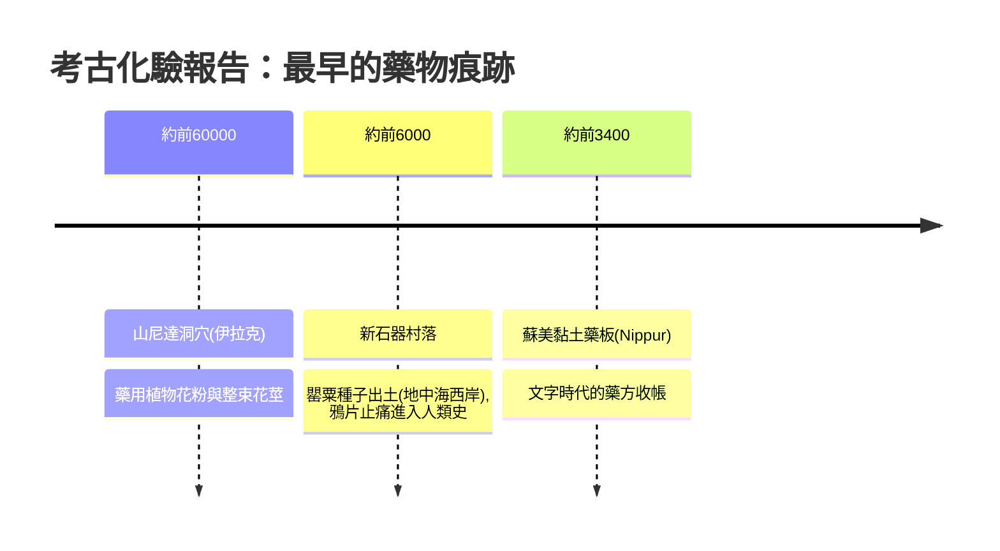

## -6000 - 史前草藥與山尼達洞穴的紫菀（人類第一份「處方」是誰開的？）

## 案件摘要

**本案偵破的是人類最古老的一樁「用藥案」——證據只有花粉、骨骼與一根斷裂的股骨。**

1960 年，考古學家 Ralph Solecki 在伊拉克北部山尼達（Shanidar）洞穴發掘尼安德塔人墓葬（IV 號骨架，約距今 6 萬年前），墓土中檢出大量紫菀、蓍草、蜀葵等藥用植物花粉。1960–70 年代大眾書籍把這浪漫化為「花葬」——尼安德塔人懂得用花告別死者。但真正的謎題更深：六萬年前的沒有文字的人類，如何知道哪些草能吃、哪些能止痛、哪些會殺人？本案要還原的，是「藥物」這個概念在文字發明之前如何誕生。

## 前因 -- 為什麼會有這個案子

- **藥與毒同源**。人類祖先與植物共同演化了數百萬年；植物鹼（生物鹼）本是植物的防禦武器，對動物神經系統卻是現成的藥物分子庫。
- **動物自療的旁證**。黑猩猩吞食整片粗糙的 *Aspilia* 葉驅除腸道寄生蟲、鳥類把菸草葉敷入巢穴滅蟎——「藥物行為」不必有語言，只需觀察與模仿。
- **受傷倖存者的疑點**。山尼達 I 號骨架右臂因傷萎縮癒合，眼窩有舊傷，卻活到相當高齡——沒有幫助（痛覺緩解、傷口處理）難以存活。

## 線索與推理 -- 數學式、程式、理論

**線索一：試錯統計學。** 在文字之前，「藥理學」以族群記憶形式存在。設草藥 $H$ 對症狀 $S$ 的真有效率為 $p$，一個觀察力正常的部落經 $n$ 次使用後，有效率高的草藥會被口傳保留——這是一套**跨世代的自然選擇篩選**，效果相當於：

$$ P(\text{傳說中的藥真的有效}) \approx 1 - (1-p)^n $$

**線索二：法醫植物學的翻案。** 1990 年代孢粉學家對 Shanidar 重新取樣，質疑花粉是穴居嚙齒動物（一種跳鼠 *Meriones persicus*）囤積種子帶入的；但 2020 年代新發掘（Solecki–Pomeroy 團隊）在同一墓葬發現**整束排列的花莖**與墓穴四周的挖痕，證據重新倒向「有意的植物處置」。本案的教訓：花粉證據要像指紋一樣問「是誰、何時、以何方式留下」。

**線索三：跨文化的一致性。** 相隔萬里的史前遺址都出現藥用植物的系統性使用，最經典的解剖學證據是：

**線索四：止痛的理論預言。** 罌粟之所以橫跨六萬年仍有效，後世藥理學給出了偵探式的解釋：人體內本來就有內源性鴉片受體（見 `1975-內啡肽與鴉片受體的發現.md`）——史前人類用植物鑰匙，打開了身體裡早就存在的鎖。

## 結案 -- 後果與影響

- **醫與藥的分工尚未發生**。史前部落裡薩滿、祖母、採藥人都是藥師——「誰有權配藥」的鬥爭要到漢謨拉比法典與中世紀藥師行會（見 `1231-腓特烈二世藥師法規.md`）才上演。
- **口傳藥典的演化**。史前試錯積累的草藥清單，最終沉澱為美索不達米亞泥板藥方（見 `-0175-漢謨拉比泥板與美索不達米亞藥方.md`）與埃及紙草（見 `-1550-埃伯斯紙草與埃及藥典.md`）。
- **一句話結案**：第一間藥房不是建築，而是部落的記憶；第一味藥不是分子，而是倖存下來的觀察。

## 關鍵人物與文獻

- **Ralph Solecki（1917–2019）**——山尼達洞穴發掘者；哥倫比亞大學考古學家，其發現改寫了「原始人沒有情感與醫藥」的成見。
- **Erik Trinkaus**——古人類學家，山尼達 I 號「受傷老尼安德塔人」的再分析者，主張其長壽代表群體照護。
- 原始文獻——Solecki, *Shanidar Cave: A Neanderthal Site in Northern Iraq*, Science 1953；Lietava, "Medicinal plants in a Middle Paleolithic grave Shanidar IV?", *Journal of Ethnopharmacology*, 1992（對花粉證據的藥學檢視）。
- 現代註腳——2021 年 *Antiquity* 對 Shanidar Z 新發掘的報告顯示尼安德塔墓葬行為的證據持續增強；「藥物起源於尼安德塔人與智人共同祖先」已從異端變成主流假說。
