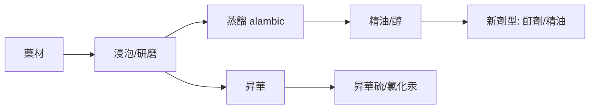

## 0850 - 阿拉伯藥學與最早的藥妝店（巴格達的藥師行會與蒸餾鍋）

## 案件摘要

**本案偵破的是藥學「職業化」的關鍵一環。** 8–10 世紀的阿拔斯王朝治下，巴格達與大馬士革出現了獨立於醫師的藥鋪（*'attārīn* 香藥舖）與官方檢驗官（*muḥtasib*，市場督察）巡視藥秤與藥材品質的制度；同時煉金術士賈比爾・伊本・哈揚（Jabir ibn Hayyan，傳說人物）一系的實驗室發展出蒸餾、昇華、結晶技術——酒精（*al-kuḥl* → alcohol）一詞由此進入人類藥典。謎題：為什麼藥師這個職業不在希臘或中國成熟，而在沙漠商路的中心？

## 前因 -- 為什麼會有這個案子

- **商路即藥路**。阿拔斯帝國控制從印度洋到地中海的香料與藥材貿易：龍涎香、沒藥、樟腦、麝香、藏紅花在巴格達匯流——**藥材市場巨大，且必須辨偽與定價**。
- **《藥物志》的阿拉伯化**。9 世紀希臘醫藥文獻大翻譯運動（巴格達智慧宮）把狄奧斯科里德斯（見 `0070-狄奧斯科里德斯藥物志.md`）與蓋倫（見 `0130-蓋倫與蓋倫製劑的千年帝國.md`）譯成阿拉伯文，提供了理論底座。
- **伊斯蘭的宗教驅動力**。先知聖訓「真主為每種病造了藥」鼓舞系統性尋藥；清真寺與醫院（*bīmāristān*）一體，藥房成為慈善機構的標配。

## 線索與推理 -- 數學式、程式、理論

**線索一：藥師執照制度。** 伊本・泰米亞（13 世紀）記載的 *ḥisba* 文獻顯示：藥師需經考試方可開業，督察官抽查藥秤、藥材新鮮度、有害摻假（如以鉛紅冒充硃砂）——**執照＋抽檢＋處罰**，現代藥事監理的三件套在巴格達已成形。

**線索二：煉金技術=萃取技術。** 煉丹爐（*athanor*）與蒸餾器的發明，使水溶性/醇溶性成分第一次可分離：

酒精作為溶媒與防腐劑的出現，讓藥效保存期倍增——**這是藥學史上的第一次「技術跳級」**。

**線索三：藥理學的先聲——伊本・瓦菲德與薩萊諾。** 11 世紀安達魯西亞藥學家 Ibn al-Wafid、al-Ghafiqi 對藥材做劑量與配伍的系統整理；薩萊諾醫學院（受阿拉伯影響）提出「劑量決定毒與藥」的格言——毒理學鼻祖 Paracelsus 的名句（見 `1527-帕拉塞爾蘇斯與化學醫學革命.md`）其實是薩萊諾格言的復活。

**線索四：藥典的本地化。** 850 年前後巴格達醫師 Sabur ibn Sahl 編成最早的阿拉伯藥典 *Aqrabadhin*（處方集），按劑型分卷——**藥典從此是「法規文件」而非「私人筆記」**。

## 結案 -- 後果與影響

- **藥師與醫師正式分家**。1231 年腓特烈二世（見 `1231-腓特烈二世藥師法規.md`）把阿拉伯制度移植到西西里，再傳全歐——今日藥局與診所分立的格局，源自巴格達的市集規則。
- **化學藥物的第一波**。蒸餾酒精、昇華汞劑、砷劑的製備，為 16 世紀化學醫學備好工具箱。
- **一句話結案**：阿拉伯藥學案的真相——**職業化的三要素是市場、法治與技術**；希臘給了理論，羅馬給了戰場，巴格達給了藥師一間有執照、有秤、有蒸餾鍋的店。

## 關鍵人物與文獻

- **Sabur ibn Sahl（?-869）**——巴格達醫師、宮廷藥師；《Aqrabadhin》為最早系統阿拉伯藥典。
- **al-Kindī（約 801–873）**——哲學家兼藥理先驅，《論複方》(De Gradibus) 嘗試用數學計算藥效等級——**用算式處理藥性的第一人**。
- **Ibn al-Baitar（1197–1248）**——安達魯西亞博物學家，《藥物大全》收 1400 種藥物，超越狄奧斯科里德斯。
- 原始文獻——Martin Levey, *Early Arabic Pharmacology*, Brill, 1973；Gary Leiser & Michael Dols, "Evirtheim's note on hospitals", *Bull. Hist. Med.*。
- 現代註腳——2020 年代對伊斯蘭金屬藥物（汞、砷、銻製劑）的毒理回驗顯示多數確有細胞毒性——**中世紀藥師不是不懂得毒，而是還沒有治療指數的量尺**。
