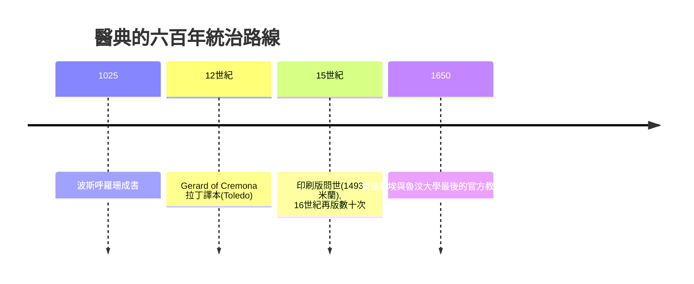

## 1025 - 伊本西那醫典與阿拉伯藥學盛世（一部教科書統治東西六百年）

## 案件摘要

**本案偵破的是醫學史上被引用最久的教科書案。** 1025 年前後，布哈拉出生的博學家伊本・西那（Ibn Sina，西方稱 Avicenna，980–1037）在流亡途中完成《醫典》（*al-Qānūn fī al-ṭibb*）五卷，系統整合蓋倫理論與阿拉伯醫療經驗，其中第二卷與第五卷為藥物總論與複方集。謎題：為什麼這部書能在開羅、科爾多瓦、巴黎、蒙彼利埃同時成為標準教材直到 17 世紀？它把「藥物試驗」寫成了怎樣的規則？

## 前因 -- 為什麼會有這個案子

- **理論整合的歷史窗口**。亞里士多德哲學、蓋倫醫學、波斯與印度藥材知識已各自成熟，卻無人做系統合編；伊本・西那是那個時代的「集大成者型天才」。
- **個人際遇的催化**。他一生在諸宮廷間流亡（被烏古斯人追殺、坐牢），被迫以驚人記憶力與抄寫速度完成巨著——《醫典》部分是在囚禁中口述的。
- **醫院網絡的實證土壤**。*bīmāristān* 醫院按病種分科、有病案記錄，提供了蓋倫時代沒有的臨床資料流。

## 線索與推理 -- 數學式、程式、理論

**線索一：《醫典》第一卷的「七則藥物試驗法」。** 伊本・西那提出新藥測試的原則，可逐條對照現代方法論：

| 《醫典》原則 | 現代對應 |
|---|---|
| 藥須無摻假、純淨 | 原料藥純度 |
| 不得與複方混試 | 單藥試驗（單變量原則） |
| 用於**單純疾病**，勿用於併發症 | 明確適應症入組 |
| 時間要夠長，觀察要一致 | 隨訪期與標準化評估 |
| **急慢性病都要試**，記錄復發 | 長期療效與復發終點 |
| 效果須**恆定重現**，非偶一為之 | 可重複性 |
| **人體試驗優於動物與類比** | 臨床試驗的等級觀念 |

**這是臨床試驗方法論的第一次完整陳述，比 1747 年 Lind 的柑橘試驗早七百年**。

**線索二：藥理分類的架構。** 第二卷按「性質度數（承蓋倫）＋臟器親和性（他新增）＋適應症」三層索引藥物——**受體「親和性」概念的史前版本**（見 `1905-蘭利受體學說.md`）。

**線索三：以傳播鏈驗證影響力。**

**線索四：批判的先聲**。伊本・西那在書中不時標註「蓋倫此說我未能同意」——例如他否認「男胎在右子宮」等解剖謬說；《醫典》的權威其來自**敢於在權威內部做修訂**，而非盲從。

## 結案 -- 後果與影響

- **東西藥學的轉運站**。藥材（如樟腦、麝香、糖漿劑 syrūp ← 阿拉伯 sharāb）隨《醫典》進入拉丁世界，成為文藝復興藥房的標配。
- **教科書即權力的反面教材**。19 世紀歐洲醫學革命時，《醫典》與蓋倫一起被清算；但史家公認其「試藥七則」在方法論上領先同代人千年。
- **一句話結案**：伊本・西那的偵探價值——**他在沒有統計學的時代，先寫下了統計學該有的紀律**；藥物試驗的規則不是實驗室的發明，而是邏輯學的發明。

## 關鍵人物與文獻

- **Ibn Sina / Avicenna（980–1037）**——波斯博學家；《醫典》外另有哲學百科《治癒之書》。墓在伊朗哈馬丹。
- **Gerard of Cremona（1114–1187）**——托雷多翻譯家，拉丁譯本使《醫典》統治歐洲醫學教育。
- 原始文獻——*The Canon of Medicine*（Laleh Bakhtiar 等英譯；O. Cameron Gruner 1930 年譯本）；Nizami Aruzi 記載其口述成書逸事。
- 現代註腳——WHO 1980 年代在「傳統醫學」項目中重估《醫典》藥物條目；「人體試驗優於動物類比」一則，已被寫進現代 GCP 的精神內核。
