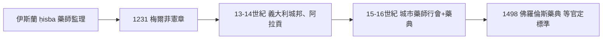

## 1231 - 腓特烈二世藥師法規（國家第一次給藥師發執照）

## 案件摘要

**本案偵破的是歐洲藥事法治的開端。** 1231 年，神聖羅馬皇帝腓特烈二世在西西里王國頒布《梅爾菲憲章》（Constitutiones of Melfi），其中醫療章節規定：**醫師不得經營藥房、藥師須經考試取得執照、藥價受官定公約約束、藥房數量按城市規模限額**。謎題：一位以「世界奇蹟」（stupor mundi）著稱、與教皇纏鬥一生的皇帝，為什麼會插手「誰能賣藥」這種市井小事？這幾條法規如何塑造了今天的社區藥局？

## 前因 -- 為什麼會有這個案子

- **西西里的十字路口**。西西里王國混融阿拉伯、拜占庭、諾曼行政傳統；腓特烈的宮廷有阿拉伯文書與猶太譯者，直接可借鑑伊斯蘭的 *ḥisba* 市場督察制度（見 `0850-阿拉伯藥學與最早的藥妝店.md`）。
- **醫師兼賣藥的利益衝突**。中世紀醫師開方又賣藥、以藥補診金，藥價混亂、假藥充斥——**利益衝突與價格管制**是立法的直接動機。
- **中央集權的野心**。腓特烈要建立可執行的官僚國家，醫療執照是「考試取官」邏輯的延伸。

## 線索與推理 -- 數學式、程式、理論

**線索一：分業原則的立法化。** 憲章的關鍵條款可寫成規則集：

```text
IF 醫師 THEN 不得開藥房（分業）
IF 藥師 THEN 須經考試、遵守藥價公約（執照+定價）
IF 城市人口 > 某閾值 THEN 藥房數量上限（牌照稀缺）
IF 無照調劑 THEN 罰沒與停業（處罰）
```

**利益迴路被切斷**：診斷（需求創造者）與供藥（供給者）分離——這是醫藥分業制度的第一次國家立法。

**線索二：藥價公約＝成本加成模型。** 公約規定藥材成本＋加工費＋合理利潤。這可視為最早的**藥品定價公式**：

$$ P = C_{\text{藥材}} + C_{\text{工時}} + r \cdot C_{\text{藥材}} $$

現代藥價談判（自付額、健保核定）在概念上仍是此式的子孫。

**線索三：制度擴散鏈的重建。**



**線索四：為什麼是「考試」？** 腓特烈把他的宮廷法律學校邏輯套到醫藥：資格由**可稽核的知識檢定**授予，而非行會世襲——職業的現代性不在技能，而在**進入門檻的標準化**。

## 結案 -- 後果與影響

- **藥師行會與藥典的正名**。行會需要統一的品質標準，直接催生 1498 佛羅倫斯藥典（見 `1498-佛羅倫斯藥典.md`）與 1618 倫敦藥典（見 `1618-倫敦藥典與藥師行會的品質戰爭.md`）。
- **藥局作為社會制度**。「限額執照」塑造了歐洲藥局的稀缺性與社區地位——直到今日，德國、法國藥局的「一城一距離」規則仍是此案的餘響。
- **一句話結案**：腓特烈案的真相——**藥師的專業地位不是醫學恩賜的，而是法治設計的**；把「利益衝突」寫成法條，比一千年後的倫理委員會更早悟到同一件事。

## 關鍵人物與文獻

- **腓特烈二世（1194–1250）**——神聖羅馬皇帝、西西里王；自稱「世界奇蹟」，被教皇逐出教會三次；《梅爾菲憲章》1231 年頒布於梅爾菲城堡。
- **《梅爾菲憲章》醫療三篇**——其中明文「藥師須依藥典調劑」的配套，由御醫 Margaritus 等起草（巴黎會議紀錄存世）。
- 原始文獻——*Constitutiones regni Siciliae*（Huillard-Bréholles 編）；Edward Peters, *The Shadow King: Rex Inutilis*；David Abulafia, *Frederick II: A Medieval Emperor*, 1988。
- 現代註腳——藥史學家（如 J. K. Crellin）確認：1231 法規的「分業條款」直到 20 世紀才在多數國家被真正嚴格執行——**立法容易，執行等了七百年**。
