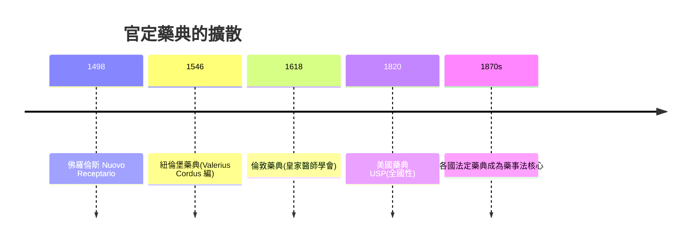

## 1498 - 佛羅倫斯藥典（第一部官定城市藥典的誕生）

## 案件摘要

**本案偵破的是「藥物品質有了法定標準」的第一案。** 1498 年，佛羅倫斯醫師公會（Collegio Medico）與藥師公會（Speziali）聯合出版 *Nuovo Receptario*（新處方集），由城市頒布、要求全城藥房遵守——公認為歐洲第一部官定藥典。謎題：在美第奇統治、戰火頻仍的 15 世紀末，一座城市憑什麼統一全城藥品的製法與品質？官定藥典為什麼非出現不可？

## 前因 -- 為什麼會有這個案子

- **1231 法規的百年孵化**。腓特烈二世要求「依藥典調劑」，但此後兩百年各地只有私人處方集，無官定版本（見 `1231-腓特烈二世藥師法規.md`）——法規等一本標準書。
- **文藝復興的印刷術**。古騰堡活字印刷（1450s）使大量精確複製成為可能；手抄本時代的以訛傳訛（見 `0070-狄奧斯科里德斯藥物志.md`）終於可被機器終結。
- **佛羅倫斯的藥業帝國**。美第奇家族本為藥師世家（*medici speziali*），城內藥房（如後世的新聖母藥房，1221 年開業至今）是歐洲最成熟的藥業生態。
- **1494 年的震撼**。梅毒大流行（見性病史 `../性病的歷史/1494-那不勒斯梅毒大流行.md`）同年爆發，對「有效且可靠的治療」的需求空前高漲——癒創木等新藥湧入市場，真偽難辨。

## 線索與推理 -- 數學式、程式、理論

**線索一：藥典的三重公權力。** 《新處方集》不僅是食譜合集，它同時主張三種權力：

1. **內容權**——規定各製劑的組成與製法（如糖漿的濃度、膏藥的火候）；
2. **執法權**——違者由城市官員處罰；
3. **更新權**——由醫師＋藥師聯合委員會定期修訂（藥師與醫師共治，呼應分業制）。

**線索二：品質的可操作性。** 藥典把「好藥」從經驗形容詞變成可稽核的條件：藥材產地（「玫瑰須來自……」）、採收時令、儲存年限、色澤氣味測試、調劑器具的清潔——**標準化四要素：原料、時令、製程、檢測**，與今日 GMP 的邏輯同構。

**線索三：為什麼醫師與藥師要合編？** 1490 年代的佛羅倫斯，醫師抱怨藥師偷工減料，藥師抱怨醫師外行指揮；合編藥典是一份**聯合管轄協議**——雙方都讓渡部分裁量權，換取整體市場的信任。

**線索四：擴散的檢驗。**

## 結案 -- 後果與影響

- **藥典成為國家技術主權的象徵**。誰定標準，誰就控制藥物品質的話語權；這條邏輯延伸到 20 世紀的國際藥典與 ICH 標準之爭。
- **天然藥物時代的標準化極限**。藥典可規定製程，卻無法檢測活性成分含量（化學分析要等 19 世紀）；所以 1498 藥典的品質仍是「過程管控」而非「終點檢驗」——這一躍要等植物化學與生物檢定（見 `1847-布赫海姆與實驗藥理學的誕生.md`）。
- **一句話結案**：佛羅倫斯案的真相——**藥物標準化的第一動力不是科學，而是信任的商業需求**；城市信譽是美第奇銀行時代的硬通貨，藥典是它的護照。

## 關鍵人物與文獻

- **《Nuovo Receptario composto in famosa città di Fiorenza》**——1498 年由 Antonio Benivieni 等醫師與藥師公會合作編纂出版。
- **Valerius Cordus（1515–1544）**——稍後紐倫堡藥典的編者，26 歲早逝；其藥典以化學精確度更上一層。
- 原始文獻——John K. Crellin, "Florentine pharmacopoeias" 諸研究；David L. Cowen & William Helfand, *Pharmacy: An Illustrated History*, 1990。
- 現代註腳——佛羅倫斯新聖母瑪利亞藥房（Officina Profumo-Farmaceutica di Santa Maria Novella）今日仍營業，自稱「世界最老藥房」——1498 年那場信任工程的最後活見證。
