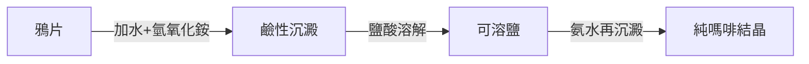

## 1805 - 塞爾特納分離嗎啡（第一個植物鹼純化出來的藥）

## 案件摘要

**本案偵破的是「藥物即純物質」的第一案。** 1805 年，20 歲的德國藥師助理 Friedrich Sertürner 在帕德博恩的實驗室裡，用氨水與酸鹼萃取，從鴉片中分離出一種「植物鹼」（他稱之 *morphium*，以夢神 Morpheus 命名），並在自願者（包括自己與一個少年）身上證明：10 毫克純嗎啡的鎮痛力等於大量鴉片酊。謎題：為什麼人類用了六千年的鴉片（見 `-6000-史前草藥與山尼達洞穴的紫菀.md`），要等到 1805 年才被「拆開」？拆開之後，得到的是藥還是災難？

## 前因 -- 為什麼會有這個案子

- **拉瓦錫革命之後**。化學定量分析（1789 前後）確立「化合物有固定組成」的信念；藥師開始問：鴉片酊的「有效成分」是什麼？
- **Lavoisier–Fourcroy 的植物化學**。18 世紀末已從植物分出樟腦、苯甲酸等純物質；缺的是**帶氮的鹼性植物成分**這一類。
- **藥師職業的科學化**。德國藥師行會的實驗室傳統（參見 `1231-腓特烈二世藥師法規.md` 之後的行會演化）把「調劑台」升級成「分析台」。

## 線索與推理 -- 數學式、程式、理論

**線索一：關鍵操作——酸鹼萃取循環。** Sertürner 的方法可以寫成流程：

植物鹼在酸中成鹽、在鹼中游離——這套兩相切換就是**所有植物鹼藥物提取的母法**，直接開啟了奎寧（1820）、可待因（1832）、尼古丁（1828）、士的寧（1818）、阿托品（1831）的「淘金潮」。

**線索二：第一次「劑量—反應」的人體演示。** 他先以狗試毒，再自行服用 50 毫克觀察副作用，最後對三個痛苦病人各給 10 毫克——鎮痛精準、可數粒計量。這是**化學純度使劑量成為變數**的歷史時刻：以前「一匙鴉片酊」的有效成分含量可以差十倍，現在毫克就是毫克。劑量反應的量尺（見 `1847-布赫海姆與實驗藥理學的誕生.md`）終於有了刻度。

**線索三：法國的確認與命名。** 1817 年巴黎化學家 Gay-Lussac 與 J. Pelletier 予以確認並命名 *morphine*；同所實驗室的 Caventou 與 Pelletier 次年分離奎寧——**巴黎成為植物鹼產業的心臟**，德法之間的科學競賽自此開跑。

**線索四：災難的引信。** 1853 年皮下注射針（Pravaz、Wood）問世，嗎啡注射繞過口服的緩衝；1856 年克里米亞戰爭的傷兵營成為第一場大規模成癮現場，美國內戰「士兵病」隨之——**純化放大了效力，也放大了成癮**；1898 年拜耳以乙醯化製成「更安全」的海洛因（見 `1897-阿斯匹林與拜耳的專利之爭.md`），悲劇加倍。

## 結案 -- 後果與影響

- **「活性成分」範式的確立**。從此藥=純分子，草藥=未分析的分子庫；這一範式統治製藥業至今（天然物藥物化學、高通量篩選皆其子孫）。
- **受體學說的伏筆**。嗎啡結構特異、效力驚人，逼問「身體為何有鴉片座」——1973 年鴉片受體與 1975 年內啡肽（見 `1975-內啡肽與鴉片受體的發現.md`）的發現，正是對此案的 170 年後續偵查。
- **一句話結案**：塞爾特納案的真相——**純化是藥物史的分水嶺：它讓劑量可以被談論，也讓濫用可以被放大**；分子被拆出來的那天，藥與毒的邊界從此變成一條需要時時看守的曲線。

## 關鍵人物與文獻

- **Friedrich Wilhelm Sertürner（1783–1841）**——漢諾威藥師助理出身，後任 Einbeck 宮廷藥師；晚年因批評同業與財務糾紛抑鬱，死於嗎啡過量（與心臟病合併）——**發明者死於自己的分子**。
- **Pierre-Joseph Pelletier 與 Joseph Caventou**——巴黎藥化雙人組，奎寧工業化的創始人；法國 1951 年發行郵票致敬。
- 原始文獻——Sertürner, "Säure im Opium", *Journal der Pharmacie*, 1805；1817 年 *Annales de Chimie* 確認報告。
- 現代註腳——2020 年代阿片危機使嗎啡案重審：從植物鹼純化到芬太尼合成，**效力曲線每上一階，成癮社會成本就加一個數量級**——劑量決定毒性，供應鏈決定疫情。
