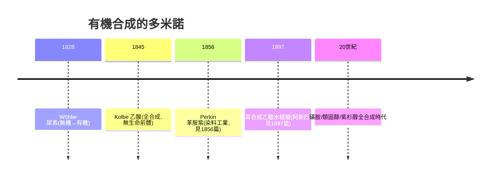

## 1828 - 維勒合成尿素與活力論的崩塌（藥物合成的哲學入場券）

## 案件摘要

**本案偵破的是一場「無機變有機」的哲學謀殺案。** 1828 年，柏林的青年化學家 Friedrich Wöhler 寫信給老師 Berzelius：「我必須告訴您，我可以不經腎臟、不論人或狗，就製出尿素。」他把氰酸銨加熱，得到了動物代謝的產物——尿素。謎題：這個產量不到一克的白色晶體，為什麼被史家視為**活力論（Vitalism）之死**與現代合成藥物時代的哲學入場券？

## 前因 -- 為什麼會有這個案子

- **活力論的統治**。Berzelius 一派主張：有機物（來自生命體的物質）需要「活力」（vis vitalis）才能生成，人工合成「本質上不可能」——這是化學界的蓋倫主義（參見 `0130-蓋倫與蓋倫製劑的千年帝國.md`）。
- **同分異構的懸案**。已知氰酸銀與雷酸銀組成相同而性質不同（Wöhler 與 Liebig 1824 的爭論），暗示「組成並非一切」——原子連接方式的革命正在孕育。
- **藥物全靠提取**。當時所有藥物（嗎啡見 `1805-塞爾特納分離嗎啡.md`、奎寧）都只能從動植物提取——提取有天花板，合成是唯一的量產路。

## 線索與推理 -- 數學式、程式、理論

**線索一：實驗的化學本質——異構重排。**

$$ \mathrm{NH_4OCN} \xrightarrow{\Delta} \mathrm{(NH_2)_2CO} $$

氰酸銨與尿素分子式相同（$CH_4N_2O$）、原子連接不同——這是**史上第一個明確的「同分異構體→加熱異構化」案例**。活力論被攻破的部位不是「生命力是否存在」，而是「生命物質的分子無法在實驗室製造」這一條。

**線索二：偵探的誠實——這是意外。** Wöhler 本在研究氰酸與銀的反應；「人工尿素」是他自己起初困惑的雜質。他反覆驗證（與尿素的味道、與尿素氧化產物比對）才敢宣布。**發現的敘事常被浪漫化，但本案的證據鏈顯示：嚴謹的困惑比天才的直覺更常是真相的接生婆。**

**線索三：骨牌效應的重建。**

**線索四：對藥物史的真正意義。** 活力論崩塌後，兩扇門打開：**(1) 天然藥物可以被全合成、被修飾（半合成）；(2) 「非自然」的分子也可以是藥**——這一條在 1935 年磺胺（見 `1935-多馬克磺胺與魔法子彈量產.md`）身上徹底兌現。

## 結案 -- 後果與影響

- **化學成為藥學的母語**。藥師行會的教育重點從鑑藥、調劑轉向化學；大學藥學院與化學系合流，現代 pharmaceutical chemistry 誕生。
- **活力論的「餘生」**。生物學中的活力論又拖了幾十年（酶與發酵之爭要到 1897 Buchner 無細胞發酵才終結）——**哲學的死刑判決，執行往往分期**。
- **一句話結案**：維勒案的真相——**一克尿素殺死的是一種世界觀**；從此「自然」不再是藥物的合法來源清單，實驗室取得與生命等價的化學簽證。

## 關鍵人物與文獻

- **Friedrich Wöhler（1800–1882）**——出身法蘭克福獸醫家庭；哥廷根教授；同時是無機化學巨匠（鋁、鈹的分離）。
- **Jöns Jacob Berzelius（1779–1848）**——瑞典化學宗師、活力論旗手；面對學生的反例，他的反應是修正定義而非否認證據——科學的自我修正機制的典範。
- 原始文獻——Wöhler, "Ueber künstliche Bildung des Harnstoffs", *Poggendorff's Annalen der Physik*, 1828；其與 Berzelius、Liebig 往返書信現存。
- 現代註腳——史家（如 P. S. Cohen）指出：活力論的「死亡日期」更多是教科書修辭；但無人否認 1828 年是**合成藥物產業的元年象徵**——今天約半數小分子藥物由全合成或半合成製造，血統皆溯至此案。
