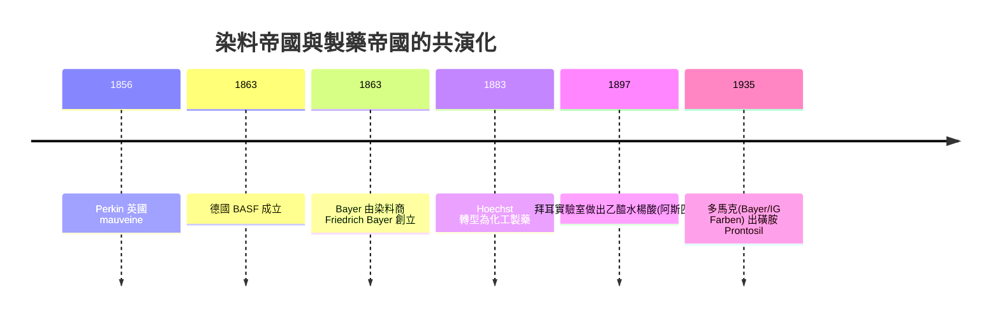

## 1856 - 珀金苯胺紫與染料藥廠（化學工業如何意外成為藥物軍火庫）

## 案件摘要

**本案偵破的是藥物史上最華麗的「走錯門」案。** 1856 年復活節假期，18 歲的倫敦皇家化學院學生 William Henry Perkin 原本奉導師 Hofmann 之命合成抗瘧藥奎寧，卻從煤焦油裡意外得到一種紫色染料——**mauveine（苯胺紫）**。它沒治好瘧疾，卻點燃了合成染料工業。謎題：染料與藥物有什麼關係？為什麼 60 年後「魔法子彈」606 號（見 `../性病的歷史/1910-埃爾利希洒爾佛散606.md`）與 1935 年磺胺（見 `1935-多馬克磺胺與魔法子彈量產.md`）都從染料公司的化學品庫裡走出來？

## 前因 -- 為什麼會有這個案子

- **煤焦油是黑金**。煤氣工業副產煤焦油，內含苯、苯胺、萘——有機化學家的廉價原料山；倫敦與魯爾區堆滿了它。
- **奎寧的致命吸引力**。瘧疾是大英帝國的頭號敵人（印度、加勒比），天然奎寧昂貴且供應受限——合成奎寧是當年的「登月計畫」。
- **德國的工學一體**。Perkin 的導師 Hofmann 是德國人，把德國大學的實驗教學法帶到倫敦；此後德國以「大學—工業」雙螺旋反超英國。

## 線索與推理 -- 數學式、程式、理論

**線索一：意外的化學偵查。** Perkin 用重鉻酸鉀氧化苯胺硫酸鹽，得到黑色污泥；洗滌時發現紫色溶液能染絲綢且耐洗。他 1856 年申請專利，1857 年建廠量產——**18 歲發現、19 歲創業**。化學上，他合成的不是奎寧，而是染料母體；今天的解釋是氧化偶聯生成吩嗪類混合物——「失敗的目標、成功的副產品」。

**線索二：染料與藥的兩座橋。** 第一座橋：**合成方法論**——染料工業累積了取代基、偶氮化、縮合反應的完整技術；第二座橋更關鍵：**生物親和性**。染料會選擇性染色特定組織與微生物（Ehrlich 的亞甲藍染神經與瘧原蟲），Ehrlich 由此悟出：

$$ \text{選擇性染色} \Rightarrow \text{分子與靶點有特異結合} \Rightarrow \text{可能選擇性殺傷} $$

**「染料的顏色，就是分子對生物靶點親和性的可視化」**——這是受體概念（見 `1905-蘭利受體學說.md`）最早的實驗直覺。

**線索三：產業地圖的轉移。**

**線索四：為什麼德國贏了？** 德國大學（以 Liebig 傳統）培養大量博士級化學家，企業直接支付研究費、留用畢業生；英國走個人英雄路線。**藥物發現從此成為「規模化化學勞動力」的遊戲**——這一結構延續到今天的高通量篩選。

## 結案 -- 後果與影響

- **製藥工業的出生證**。Bayer、Hoechst、Ciba、Geigy、Sandoz 皆染料起家；「化工—製藥」一體的商業模式使藥物第一次成為可規模化研發的商品。
- **英國的教訓**。Perkin 的合成染料帝國在德國競爭下 1880 年代崩潰——**基礎研究的產業配套**成為各國化學政策的教科書案例。
- **一句話結案**：珀金案的真相——**藥物工業不是從醫學出發的，是從染料缸裡爬出來的**；二十世紀每一顆由化合物庫篩出的藥，背後都有一口 1856 年的煤焦油缸。

## 關鍵人物與文獻

- **William Henry Perkin（1838–1907）**——皇家化學院學生、後為爵士；1906 年（mauveine 半百）英國辦首屆 Perkin 紀念獎章。
- **August Wilhelm Hofmann（1818–1892）**——德國有機化學宗師、苯胺化學之父；其學生遍布歐洲染料與製藥業。
- 原始文獻——W. H. P. 諸專利（1856, 英國專利 No. 1984）；Simon Garfield, *Mauve: How One Man Invented a Color That Changed the World*, 2000。
- 現代註腳——2007 年 Manchester 大學以現代質譜重析 mauveine 樣本，確認其為多組分混合物——**連「第一瓶染料」的真實結構都遲到 150 年才破案**，與 Salvarsan 結構之謎（見 `../性病的歷史/1910-埃爾利希洒爾佛散606.md`）互為鏡像。
